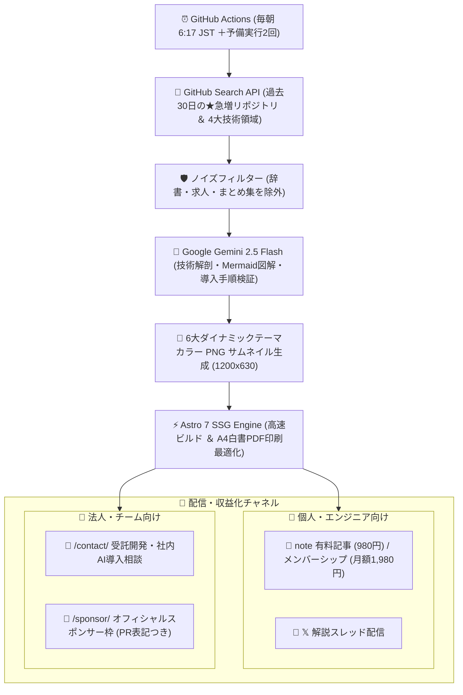

# 📡 Auto Tech Radar - Global Trending OSS Intelligence & Monetization Engine

> **Auto Tech Radar** は、世界中の GitHub（Search API）からスター急上昇中のオープンソース（OSS）を毎朝 6:17 (JST)（8:43・12:17 に予備実行）に自動検出。Google Gemini（`gemini-2.5-flash`）が**「日本語アーキテクチャ深層解剖」**および**「受託開発・自社SaaS構築のマネタイズ考察」**を自動生成・配信するテックインテリジェンスメディアです。

---

## ⚡ クイックアクセス・公式ゲートウェイ
- 🌐 **公開メディア（公式Webサイト）**: https://ssk0224.github.io/auto-tech-radar/
- 📊 **全OSS商用化チートシート（Markdown/CSV出力・A4印刷対応）**: https://ssk0224.github.io/auto-tech-radar/cheatsheet/
- 📩 **法人・企業向け受託開発 ＆ AI導入相談窓口**: https://ssk0224.github.io/auto-tech-radar/contact/
- 📗 **note 公式メンバーシップ（特典に追加した有料記事を閲覧可能）**: https://note.com/vast_ixora7005
- 💼 **技術調査・学習目的での領収書・社内申請ガイド**: https://ssk0224.github.io/auto-tech-radar/expense/
- 💳 **単発レポート（¥980）**: [note公式](https://note.com/vast_ixora7005)（有料記事の販売は note のみ）
- 𝕏 **公式速報アカウント**: [@AutoTechRadar](https://x.com/AutoTechRadar)

---

## 🏆 注目の急上昇OSSアーキテクチャ解剖カタログ

| プロジェクト | 技術領域 / 言語 | GitHub Stars | アーキテクチャ概要 ＆ 活用領域 | 日本語解剖レポート |
| :--- | :--- | :--- | :--- | :--- |
| **[pinvou-agent](https://github.com/Pinvou/pinvou-agent)** | 🤖 AI Agent / Rust | ⭐ 2,400+ | 文書・デザイン・コードを1画面で扱うデスクトップAI環境 | [解剖レポートを読む →](https://ssk0224.github.io/auto-tech-radar/radar/pinvou-agent/) |
| **[answer-me-with-html](https://github.com/QingYunA/answer-me-with-html)** | 🌐 Modern Web / LLM | ⭐ 2,350+ | LLMの出力を1枚のHTML/図解に変換する軽量レンダリング手法 | [解剖レポートを読む →](https://ssk0224.github.io/auto-tech-radar/radar/answer-me-with-html/) |
| **[tokenspeed](https://github.com/tokenspeed/tokenspeed)** | ⚡ ローカル推論 / Python | ⭐ 2,200+ | LLM推論ベンチマーク＆プロファイリング基盤 | [解剖レポートを読む →](https://ssk0224.github.io/auto-tech-radar/radar/tokenspeed/) |
| **[OpenSandbox](https://github.com/opensandbox/opensandbox)** | 🛠️ Security / Go | ⭐ 15,700+ | AIエージェントやUntrustedコードを隔離実行する軽量サンドボックス | [解剖レポートを読む →](https://ssk0224.github.io/auto-tech-radar/radar/opensandbox/) |
| **[PotatoTool](https://github.com/potato-security/PotatoTool)** | 🛠️ Security / Java | ⭐ 1,200+ | セキュリティ解析・通信検証向けの多機能ツールセット | [解剖レポートを読む →](https://ssk0224.github.io/auto-tech-radar/radar/potatotool/) |
| **[GPTQModel](https://github.com/ModelCloud/GPTQModel)** | ⚡ 量子化 / PyTorch | ⭐ 1,270+ | LLM量子化（圧縮）ツールキット。推論時のGPUメモリ消費を削減 | [解剖レポートを読む →](https://ssk0224.github.io/auto-tech-radar/radar/gptqmodel/) |
| **[JiuwenSwarm](https://github.com/openJiuwen-ai/jiuwenswarm)** | 🤖 AI Swarm / Python | ⭐ 5,900+ | マルチエージェント協調オーケストレーション基盤 | [解剖レポートを読む →](https://ssk0224.github.io/auto-tech-radar/radar/jiuwenswarm/) |

---

## 🏗 自律型オムニチャネル ＆ 配信アーキテクチャ

---

## 🔐 有料コンテンツの保護
有料記事は note の有料エリア（購入者のみ閲覧可能）でのみ提供します。
- Webサイト（GitHub Pages）には無料部分だけを掲載します。有料本文が配信物に混入するとビルドが失敗します。
- `note_drafts/` には無料部分と有料ラインだけを平文で置き、有料部分は公開鍵 `keys/note_vault_public.pem` で暗号化した `*_note.paid.enc` として保存します（RSA-OAEP-256 + AES-256-GCM）。CI は公開鍵だけで暗号化するため、秘密情報は不要です。
- 復号用の秘密鍵はオーナー端末の `%USERPROFILE%\.auto-tech-radar\note_vault_private.pem` にだけ置きます（リポジトリに入れない・必ずバックアップ）。ランチャーの note 出品操作は自動で復号し、完全版を `%USERPROFILE%\.auto-tech-radar\note_full\` に書き出して開きます。
- `npm run vault:open`（全件復号） / `npm run vault:seal`（平文の有料部分を暗号化） / `npm run vault:rotate`（鍵の作り直し）

---

## ⚙️ 環境変数 ＆ GitHub Actions Secrets 設定
リポジトリの **Settings → Secrets and variables → Actions** に以下を設定します（`.env.example` 参照）：

| Secret 名 | 必須 / 任意 | 用途 |
|---|:---:|---|
| `GEMINI_API_KEY` | **必須** | クローラーによる技術解剖・原稿自動生成用 Google Gemini API キー |
| `GH_PAT` | 任意 | GitHub Search API のレート制限緩和および Pages 自動コミット用 Personal Access Token（未設定時は `GITHUB_TOKEN` を使用） |
| `X_API_KEY` | 任意 | 毎朝の自動ツイート用 X (Twitter) API Key |
| `X_API_SECRET` | 任意 | 毎朝の自動ツイート用 X (Twitter) API Secret |
| `X_ACCESS_TOKEN` | 任意 | 毎朝の自動ツイート用 X (Twitter) Access Token |
| `X_ACCESS_TOKEN_SECRET` | 任意 | 毎朝の自動ツイート用 X (Twitter) Access Token Secret |

---

## 🛡️ ECC × SUPERPOWERS × SUBAGENT 品質保証体制
本プロジェクトは、3重の品質・境界統制プロトコルにより運用されています：
1. **ECC (Enterprise & Confidentiality Guard)**: プライベートリポジトリや機密情報の完全隔離・有料本文の平文コミット防止。
2. **SUPERPOWERS (Defect Sweep & Quality Gate)**: Mermaid図解・PNGサムネイル・外部パッケージ実在確認・13段階の自動監査（`npm run audit` / `npm test`）。
3. **SUBAGENT (Swarm Market Intelligence)**: 海外テックトレンド・README準拠検証・品質監査の並行リサーチ。

---

## 💼 法人・企業様向け受託開発・AI導入支援
Auto Tech Radar では、テック企業様向けの以下のご相談を承っております：
- **自社専用AIエージェント構築**: レポート対象OSSの社内環境導入・業務ワークフロー連携・PoC開発
- **商用SaaS代替・セルフホスト導入**: オープンソースを活用した自社管理インフラへの移行支援
- **オフィシャルスポンサーシップ**: 当メディアおよび公式𝕏でのOSS活用プロダクト紹介・協賛掲載（PR表記つき）

👉 **[受託開発・導入支援の無料相談・見積もりフォームはこちら（/contact/）](https://ssk0224.github.io/auto-tech-radar/contact/)**

---

## 📜 ライセンス ＆ クレジット
- 本プロジェクトのソースコードおよびサイト構成は MIT License に基づき公開されています。
- 分析対象となる各オープンソースソフトウェアの権利は各リポジトリの著作者に帰属します。
- © 2026 Auto Tech Radar. Engineered with Google Gemini & Astro.
