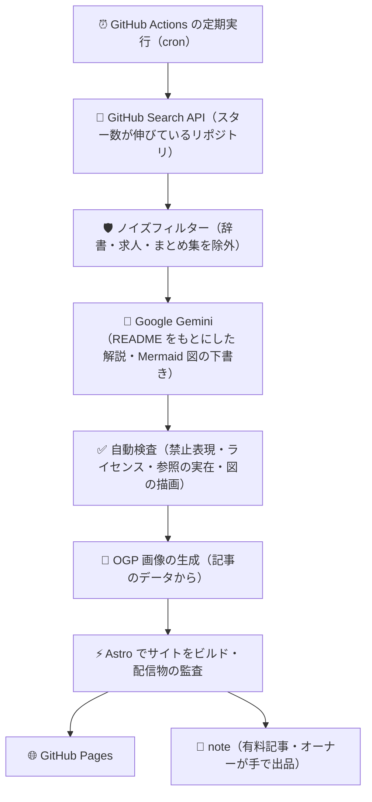

# 📡 Auto Tech Radar

> **Auto Tech Radar** は、GitHub（Search API）でスター数が伸びているオープンソース（OSS）を選び、README などの公開情報をもとに Google Gemini（`gemini-2.5-flash` ほか）が日本語の解説を下書きし、自動検査を通ったものだけを掲載するサイトです。
> 候補探しは GitHub Actions の定期実行（cron: 日本時間 6:17・8:43・12:17）で行い、条件を満たす候補が無い日・生成に失敗した日は掲載しません。実際の掲載本数は、サイトのトップページなどに掲載データ（記事の公開日）から数えて表示しています。

記事は導入や採用を勧めるものではありません。性能などの記述は README の記載に基づくもので、ソフトウェアを動かして確かめたものではありません。

---

## リンク
- 🌐 サイト: https://ssk0224.github.io/auto-tech-radar/
- 📊 掲載中の OSS の一覧（Markdown/CSV 出力）: https://ssk0224.github.io/auto-tech-radar/cheatsheet/
- 🤖 掲載中の記事のデータ（JSON）: https://ssk0224.github.io/auto-tech-radar/api/radar.json
- 📝 運営方針・自動で検査していること・訂正履歴: https://ssk0224.github.io/auto-tech-radar/about/
- 📗 note（有料記事の販売は note のみ）: https://note.com/vast_ixora7005
- 📩 お問い合わせ: https://ssk0224.github.io/auto-tech-radar/contact/

掲載中の記事の一覧は手で書かず、サイトの一覧・RSS・`api/radar.json` を正としています（記事のデータ `src/pages/radar/*.md` から生成）。

---

## 🏗 生成と配信の流れ

---

## 🔐 有料コンテンツの保護
有料記事は note の有料エリア（購入者のみ閲覧可能）でのみ提供します。
- Webサイト（GitHub Pages）には無料部分だけを掲載します。有料本文が配信物に混入するとビルドが失敗します。
- `note_drafts/` には無料部分と有料ラインだけを平文で置き、有料部分は公開鍵 `keys/note_vault_public.pem` で暗号化した `*_note.paid.enc` として保存します（RSA-OAEP-256 + AES-256-GCM）。CI は公開鍵だけで暗号化するため、秘密情報は不要です。
- 復号用の秘密鍵はオーナー端末の専用フォルダ（`scripts/utils/owner_dir.mjs`）にだけ置きます（リポジトリに入れない・クラウド同期されない場所にバックアップ）。ランチャーの note 出品操作は自動で復号し、完全版を同じ専用フォルダに書き出して開き、24 時間以内に消します。
- オーナー端末の状態（note の検査結果・差し替えの一覧・自動メンテの実行記録・選定の候補）と内部の引き継ぎ文書も、公開リポではなく同じ専用フォルダに置きます。CI の検査結果は実行ごとの一時フォルダに書き、問題はログの ::error で知らせます（`tests/public_tree.test.mjs` が追跡ファイル・書き出し先・`git add` を確かめます）。
- `npm run vault:open`（全件復号） / `npm run vault:seal`（平文の有料部分を暗号化） / `npm run vault:rotate`（鍵の作り直し）

---

## ⚙️ 環境変数 ＆ GitHub Actions Secrets 設定
リポジトリの **Settings → Secrets and variables → Actions** に以下を設定します（`.env.example` 参照）：

| Secret 名 | 必須 / 任意 | 用途 |
|---|:---:|---|
| `GEMINI_API_KEY` | **必須** | 記事の下書きに使う Google Gemini API キー |
| `GH_PAT` | 任意 | GitHub Search API のレート制限緩和および Pages 自動コミット用 Personal Access Token（未設定時は `GITHUB_TOKEN` を使用） |
| `X_API_KEY` | 任意 | X (Twitter) への自動投稿用。未設定なら投稿しない |
| `X_API_SECRET` | 任意 | 同上 |
| `X_ACCESS_TOKEN` | 任意 | 同上 |
| `X_ACCESS_TOKEN_SECRET` | 任意 | 同上 |

---

## 🛡️ 品質の検査
- `npm test`: 生成物・サイト・スクリプトのテスト（GitHub Actions のワークフローでも実行）。
- `npm run audit`: 原稿とビルド結果（`dist/`）の監査。
- 公開している文言のうち、更新頻度・ライセンス・リンク・実行時刻などの事実は `tests/docs_facts.test.mjs` がデータ・コードと突き合わせます。
- テストの合否は件数を文書に書かず、GitHub Actions の実行結果（Linux は `daily-crawl.yml`、Windows は `ci-windows.yml`）で確かめます。

開発には外部の開発支援ツール（Claude Code と、そのプラグインの ECC・Superpowers）を使っています。

---

## 📜 ライセンス ＆ クレジット
- 本プロジェクトのソースコードおよびサイト構成は MIT License（[LICENSE](LICENSE)）で公開しています。
- 分析対象となる各オープンソースソフトウェアの権利は各リポジトリの著作者に帰属します。
- © 2026 Auto Tech Radar. Built with Google Gemini & Astro.
