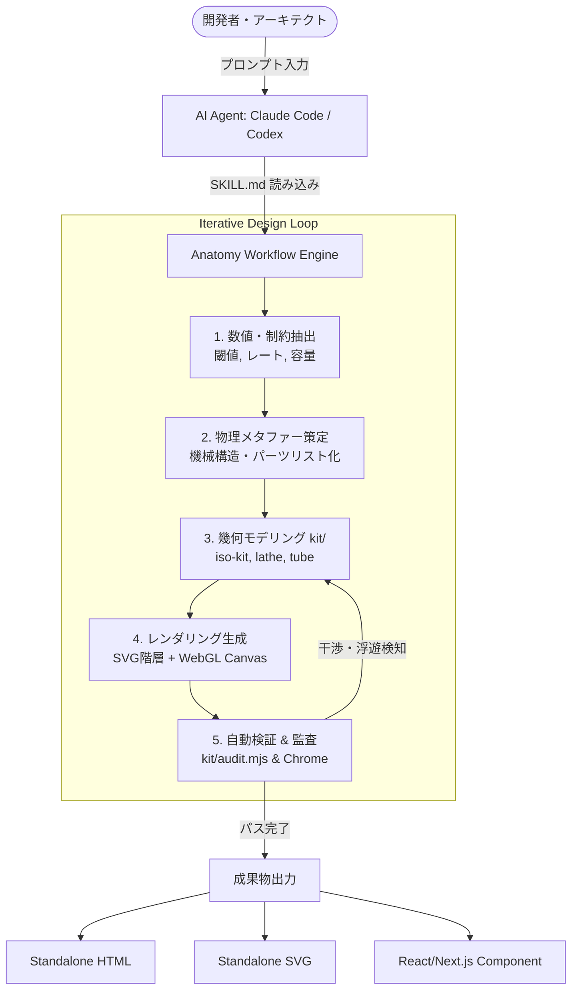

# anatomy: 概要と革新性

ソフトウェアアーキテクチャや分散システムの内部動作を説明する際、多くのエンジニアは「四角と矢印」で構成された抽象的なブロック図（C4モデルやフローチャート）に頼りがちです。しかし、キャッシュヒット率の挙動、トークンバケットによるレート制限、データベース接続プーリングといった動的なアルゴリズムは、静止した図形だけでは直感的な理解に限界があります。

**「anatomy」**は、この課題を根本から覆すアプローチを採用したAIエージェント向けスキル（Claude Code、OpenCode、Codex等に対応）です。抽象的な技術コンセプトを入力すると、その概念を模した「実在しそうな精密機械」を物理モデルとしてメタファー化。数十〜数百のソリッドパーツからなる等角投影図（Isometric Illustration）を、ピュアSVG、WebGLシェーダー、3D投影技術を駆使してコードとして自動生成します。

最大の革新性は以下の点にあります：
- **概念の物理機械化**: キャッシュ検証を「ピンタンブラー錠」、複数キャンバスのGPU描画を「ガントリープロッター」のように、動作原理が直感的に伝わる物理ギミックへ自律的に再設計。
- **純粋なゼロ依存（Zero-Dependency）**: 外部npmライブラリを一切使わず、Node.js標準モジュールのみで幾何計算からレンダリングまで完結。
- **自律的幾何学監査（Geometry Audit）**: 生成したパーツ同士の干渉（パイプの衝突、浮遊オブジェクト、描画順序の破綻）をヘッドレスChromeと幾何解析スクリプトで自己テストし、厳密に修正。

---

## 解決する主要な課題とアーキテクチャ

システム設計書の作成において、高品質なインタラクティブ図解を作成するには、3Dモデラー（Blender等）やUIデザイナー（Figma）、フロントエンドエンジニアが数週間かけて共同作業を行う必要がありました。anatomyはこの制作パイプラインをAIエージェントの自律ループへ統合します。

### アーキテクチャと実行フロー

anatomyは、Agent Skills仕様に準拠したプロンプトフレームワークと、自社開発の軽量幾何エンジン（`kit/`）で構成されています。



#### コアコンポーネント構成
1. **`SKILL.md`**: エージェントに「まず真の数値を集め、機械を発明し、背面から前面へ描画せよ」という職人的制約を与えるシステムプロンプト。
2. **`kit/iso-kit.ts`**: 等角カメラ変換、4トーンシェーディング、深度ソート（Painter's Algorithm）を司るコア描画基盤。
3. **`kit/tube.mjs` & `lathe.mjs`**: 任意の3次元軸に沿った配管・配線、旋盤加工のような回転体のパラメトリック生成。
4. **`kit/gl.mjs`**: 火炎、排気、液体、波紋などベクターでは表現不可能な流体を表現するため、SVGのレイヤー間にアイソメトリック視点で挟み込むWebGLシェーダー。
5. **`kit/audit.mjs`**: 部品間のクリッピングや貫通バグ、未接合ラインを幾何数学的にチェックする監査システム。

---

## 競合ツール/商用SaaSとの徹底比較

| 評価軸 | anatomy (OSS) | Mermaid / PlantUML | Spline / Three.js | Figma / 手描きイラスト |
|---|---|---|---|---|
| **表現力** | 極めて精密な動的機械図解 (SVG/WebGL) | プレーンなフローチャート・シーケンス図 | 完全3Dシーン・Web 3Dアニメーション | 自由なグラフィックデザイン |
| **自動化度** | テキスト指示で完全自律生成 | テキストから定型図生成 | 手動モデリングが基本 (一部AI連携) | 完全手動制作 |
| **インタラクティブ性** | マウス・キーボード連動 / ライブ数値連動 | 静的（限定的なクリックリンクのみ） | 高（3Dオービット・自由視点） | 静的（プロトタイプ操作のみ） |
| **依存関係・重量** | **依存ゼロ（0 dependencies）** / 極小バンドル | レンダラーJSライブラリに依存 | Three.js等巨大なバンドルサイズ | 画像・SVG出力 |
| **検証機構** | **自己幾何監査（衝突・浮遊検知）内蔵** | 構文チェックのみ | 手動目視確認 | 手動目視確認 |
| **運用コスト** | **完全無料 (MITライセンス)** | 無料 (OSS) | 有料SaaSプランあり ($12〜/月) | 外注費高騰（1点5万〜30万円） |

---

## 💡 ビジネス・マネタイズ活用アイデア（実践例）

### 1. 開発者向け技術ドキュメント・LPの「インタラクティブ解説図」受託制作
- **概要**: 複雑なSaaS（分散DB、認証機構、決済パイプライン）のランディングページや公式ドキュメント向けに、動的に動作を学べるインタラクティブパーツを納品。
- **提供価値**: デザイナー不在の開発チームでも、Next.js対応の高品質な動的SVG/WebGLパーツを数時間で調達可能。平均1コンポーネントあたり20万〜50万円の制作単価が成立。

### 2. 産業機器・IoTシステムのデジタルツイン風ダッシュボード構築
- **概要**: 工場設備やサーバールームのセンサーデータを、anatomyで出力したアイソメトリック機材図の「ライブリードアウト（計器）」にリアルタイムバインド。
- **提供価値**: 重厚な3D CADビューア（WebAutoCADやBIM）を導入する予算のない中堅企業向けに、ブラウザ標準技術だけで軽量に動く設備モニタリング画面を低コストで納品。

---

## インストール & クイックスタート手順

### 前提条件
- Node.js 20.10以上
- Claude Code, OpenCode, Codex, またはAntigravity
- ヘッドレス検証用: Google Chrome / Chromium

### 1. Agent Skillのグローバルインストール

```bash
# Claude Code 環境へのグローバル追加
npx skills add wheresryan22/anatomy -g -a claude-code

# もしくは手動クローン
git clone https://github.com/wheresryan22/anatomy.git ~/.claude/skills/anatomy
```

### 2. 図解生成の実行（Claude Code CLI内）

セッションを開き、自然言語で概念と数値を指定します。

```text
/anatomy explain how a token bucket rate limiter works, interactive
```

### 3. 生成成果物のビルドと幾何監査

スタンドアロンHTMLとしてビルドし、衝突やラインの途切れを監査します。

```bash
# 生成されたビルドスクリプトを実行
node examples/dial-indicator/build.mjs

# 幾何学監査（衝突・浮遊チェック）の実行
node examples/raptor-engine/build.mjs --audit
```

---

## 商用利用可否 & ライセンス考察

anatomyは **MITライセンス** で公開されています。

- **商用利用**: 個人・法人を問わず商用利用が無償で認められています。
- **改変・再配布**: コードの改変、プロプライエタリな製品（受託制作コード、商用SaaS）への組み込み、再配布が自由です。
- **著作権表示**: MITライセンスの全文および著作権表示を保持することが唯一の法的な要件です。
- **実務上のポイント**: anatomyが生成するSVG、HTML、Reactコンポーネント自体はコード成果物であるため、クライアントへの納品物コードベースに安心してそのまま組み込むことができます。また、外部依存が0であるため、商用環境におけるサプライチェーン攻撃やライセンス汚染のリスクが極めて低い点も特筆すべきメリットです。

---

## 💡 商用化アーキテクチャ ＆ 受託開発提案テンプレートについて
本OSSを活用した**受託開発（単価80万〜250万円）の提案書テンプレート**や、自社マイクロSaaS構築仕様書、コピペで使える本番環境構築手順の完全版は、開発者向け専門メディア「Auto Tech Radar」にて全編公開されています。

👉 **[Auto Tech Radar で完全版レポートを読む（即時アンロック対応）](https://ssk0224.github.io/auto-tech-radar/radar/anatomy/)**
