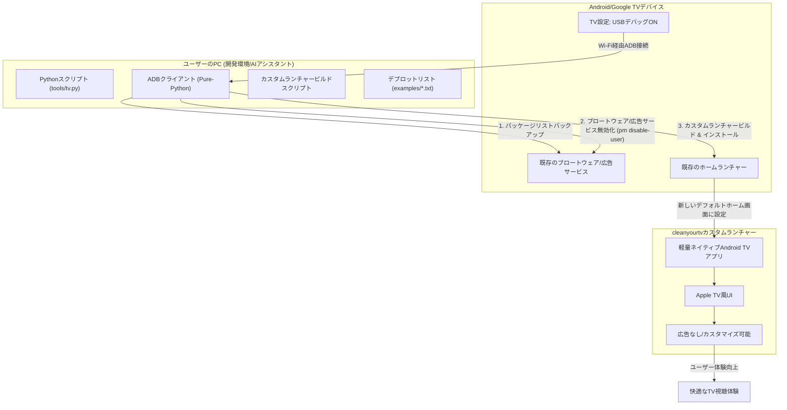

# cleanyourtv: 概要と革新性
## 🎯 成熟度の目安（AI による見立て）
**根拠:**
記事作成時点で GitHub のスター数は 11,000 を超えています。[README](https://github.com/Gathin23/cleanyourtv#readme) には、対応機種（158 モデル・52 ブランド）と、TechCrunch・Mashable・Android Authority などでの紹介（README の記載では 21 か国・73 記事）が掲載されています。スター数や紹介記事の数は関心の高さを示すもので、品質や安定性を保証するものではありません。この記事は README などの公開情報をもとに書いており、実機での動作検証は行っていません。

**検証候補になる用途:**
Android TV / Google TV の不要なプリインストールアプリやホーム画面の広告を減らしたい場合の検証候補になります。業務用の端末や多数の端末に適用する前に、対象機種で README の手順（変更前の記録と復元スクリプトを含む）を少数台で試し、メーカー保証や社内の端末管理ルールとの関係も確認してください。

## 解決する主要な課題とアーキテクチャ
cleanyourtvは、Android TVやGoogle TVデバイスが抱える以下の主要な課題を解決します。

1.  **ブロートウェアと不要な広告:** 多くのAndroid TV/Google TVは、メーカーやGoogleがプリインストールした不要なアプリ（ブロートウェア）や、ホーム画面に表示される広告によって、ユーザーエクスペリエンスが損なわれています。
2.  **パフォーマンスの低下:** これらの不要なソフトウェアは、デバイスのリソースを消費し、動作の遅延や不安定さを引き起こすことがあります。
3.  **カスタマイズ性の欠如:** 標準のホーム画面は、ユーザーが自由にカスタマイズできる範囲が限られており、個人の好みに合わせたUIを実現することが困難です。

cleanyourtvは、これらの課題に対し、Wi-Fi経由でのADB（Android Debug Bridge）通信を利用して、以下のアーキテクチャで解決策を提供します。

**アーキテクチャの主要なポイント:**

*   **Wi-Fi経由のADB通信:** 物理的なケーブル接続なしに、PCからTVを操作できます。
*   **非破壊的なデブロット:** `pm disable-user`コマンドを使用するため、アプリはアンインストールされず、いつでも元の状態に復元可能です。これにより、TVを「文鎮化」するリスクを最小限に抑えます。
*   **軽量なカスタムランチャー:** README によるとインストール後のサイズが約 429 KB のネイティブ Android TV アプリで、Apple TV 風のホーム画面を提供します。
*   **AIアシスタント連携:** Claude Codeなどのコーディングアシスタントと連携することで、TVモデルに応じたデブロットリストの作成や、手順の実行を任せる使い方が README で紹介されています。

## 競合ツール/商用SaaSとの徹底比較

| 特徴/機能 | cleanyourtv (OSS) | Android TV/Google TV 標準ランチャー | 他のカスタムランチャー (例: ATV Launcher Pro) | 商用デブロットサービス (例: 有料アプリ) |
| :-------- | :---------------- | :--- | :--- | :--- |
| **広告表示** | なし (完全に除去) | あり (ホーム画面に表示) | なし (一部有料版で除去) | なし (有料サービスとして提供) |
| **ブロートウェア** | 無効化 (リソース解放) | プリインストール済み | 無効化機能は限定的 | 無効化 (一部有料サービス) |
| **UIデザイン** | Apple TV風 (洗練) | 標準UI (カスタマイズ性低) | 多様 (テーマによる) | 提供なし (デブロットのみ) |
| **パフォーマンス** | 向上 (軽量化) | 低下する可能性あり | 改善する可能性あり | 改善する可能性あり |
| **root化** | 不要 | 不要 | 不要 (一部機能で必要) | 不要 |
| **ケーブル接続** | 不要 (Wi-Fi経由) | 不要 | 不要 | 不要 |
| **復元機能** | ワンラインで完全復元 | 不要 | 限定的 | 限定的 |
| **費用** | 無料 (OSS) | 無料 (デバイスに付属) | 有料 (アプリ購入) | 有料 (サブスクリプション/買い切り) |
| **カスタマイズ性** | 高い (config.xml, テーマ) | 低い | 中〜高 | 低い |
| **開発環境** | Python, Java (PC側) | 不要 | 不要 | 不要 |

**cleanyourtvの特徴（README の記載に基づく）:**

*   **費用:** MIT License で公開されており、ソフトウェア自体は無料で入手できます。導入・運用の作業時間や端末管理の費用は別途かかります。
*   **非破壊的な方式:** root 化不要で、パッケージをアンインストールせず無効化する方式です。README には、変更前の状態を記録し、復元スクリプトで元に戻せると記載されています。
*   **UI:** Apple TV を参考にしたシンプルなホーム画面です。
*   **高いカスタマイズ性:** `config.xml`やテーマを通じて、ドックの配置、隠しアプリ、カラム数などを細かく調整できます。
*   **AIアシスタント連携:** README では、Claude Code などのコーディングアシスタントに機種の特定や手順の実行を任せる使い方が紹介されています。

## 商用利用可否 & ライセンス考察
**ライセンス:** MIT License（[LICENSE ファイル](https://github.com/Gathin23/cleanyourtv/blob/HEAD/LICENSE)）

記事作成時点の GitHub のリポジトリ情報ではライセンスが「Other」と表示されていましたが、LICENSE ファイルの本文は MIT License です。README の「Licence」の節にも「MIT」と記載されています。

**追加の表示:** LICENSE ファイルには、ランチャーに同梱されている Outfit フォント（`launcher/app/src/main/res/font/outfit.ttf`）が SIL Open Font License 1.1 で提供されている旨の記載があります（ライセンス文は `launcher/FONT-LICENSE-OFL.txt`）。

**利用時の注意:**
*   MIT License の条件として、ソフトウェアを複製・再配布する際は著作権表示と許諾表示を含める必要があります。
*   フォントを含めて再配布する場合は、SIL Open Font License 1.1 の条件（ライセンス文の同梱など）も確認してください。
*   MIT License・SIL Open Font License 1.1 ともに無保証です。テレビ本体のメーカー保証や、テレビ・配信サービスの利用規約への影響は、ライセンスとは別に確認が必要です。

この節はライセンスの概要の紹介で、法的助言ではありません。利用前に LICENSE ファイルの全文をご確認ください。

---

## 📖 続きと実務キットについて
本記事は Auto Tech Radar の無料解説の抜粋です。

- 📖 **無料**: アーキテクチャ・競合比較・ライセンス考察の全文 → [Auto Tech Radar で読む](https://ssk0224.github.io/auto-tech-radar/radar/cleanyourtv/)
- 🔒 **有料（note）**: 導入提案書テンプレート・工数見積表・公式READMEに基づく導入手順 → [note の有料記事・メンバーシップ](https://note.com/vast_ixora7005/membership)

