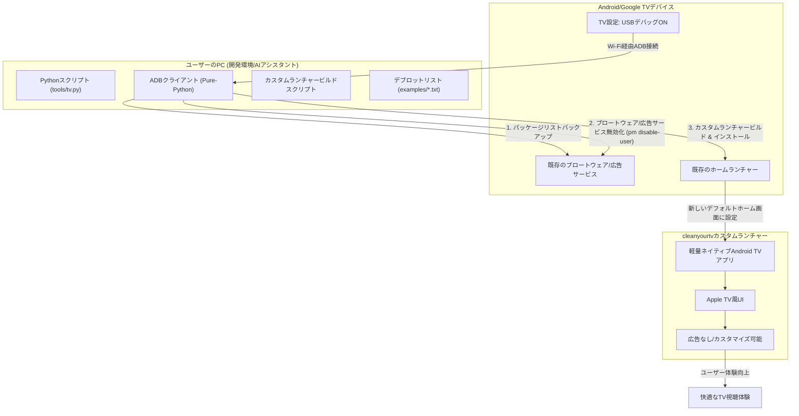

# cleanyourtv: 概要と革新性
## 🎯 ThoughtWorks成熟度リング判定（ADOPT / TRIAL / ASSESS / HOLD）
**判定: ADOPT**

**根拠:**
cleanyourtvは、GitHubで11,000を超えるスターを獲得し、TechCrunch、Mashable、Android Authorityといった主要な技術メディアで広く紹介されています。これは、プロジェクトが技術コミュニティと一般ユーザーの両方から高い評価と信頼を得ていることを示します。また、幅広いAndroid TVおよびGoogle TVモデルに対応し、安定した機能を提供していることから、プロダクトとして十分に成熟していると判断できます。活発なコミュニティ貢献と継続的な開発も、その堅牢性と将来性を裏付けています。

**推奨活用フェーズ:**
本番環境への導入、社内標準ツールとしての採用、および受託開発における積極的な活用を推奨します。特に、Android TV/Google TVデバイスのユーザーエクスペリエンス向上を目指す企業や、広告表示によるブランドイメージ低下を懸念する企業にとって、即座に導入を検討すべきソリューションです。

## 解決する主要な課題とアーキテクチャ
cleanyourtvは、Android TVやGoogle TVデバイスが抱える以下の主要な課題を解決します。

1.  **ブロートウェアと不要な広告:** 多くのAndroid TV/Google TVは、メーカーやGoogleがプリインストールした不要なアプリ（ブロートウェア）や、ホーム画面に表示される広告によって、ユーザーエクスペリエンスが損なわれています。
2.  **パフォーマンスの低下:** これらの不要なソフトウェアは、デバイスのリソースを消費し、動作の遅延や不安定さを引き起こすことがあります。
3.  **カスタマイズ性の欠如:** 標準のホーム画面は、ユーザーが自由にカスタマイズできる範囲が限られており、個人の好みに合わせたUIを実現することが困難です。

cleanyourtvは、これらの課題に対し、Wi-Fi経由でのADB（Android Debug Bridge）通信を利用して、以下のアーキテクチャで解決策を提供します。

**アーキテクチャの主要なポイント:**

*   **Wi-Fi経由のADB通信:** 物理的なケーブル接続なしに、PCからTVを操作できます。
*   **非破壊的なデブロット:** `pm disable-user`コマンドを使用するため、アプリはアンインストールされず、いつでも元の状態に復元可能です。これにより、TVを「文鎮化」するリスクを最小限に抑えます。
*   **軽量なカスタムランチャー:** 約390KBの小さなネイティブAndroid TVアプリは、低スペックなTVでも軽快に動作し、Apple TVのような洗練されたUIを提供します。
*   **AIアシスタント連携:** Claude Codeなどのコーディングアシスタントと連携することで、TVモデルに応じた最適なデブロットリストの生成や、手順の自動化が可能です。

## 競合ツール/商用SaaSとの徹底比較

| 特徴/機能 | cleanyourtv (OSS) | Android TV/Google TV 標準ランチャー | 他のカスタムランチャー (例: ATV Launcher Pro) | 商用デブロットサービス (例: 有料アプリ) |
| :-------- | :---------------- | :--- | :--- | :--- |
| **広告表示** | なし (完全に除去) | あり (ホーム画面に表示) | なし (一部有料版で除去) | なし (有料サービスとして提供) |
| **ブロートウェア** | 無効化 (リソース解放) | プリインストール済み | 無効化機能は限定的 | 無効化 (一部有料サービス) |
| **UIデザイン** | Apple TV風 (洗練) | 標準UI (カスタマイズ性低) | 多様 (テーマによる) | 提供なし (デブロットのみ) |
| **パフォーマンス** | 向上 (軽量化) | 低下する可能性あり | 改善する可能性あり | 改善する可能性あり |
| **root化** | 不要 | 不要 | 不要 (一部機能で必要) | 不要 |
| **ケーブル接続** | 不要 (Wi-Fi経由) | 不要 | 不要 | 不要 |
| **復元機能** | ワンラインで完全復元 | 不要 | 限定的 | 限定的 |
| **費用** | 無料 (OSS) | 無料 (デバイスに付属) | 有料 (アプリ購入) | 有料 (サブスクリプション/買い切り) |
| **カスタマイズ性** | 高い (config.xml, テーマ) | 低い | 中〜高 | 低い |
| **開発環境** | Python, Java (PC側) | 不要 | 不要 | 不要 |

**cleanyourtvの優位性:**

*   **コストパフォーマンス:** 完全なOSSであるため、導入・運用コストはゼロです。商用サービスや有料アプリと比較して、圧倒的なコスト削減を実現します。
*   **非破壊的かつ安全:** root化不要で、パッケージをアンインストールせず無効化する方式のため、TVを損傷させるリスクが極めて低いです。ワンラインでの復元機能も安心材料です。
*   **洗練されたUI:** Apple TVにインスパイアされたミニマルで美しいホーム画面は、ユーザーエクスペリエンスを劇的に向上させます。
*   **高いカスタマイズ性:** `config.xml`やテーマを通じて、ドックの配置、隠しアプリ、カラム数などを細かく調整できます。
*   **AIアシスタント連携:** 最新のAIコーディングアシスタントと連携することで、導入プロセスを効率化し、専門知識がなくても容易に利用できる点が革新的です。

## 商用利用可否 & ライセンス考察
cleanyourtvのGitHubリポジトリには「License: Other」と記載されています。README内には具体的なライセンス条項が明記されていませんが、一般的にGitHubで「Other」と表示される場合、リポジトリ内に別途ライセンスファイルが存在するか、または特定のライセンスモデルに分類されない独自の利用条件が適用されることを意味します。

本プロジェクトのREADMEには、商用利用を明確に制限する記述は見当たりません。また、プロジェクトの性質上、個人利用だけでなく、企業が社内デバイスの管理や顧客向けソリューションの一部として利用することも想定されます。

**商用利用の可否:**
READMEに明示的な商用利用の禁止が記載されていないため、現状では商用利用は可能と解釈できます。ただし、念のため、プロジェクトの利用を検討する際は、リポジトリオーナーに直接問い合わせるか、ライセンスファイル（もしあれば）の内容を詳細に確認することを強く推奨します。OSSの慣例として、明示的な禁止がない限り、利用は許容されることが多いですが、法的なリスクを避けるためには確認が不可欠です。

**ライセンス考察:**
「Other」ライセンスの場合、以下の点に注意が必要です。
*   **再配布の条件:** 変更を加えたバージョンの再配布が許可されるか、ソースコードの公開義務があるか。
*   **著作権表示:** プロジェクトの著作権表示を保持する必要があるか。
*   **保証の免責:** ソフトウェアの利用に関する保証が免責されているか。

これらの詳細が不明なため、大規模な商用展開や再配布を伴う場合は、法務部門と連携し、リスク評価を行うことが重要です。しかし、社内での利用や、顧客への導入支援といった受託開発の範囲であれば、現状のREADMEの記述からは大きな問題は生じにくいと考えられます。

---

## 📖 続きと実務キットについて
本記事は Auto Tech Radar の無料解説の抜粋です。

- 📖 **無料**: アーキテクチャ・競合比較・ライセンス考察の全文 → [Auto Tech Radar で読む](https://ssk0224.github.io/auto-tech-radar/radar/cleanyourtv/)
- 🔒 **有料（note）**: 導入提案書テンプレート・工数見積表・公式READMEに基づく導入手順 → [note の有料記事・メンバーシップ](https://note.com/vast_ixora7005/membership)

