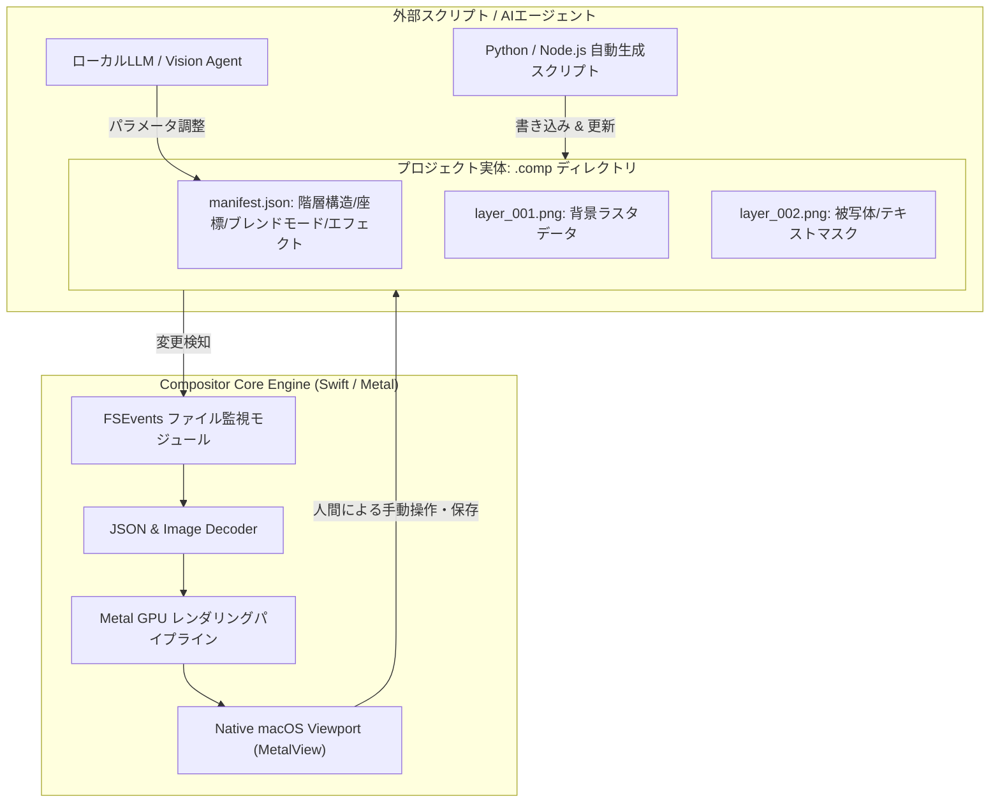

# Compositor: 概要と革新性

近年、Adobe Creative Cloudのサブスクリプションコスト高騰やクラウド依存への反発から、ローカルネイティブかつ軽量なクリエイティブツールの需要が急速に高まっています。「Compositor」は、macOS（Apple Silicon）専用にゼロからSwiftで設計された、完全オープンソース（MITライセンス）のPhotoshopオルタナティブです。

従来のGIMPのようなマルチプラットフォームOSSが抱えていた「UI/UXの非直感性」「macOS独自機能への非対応」「描画レスポンスの遅延」といった課題を、macOS専用設計（MetalやAccelerateフレームワークのフル活用）により完全に克服。さらに特筆すべき革新性として、**「AIエージェントフレンドリーなアーキテクチャ」**を標準搭載している点が挙げられます。独自プロジェクト形式（`.comp`）をファイルシステム直結のJSONマニフェストとPNG群で構成することで、外部スクリプトや生成AIモデルがバックグラウンドから画像編集をリアルタイムに駆動できる設計になっています。

## 解決する主要な課題とアーキテクチャ

Compositorが解決する中核的な技術課題は以下の3点です：

1. **高負荷なGPU非破壊レンダリングのローカル完結**:
   各レイヤーの調整レイヤー（Curves, Levels, LUT）、レイヤースタイル（Drop Shadow, Stroke等）をMetalパイプライン上でリアルタイム計算。メモリ消費を動的にスケーリングし、大容量PSD/PSBファイルも即座に展開。
2. **Photoshopワークフローの完全再現**:
   ブレンドモードの計算順序、クリッピングマスク、非破壊変形、Camera Raw風フィルターパネルなど、プロが違和感なく移行できる操作系を提供。
3. **人間とAIエージェントのハイブリッド制作基盤**:
   `.comp`ファイルの実体はディレクトリ構造（`manifest.json` + `layer_*.png`）であり、OSのファイル監視（FSEvents）と連動。AIスクリプトがレイヤーを追加・変形すると、エディタ側がリロードなしで即座にビューポートを更新します。

## 競合ツール/商用SaaSとの徹底比較

| 機能・指標 | Adobe Photoshop | GIMP | Figma | **Compositor (本OSS)** |
|---|---|---|---|---|
| **ライセンス / コスト** | 月額約3,278円〜 / プロプライエタリ | 無料 / GPLv3 | 無料〜月額課金 / クラウド限定 | **完全無料 (MITライセンス)** |
| **プラットフォーム** | macOS / Windows / iPad | Win / Mac / Linux | Web / Electron | **macOS (Apple Silicon特化)** |
| **レンダリング基盤** | 独自GPUエンジン | GEGL (CPU主体/一部GPU) | WebGL | **Metal / Swift Native (超低遅延)** |
| **PSD/PSB 互換性** | 完全対応 (ネイティブ) | 部分対応 (スタイル欠落あり) | インポートのみ | **高精度対応 (レイヤー・マスク保持)** |
| **外部自動化 / AI統合** | ExtendScript / UXP (重厚) | Script-Fu / Python-fu | REST API / プラグイン | **ローカルファイル直書き換え型 (超高速)** |
| **ソースコード改変** | 不可 | 可能 (難解なCベース) | 不可 | **可能 (モダンSwift/Xcode)** |

## 📖 続きと実務キットについて
本記事は Auto Tech Radar の無料解説の抜粋です。

- 📖 **無料**: アーキテクチャ・README から転記したインストール手順・ライセンスの確認先 → [Auto Tech Radar で読む](https://ssk0224.github.io/auto-tech-radar/radar/compositor/)
- 🔒 **有料（note）**: 導入提案書テンプレート（Markdown）と工数・見積表 → [note の有料記事・メンバーシップ](https://note.com/vast_ixora7005/membership)

