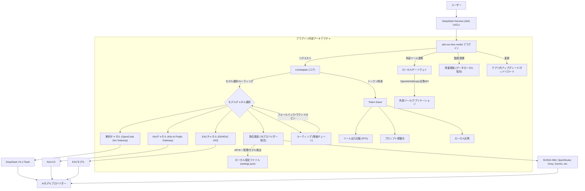

# dsh-our-free-model: 最先端AIモデルを無料で無制限に利用！DeepSeek Harnessプラグインの革新性

## 概要と革新性

「dsh-our-free-model」は、DeepSeek Harness (dsh) のための画期的なプラグインです。その最大の魅力は、**ログイン、登録、APIキーが一切不要**でありながら、DeepSeek V4.1 FlashやKimi K3といった**最先端のAIモデルを完全に無料で、しかも無制限に利用できる**点にあります。これは、高額なAPI利用料や複雑な管理に悩む多くの開発者や企業にとって、まさにゲームチェンジャーとなるでしょう。

本プラグインは、dshのカーネルを一切変更せず、ビルドステップも不要、依存関係もゼロという極めて軽量な設計が特徴です。インストールするだけで即座に利用開始できる「開箱即用（Out-of-the-box）」の体験を提供します。

主な革新的な機能は以下の通りです。

*   **設定不要の即時利用:** アカウント、APIキー、配額申請が一切不要。
*   **透明性の高い上流ソース:** OpenCodeのZenゲートウェイやKilo AIの公共ゲートウェイを直接利用し、第三者の中継なし。
*   **リアルタイムなモデルリスト:** モデル集合、コンテキスト長、能力は上流から常に最新情報を取得。
*   **利用可能なモデルのみ表示:** 選択肢には実際に利用可能なモデルのみが提示され、ユーザー体験を最適化。
*   **高度なトークン削減機能:** ツール出力圧縮（RTK）、プロンプト軽量化、ローカル応答により、効率的なAI利用を実現。
*   **柔軟なルーティング（降級チェーン）:** 複数のモデルを組み合わせ、フォールバックやラウンドロビン戦略で最適なモデルを自動選択。
*   **OpenAI/Anthropic互換ローカルゲートウェイ:** 本機やLAN内の他のツールから、OpenAI/AnthropicのAPI形式でモデルを呼び出し可能。
*   **データプライバシーの確保:** 利用状況データ（トークン消費、速度など）は全てローカルに保存され、外部への送信は一切なし。
*   **多チャネル統合:** 13の無料利用チャネル（CodeArts, Kiloなど）と、76社のプロバイダーを統合管理する「聚合渠道」を搭載。
*   **アプリ内アップグレードとホットリロード:** アプリケーションを再起動することなく、プラグインの更新やコード変更を即座に適用。

## 解決する主要な課題とアーキテクチャ

「dsh-our-free-model」は、現代のAI活用における以下の主要な課題を解決します。

1.  **高額なAI利用料:** 商用AIサービスの従量課金モデルは、特に大規模な利用においてコストが膨大になる可能性があります。本プラグインは「無料・無制限」という選択肢を提供し、この課題を根本から解決します。
2.  **複数のAIモデル管理の煩雑さ:** 異なるプロバイダーのAIモデルを利用する際、それぞれ異なるAPI仕様や認証方法に対応する必要があります。本プラグインは「聚合渠道」機能により、76社ものプロバイダーを単一のインターフェースで統合管理し、この複雑さを解消します。
3.  **APIキー管理とセキュリティリスク:** APIキーの漏洩は深刻なセキュリティリスクに繋がります。本プラグインは主要な無料チャネルでAPIキーを不要とし、聚合渠道で利用するAPIキーもローカルの安全な場所に保存し、ページ上では指紋のみを表示することでリスクを最小化します。
4.  **データプライバシーへの懸念:** AIサービス利用時のプロンプトや生成結果、利用状況データが外部に送信されることへの懸念は少なくありません。本プラグインは利用状況データを全てローカルに保存し、データプライバシーを重視する企業や個人に安心を提供します。
5.  **モデルの可用性や性能のリアルタイム把握の難しさ:** モデルの可用性や応答速度は常に変動します。本プラグインはリアルタイムで上流から情報を取得し、利用可能なモデルのみを表示することで、常に最適なモデル選択を支援します。

### アーキテクチャ概要とデータフロー

本プラグインのアーキテクチャは、dshの柔軟なプラグインシステムを最大限に活用し、高度な機能と高い拡張性を実現しています。

**データフローの解説:**

1.  **ユーザーリクエスト:** ユーザーはdshのUIまたはCLIを通じてAIモデルにリクエストを送信します。
2.  **プラグインによる処理:** リクエストは「dsh-our-free-model」プラグインのLlmAdapterによって受け取られます。
3.  **トークン削減:** リクエストはまずToken Saverモジュールを通過し、ツール出力の圧縮、プロンプトの軽量化、またはローカル応答による処理が行われ、効率が最大化されます。
4.  **モデル選択とルーティング:** LlmAdapterは、ユーザーが選択したモデル、またはルーティング（降級チェーン）設定に基づいて、最適なAIモデルチャネル（無料チャネル、Kiloチャネル、EACチャネル、聚合渠道）を決定します。
5.  **AIモデルへの送信:** 選択されたチャネルを通じて、リクエストは対応するAIモデルプロバイダー（DeepSeek, Kimi, NVIDIA NIMなど）に送信されます。
6.  **応答の受信と処理:** AIモデルからの応答はプラグインに戻され、dshを通じてユーザーに提示されます。
7.  **ローカルゲートウェイ:** プラグインはOpenAI/Anthropic互換のローカルゲートウェイを提供し、dsh以外の外部ツールやアプリケーションがこれらのAIモデルにアクセスできるようにします。
8.  **用量看板:** 全てのAI利用状況データ（トークン消費、応答速度など）は、ユーザーのローカルマシンにのみ保存され、プライバシーが保護されます。
9.  **管理機能:** アプリ内アップグレード、ホットリロード、リアルタイム通知などの機能により、プラグインの運用と管理が容易になります。

## 競合ツール/商用SaaSとの徹底比較

| 特徴/機能 | dsh-our-free-model | 商用AI SaaS (例: OpenAI, Anthropic) | 他のOSSラッパー/ゲートウェイ (例: LiteLLM) |
| :-------- | :----------------- | :--------------------------------- | :--------------------------------------- |
| **利用コスト** | **無料・無制限** | 従量課金 (高額になる可能性) | APIキーが必要なため、従量課金 |
| **APIキー** | **主要チャネルで不要** | 必須 | 必須 |
| **モデル統合** | **DeepSeek, Kimi含む76社以上** | プロバイダーごとに異なる | 複数プロバイダー対応 (APIキー必須) |
| **データプライバシー** | **利用状況データはローカル保存** | 外部送信の可能性あり | 外部送信の可能性あり |
| **設定の容易さ** | **インストール後、即利用可能** | APIキー設定、SDK導入が必要 | APIキー設定、設定ファイル記述が必要 |
| **高度な機能** | **トークン削減、ルーティング、思考強度制御、アプリ内アップグレード** | 基本的なAPI機能のみ | 基本的なルーティング、ロードバランシングなど |
| **互換性** | OpenAI/Anthropic互換ローカルゲートウェイ | 各プロバイダー独自のAPI | OpenAI互換APIが主流 |
| **ライセンス** | MIT License (商用利用可) | 各プロバイダーの利用規約 | 各OSSのライセンス (多くはMIT/Apache) |
| **サポート** | コミュニティベース | 公式サポートあり (有料プラン) | コミュニティベース |

「dsh-our-free-model」は、商用AI SaaSの高額な利用料とAPIキー管理の煩雑さ、そしてデータプライバシーの懸念という三大課題を解決します。また、他のOSSラッパーと比較しても、最先端モデルの無料提供、設定不要の即時利用、そしてトークン削減や高度なルーティングといった豊富な機能セットで一線を画しています。特にDeepSeek Harnessユーザーにとっては、シームレスな統合と強力な機能拡張を提供します。

## 📖 続きと実務キットについて
本記事は Auto Tech Radar の無料解説の抜粋です。

- 📖 **無料**: アーキテクチャ・競合比較・ライセンス考察の全文 → [Auto Tech Radar で読む](https://ssk0224.github.io/auto-tech-radar/radar/dsh-our-free-model/)
- 🔒 **有料（note）**: 導入提案書テンプレート・工数見積表・公式READMEに基づく導入手順 → [note の有料記事・メンバーシップ](https://note.com/vast_ixora7005/membership)

