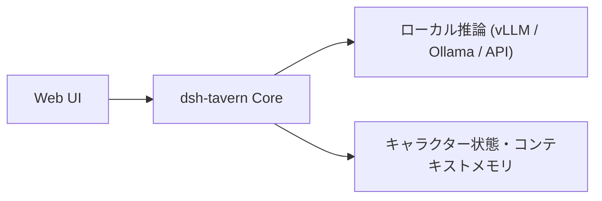

# dsh-tavern: 概要と革新性

**dsh-tavern**は、LLMを活用したテキストロールプレイングおよび対話型AIエージェントプラットフォームです。オープンソースのロールプレイ環境としてデファクトスタンダードである「SillyTavern（酒館）」のエコシステム（キャラクターカード、World Info / 世界書、正規表現ルール、MVUなど）との互換性を維持しながら、アーキテクチャを根本から再設計しています。

最大の特徴は、**「DSH（DeepSeek Harness）」を基盤としたマルチエージェント型タスク分割アーキテクチャ**の採用です。従来のSillyTavernが抱えていた「プロンプト肥大化による出力崩れ」「変数ステータス計算の失敗」「キャッシュ効率の悪さによるレイテンシ・トークンコストの増大」といったペインポイントを、洗練されたオーケストレーションによって解決しています。

### 主な革新点
- **フロントとバックエンドのタスク分離**: 本文生成と変数処理（好感度、HPなどの数値計算）を別々のエージェントに分担させ、文筆クオリティの向上とステータス管理の厳密性を両立。
- **Prompt Caching（プロンプトキャッシュ）の極限最適化**: 構造の固定化によりキャッシュヒット率95%以上を達成し、長文セッションでも1ターン約10秒の超高速応答を実現。
- **対話型メンテナンス・デバッグAgent**: キャラクターカードの調整や正規表現の不具合解析を、自然言語で自律エージェントに指示可能。

---

## 解決する主要な課題とアーキテクチャ



### 1. 従来アーキテクチャの課題（モノリシック・プロンプティング）
従来のSillyTavern等では、1回の大規模なプロンプト要求に対して「物語の地の文・会話文」「ステータスバーの変数更新」「プレイヤー用選択肢の提示」を同時にLLMに指示していました。これにより以下の致命的な欠陥が生じていました。
- **コンテキストの注意分散（Attention Dilution）**: フォーマット指定や数値計算に注意が割かれ、文章の表現力やキャラクター性が劣化する。
- **フォーマット崩れの頻発**: 会話が進むにつれてステータス枠のマークダウンが破損する。
- **全損リトライ**: 選択肢だけ直したい場合でも、本文全体を再生成（抽卡）する必要があり、APIコストと時間が無駄になる。

### 2. dsh-tavernのパイプライン・アーキテクチャ
dsh-tavernでは、ワークフローを有向グラフ（DAG）のように分割しています。

```text
[ユーザー入力] 
      │
      ├─► [本文生成Agent (Frontend)] ──► 小説クオリティの描写に専念
      │          │
      │          ▼ (生成完了本文を渡す)
      ├─► [変数決済Agent (Backend)] ──► ルール・MVU定義に基づきステータス更新 (UI側で固定レンダリング)
      │          │
      └─► [選択肢生成Agent]         ──► 次の展開の選択肢をツールコール形式でバリデーション
```

- **部分リトライと指示付き再生成（Feedback Rewrite）**: 本文のみ、選択肢のみのエラー修復が可能。「描写を減らして心理描写を増やして」といった差分ディレクションにも対応。
- **自律的メモリ検索（Tool-based Memory Retrieval）**: 毎ターン要約をプロンプトにねじ込むのではなく、エージェントが必要に応じて過去ログを検索ツール経由で取得。これにより数万トークンに及ぶ長期セッションでも初期設定の齟齬が発生しません。

---

## 競合ツール/商用SaaSとの徹底比較

| 評価軸 | SillyTavern (従来型) | 一般的な商用AIチャットSaaS | **dsh-tavern** |
| :--- | :--- | :--- | :--- |
| **アーキテクチャ** | 単一プロンプト・一括生成 | ブラックボックス単一API | **マルチエージェント・パイプライン** |
| **キャッシュ効率** | 低い（動的変数が先頭に入りキャッシュ破損） | ベンダー依存（最適化不可） | **極めて高い（95%以上のCache Hit率）** |
| **ステータス管理** | LLMのテキスト出力（破損率 高） | なし or 独自API実装要 | **固定テンプレート×バックエンド決済（完全堅牢）** |
| **拡張性・カード資産** | 膨大な既存資産あり | 互換性なし | **既存のSillyTavern資産を即座にインポート可能** |
| **モバイル対応** | WebUIのレスポンシブ / リバースプロキシ | アプリ提供（閉鎖的） | **AndroidネイティブAPK / QRコード即時共有** |

## 📖 続きと実務キットについて
本記事は Auto Tech Radar の無料解説の抜粋です。

- 📖 **無料**: アーキテクチャ・README から転記したインストール手順・ライセンスの確認先 → [Auto Tech Radar で読む](https://ssk0224.github.io/auto-tech-radar/radar/dsh-tavern/)
- 🔒 **有料（note）**: 導入提案書テンプレート（Markdown）と工数・見積表 → [note の有料記事・メンバーシップ](https://note.com/vast_ixora7005/membership)

