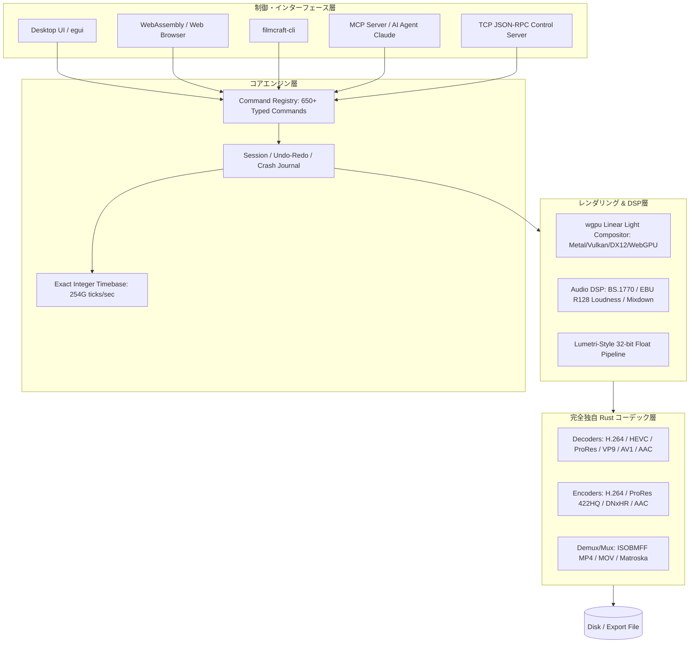

# filmcraft: 概要と革新性

**FilmCraft**は、Adobe Premiere ProのUIおよびワークフローをピュアRustでゼロからクリーンルーム再実装したオープンソースのノンリニアビデオ編集（NLE）システムです。

従来のオープンソース動画編集ソフト（Shotcut、Kdenlive、Blenderなど）の多くは、動画デコード・エンコード処理をFFmpegなどのC/C++ライブラリに全面的に依存していました。しかし、FilmCraftは**FFmpeg非依存**を掲げ、H.264、HEVC、ProRes、AACなどの主要コーデックやコンテナパーサーをITU-T/ISO/IETFの公式仕様書に基づきピュアRustで独自実装しています。

最大の革新性は、全UI操作および編集パイプラインが650以上の厳密に型定義されたコマンドとして抽象化されており、標準で**MCP (Model Context Protocol)** サーバーおよびJSON-RPC制御ソケットを備えている点です。人間が触るPremiere互換のネイティブGUIを持ちながら、Claudeなどの自律型AIエージェントがヘッドレスまたはリアルタイム描画付きでタイムライン配置・カラーコレクション・音声ミックス・書き出しをミリ秒精度の完全自律操作で行える「AIネイティブ・ビデオ編集基盤」を実現しています。

## 解決する主要な課題とアーキテクチャ

FilmCraftは、長年プロフェッショナル映像制作業界と自動化エンジニアリングを悩ませてきた以下の課題を解決します。

1. **高額なプロ向けNLEのライセンス縛りと自動化の難しさ**: Premiere Pro等のExtendScript/CEP/UXPは低速でヘッドレス運用が難しく、クラウド自動レンダリングに不向き。
2. **フレーム落ち・音ズレ問題（浮動小数点ドリフト）**: ドロップフレーム（29.97fps）や混在フレームレートの計算に浮動小数点数を用いると、長時間シーケンスで1フレーム未満の累積誤差（ドリフト）が発生する。
3. **C/C++製マルチメディアライブラリの脆弱性とクラッシュ**: 外部メモリ破壊やセグフォをRustの所有権・型システムで完全排除。

### アーキテクチャとデータフロー

FilmCraftは、UIフレームワークやOS APIに依存しないレイヤードアーキテクチャを採用しています。タイムベースには毎秒`254,016,000,000`ティック（24, 25, 30, 23.976, 29.97, 59.94fpsおよび44.1kHz, 48kHz, 96kHzの公倍数）の固定小数点整数を使用し、絶対的な時間精度を保証します。

## 競合ツール/商用SaaSとの徹底比較

| 機能・指標 | Adobe Premiere Pro | FFmpeg (CLI/スクリプト) | FilmCraft (本作) |
|---|---|---|---|
| **コア言語** | C++ | C / ASM | **Pure Rust** |
| **ライセンス** | 商用プロプライエタリ (月額サブスク) | LGPL / GPL | **Apache 2.0 / MIT** |
| **AIエージェント操作 (MCP)** | 非対応 (プラグイン開発が必要) | 非対応 (CLIパラメータ生成のみ) | **公式標準対応 (MCP Server内蔵)** |
| **タイムラインUI** | 業界標準 (高機能) | なし (CLIのみ) | **Premiere互換 UI (egui/Wasm)** |
| **外部依存性** | 重厚なランタイム必須 | 多数のCライブラリ依存 | **ゼロ依存 (Self-contained)** |
| **時間精度** | 高精度 | 浮動小数点計算による丸め誤差リスク | **完全整数演算 (2540億ticks/秒)** |
| **WebAssembly実行** | 不可 | 一部可能だが重厚 (ffmpeg.wasm) | **ネイティブ対応 (Wasmビルド公式提供)** |

## 📖 続きと実務キットについて
本記事は Auto Tech Radar の無料解説の抜粋です。

- 📖 **無料**: アーキテクチャ・競合比較・ライセンス考察の全文 → [Auto Tech Radar で読む](https://ssk0224.github.io/auto-tech-radar/radar/filmcraft/)
- 🔒 **有料（note）**: 導入提案書テンプレート・工数見積表・公式READMEに基づく導入手順 → [note の有料記事・メンバーシップ](https://note.com/vast_ixora7005/membership)

