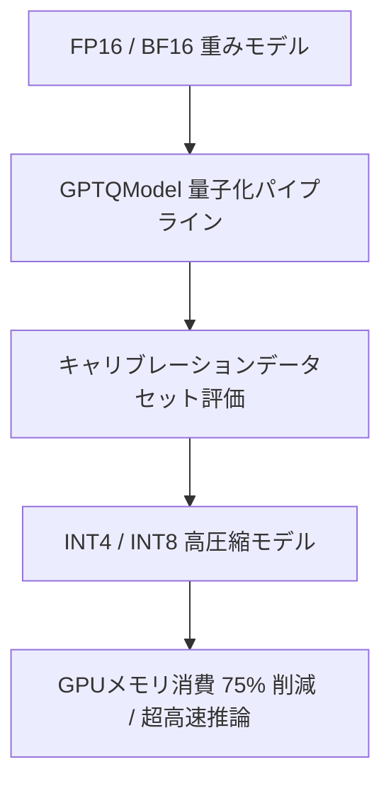

# GPTQModel: 概要と革新性

GPTQModelは、大規模言語モデル（LLM）の量子化、検証、およびデプロイメントを統合的に支援する拡張可能なプラットフォームです。本ツールは、GPTQ、AWQ、ParoQuant、GGUF、FP8、EXL3、QQQといった多様な量子化手法をサポートし、NVIDIA CUDA、AMD ROCm、Huawei Ascend、Intel XPU、Apple Silicon (MPS)、およびIntel/AMD/Apple CPUといった広範なハードウェア環境での高速化推論を実現します。Hugging Face Transformers、vLLM、SGLangといった主要なLLMエコシステムとのネイティブ統合により、LLMの効率的な運用と広範なアクセシビリティを可能にします。

## 解決する主要な課題とアーキテクチャ

### 従来の技術スタックにおける問題点

従来のLLM運用において、以下の課題が顕在化していました。

*   **高コストなリソース要件**: LLMの巨大なモデルサイズは、推論時に大量のGPUメモリを消費し、高価なハードウェア投資やクラウドインフラコストを要求します。
*   **推論レイテンシ**: 大規模モデルの推論は高い計算負荷を伴い、リアルタイムアプリケーションにおける応答速度のボトルネックとなります。
*   **複雑なツールチェイン**: 多様な量子化手法が個別のツールやAPIとして提供され、それぞれが異なるハードウェア最適化やデプロイパスを持つため、開発・運用プロセスが複雑化し、技術的負債が増大します。
*   **クロスプラットフォーム対応の不足**: 特定のハードウェアベンダーに最適化されたソリューションが多く、異なるハードウェア環境への移植性や互換性が低いという問題がありました。
*   **品質管理の課題**: 量子化によるモデル性能の劣化を評価し、品質を維持するための統一されたフレームワークが不足していました。

### 本ツールが採用するアプローチと仕組み

GPTQModelは、これらの課題に対し、以下の統合的かつモジュール化されたアプローチで解決策を提供します。

*   **統一されたプラットフォーム**: 量子化、検証、モデル変換、および高速推論のための単一かつ一貫したAPIを提供し、開発・運用プロセスを簡素化します。
*   **モジュール化されたアーキテクチャ**: 量子化メソッド (`METHOD`)、フォーマット (`FORMAT`)、バックエンド (`BACKEND`)、およびカーネルが独立したモジュールとして設計されており、新しい量子化技術やハードウェアの統合が容易です。
    *   **量子化メソッド**: GPTQ, AWQ, ParoQuant, QQQ, GGUF, FP8, EXL3, GPTAQ, EoRA, GAR, FOEM, BitsAndBytes, Rotationなど。
    *   **フォーマット**: GPTQ, GPTQ_V2, MARLIN, BITBLAS, GEMM, GGUF, FP8, EXL3など。
    *   **バックエンド/カーネル**: GPTQ_TORCH_ATEN, GPTQ_MACHETE, GPTQ_MARLIN, AWQ_MARLIN, GGUF_CPP_CUDA, EXL3_EXLLAMA_V3, FP8_TORCHなど。
*   **広範なハードウェアサポート**: NVIDIA CUDA (Turing+), AMD ROCm (7900XT+, ROCm 6.2+), Huawei Ascend NPU (Ascend 910B), Intel XPU (Arc, Datacenter Max), Apple Silicon (M1+), Intel/AMD CPU (AVX, AMX) に対応し、多様なインフラ環境でのLLM運用を可能にします。
*   **主要ランタイムとの統合**: Hugging Face Transformers, vLLM, SGLang, MLX (Apple Silicon) とのネイティブ統合により、既存のLLMエコシステムにシームレスに組み込み、量子化モデルのデプロイを加速します。
*   **高度な最適化技術**:
    *   **データ並列処理**: マルチGPU環境での量子化処理を高速化し、大規模モデルの量子化時間を大幅に短縮します。
    *   **Python 3.13t (free threading) 最適化**: ロックフリーのスレッディングにより、マルチコアCPUでのパッキング処理やMoEモデルの量子化性能を向上させます。
    *   **動的な混合量子化制御**: 各レイヤー/モジュールに対して個別の量子化設定を適用したり、量子化から除外したりすることで、精度と性能のバランスを最適化します。
    *   **JITカーネルキャッシュ**: コンパイル済みカーネルをキャッシュし、マルチプロセス環境でのビルドをシリアライズすることで、起動時間と安定性を向上させます。
    *   **Microsoft/BitBLAS統合**: タイルベースの推論最適化により、特定のハードウェアでの性能を向上させます。
    *   **W4A (Weight-only 4-bit, Activation 8-bit) 量子化**: NVIDIA GB10 (SM121) 向けに、重みはINT4、アクティベーションはFP8で量子化し、推論性能を最大化します。
*   **品質保証と継続的改善**: CI/CDパイプラインに組み込まれた包括的なユニットテストとポスト量子化品質回帰テストにより、量子化モデルの品質を継続的に監視・保証します。
*   **GGUFネイティブサポート**: Prism/Bonsai GGUFチェックポイントを外部パッケージなしで直接ロード・推論できる内部GGUFランタイムシムを提供します。
*   **量子化ジョブのチェックポイント**: 長時間かかる量子化プロセスの中断と再開をサポートし、運用上の堅牢性を高めます。

## 競合ツール/商用SaaSとの徹底比較

GPTQModelは、LLM量子化の分野において、既存のツールやサービスと比較して独自の強みを持っています。

*   **Hugging Face Optimum**:
    *   **GPTQModelの特徴**: Optimumは汎用的な最適化ライブラリであり、GPTQModelはOptimumとネイティブ統合されています。しかし、GPTQModelはParoQuant, QQQ, GGUF, FP8, EXL3といったより多様な先進的量子化手法を直接サポートし、AMD ROCm, Huawei Ascend, Intel XPU, Apple MPS向けのネイティブカーネル統合において、より深い最適化と広範なハードウェアカバレッジを提供します。特にGGUFのネイティブロードパスやEXL3のサポートはGPTQModelの強みです。
    *   **機能比較**: Optimumはより広範なモデル最適化（剪定、蒸留など）をカバーする一方、GPTQModelはLLMの量子化に特化し、その分野での網羅性と深度を追求しています。
*   **vLLM / SGLang**:
    *   **GPTQModelの特徴**: vLLMやSGLangは高速なLLM推論エンジンであり、量子化プロセス自体は提供しません。GPTQModelはこれらのエンジンと統合し、量子化されたモデルを効率的にデプロイするための補完ツールとして機能します。GPTQModelは、vLLMやSGLangがサポートする量子化フォーマット（GPTQ, AWQ Marlinなど）に加えて、GGUFやEXL3といった他のフォーマットもサポートし、より柔軟なモデル選択と最適化パスを提供します。
    *   **機能比較**: 推論速度最適化に特化したvLLM/SGLangに対し、GPTQModelはモデルの圧縮とハードウェア最適化に焦点を当て、両者は相補的な関係にあります。
*   **llama.cpp**:
    *   **GPTQModelの特徴**: llama.cppはGGUFフォーマットのデファクトスタンダードであり、CPUおよび一部GPUでの推論に強みを持っています。GPTQModelはGGUFのネイティブ量子化と推論をサポートし、llama.cppと競合する側面もありますが、Pythonエコシステム内での統合性、GPTQ, AWQ, EXL3などGGUF以外の多様な量子化手法、およびNVIDIA/AMD/Intel/Huaweiといった広範なハードウェアアクセラレーションに対応している点が特徴です。Python開発者にとっては、GPTQModelの方が既存のMLパイプラインに統合しやすいという利点があります。
    *   **機能比較**: llama.cppはC++ベースで低レベルな最適化に強みを持つ一方、GPTQModelはPythonベースで開発の柔軟性と多様な量子化手法のサポートに優れます。
*   **BitsAndBytes**:
    *   **GPTQModelの特徴**: BitsAndBytesはHugging Face Transformersで広く利用される量子化ライブラリですが、GPTQModelはBitsAndBytesもサポートしつつ、GPTQ, AWQ, ParoQuant, QQQ, FP8, EXL3など、より多様な先進的量子化手法と、それらを統一的に扱うAPIを提供します。BitsAndBytesが主に4bit/8bitのロードと推論に焦点を当てるのに対し、GPTQModelは量子化プロセス自体を詳細に制御し、品質評価やデプロイまでをカバーする包括的なソリューションです。
    *   **機能比較**: BitsAndBytesは手軽な量子化ロードに特化する一方、GPTQModelは量子化プロセスのカスタマイズ性と網羅性に強みがあります。
*   **商用SaaS (例: Anyscale, Together AI)**:
    *   **GPTQModelの特徴**: これらのSaaSはマネージドなLLM推論サービスを提供し、多くの場合、量子化モデルのデプロイもサポートします。GPTQModelは、ユーザーが自社のインフラストラクチャ上でLLMを量子化・デプロイするためのツールであり、SaaSの代替または補完として機能します。SaaSは手軽ですが、カスタマイズ性やコスト面で制約がある場合があります。GPTQModelは、より細かい制御とコスト最適化を求める企業にとって、オンプレミスまたはプライベートクラウドでの運用を可能にし、データ主権の維持にも貢献します。
    *   **コスト比較**: SaaSは従量課金制であり、大規模な利用ではコストが高騰する可能性があります。GPTQModelを活用した自社運用は、初期投資は必要ですが、長期的に見て運用コストを大幅に削減できるポテンシャルを秘めています。

## 📖 続きと実務キットについて
本記事は Auto Tech Radar の無料解説の抜粋です。

- 📖 **無料**: アーキテクチャ・README から転記したインストール手順・ライセンスの確認先 → [Auto Tech Radar で読む](https://ssk0224.github.io/auto-tech-radar/radar/gptqmodel/)
- 🔒 **有料（note）**: 導入提案書テンプレート・工数見積表 → [note の有料記事・メンバーシップ](https://note.com/vast_ixora7005/membership)

