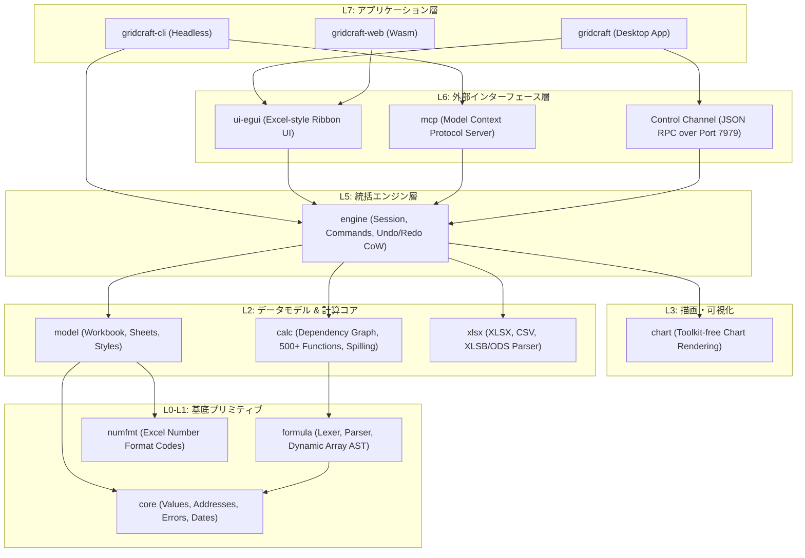

# gridcraft: 概要と革新性

**GridCraft**は、ArtCraftチームが手掛けるピュアRust実装のオープンソース・スプレッドシート基盤です。Microsoft Excelの仕様を「クリーンルーム手法（リバースエンジニアリングに頼らず外部仕様のみからゼロスクラッチ再構築）」によって忠実に再現しており、デスクトップ（macOS, Windows, Linux, BSD）およびブラウザ（WebAssembly）で同一コードベースからネイティブ動作します。

従来のWebベースのスプレッドシート（HandsontableやUniver等）やヘビーなOfficeスイート（LibreOffice等）と異なり、GridCraftは**Copy-on-Write（CoW）**による極小メモリ消費、**依存グラフ計算エンジン**による差分再計算、そして**Model Context Protocol (MCP) をネイティブサポートしたAIエージェント対応**を中核に据えている点が最大の革新性です。

## 🎯 ThoughtWorks成熟度リング判定（ADOPT / TRIAL / ASSESS / HOLD）

### 判定：**ASSESS（評価フェーズ）〜 特定用途における TRIAL**

- **根拠**:
  - **カバー率と完成度**: Excelリボンコマンドの89%、ワークシート関数523種中513種（98%）を実装済みだが、公式ロードマップでは「Alpha版」と位置付けられており、実業務利用における忠実度は約50%と見積もられている。
  - **堅牢性**: Rust特有のメモリ安全性と厳格なレイヤリング（L0〜L7）が施されており、ヘッドレスCLIやMCPサーバーとしての安定性は極めて高い。
  - **推奨フェーズ**: エンタープライズの主幹スプレッドシート置き換え（ADOPT）には時期尚早。一方で、**「LLM/AIエージェントに社内データを安全に計算・集計・チャート描画させるバックエンド基盤」**、あるいは**「閉域環境でのXLSXバッチ自動生成エンジン」**としてのPoC（TRIAL）には極めて有望。

## 解決する主要な課題とアーキテクチャ

### 既存技術のペイン
1. **重厚すぎるLibreOffice/Office365 API**: ヘッドレス実行時のメモリ消費が膨大で、コンテナでのスケールが困難。
2. **AIエージェントとの親和性不足**: 従来のExcelファイル操作（openpyxl等）は数式エンジンのリアルタイム再計算や動的配列（Dynamic Arrays: LET/LAMBDA/MAP等）の評価ができない。
3. **ベンダーロックインとテレメトリ**: 商用クラウドスプレッドシートは機密データの外部流出リスクや高額な月額シート課金が課題。

### GridCraftのアーキテクチャ構造

GridCraftは厳格なレイヤードアーキテクチャを採用しており、GUI層（`ui-egui`）と計算エンジン層（`model`, `calc`, `formula`）が完全に分離されています。

## 📖 続きと実務キットについて
本記事は Auto Tech Radar の無料解説の抜粋です。

- 📖 **無料**: アーキテクチャ・競合比較・ライセンス考察の全文 → [Auto Tech Radar で読む](https://ssk0224.github.io/auto-tech-radar/radar/gridcraft/)
- 🔒 **有料（note）**: 導入提案書テンプレート・工数見積表・公式READMEに基づく導入手順 → [note の有料記事・メンバーシップ](https://note.com/vast_ixora7005/membership)

