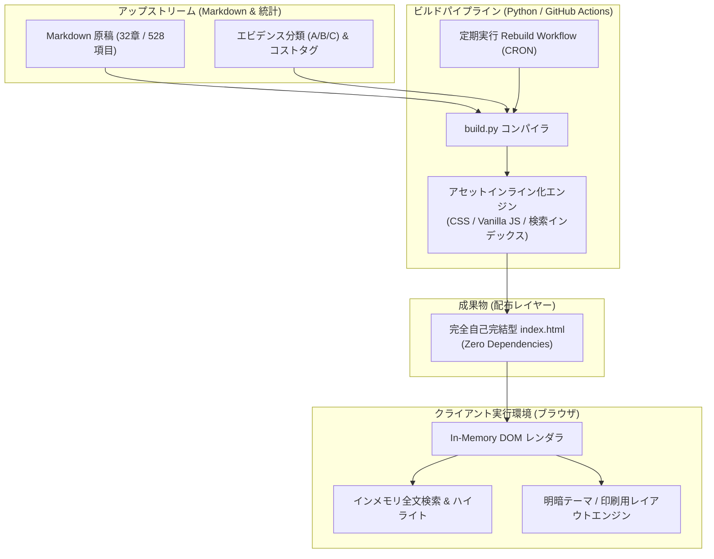

# how-to-live-better: 概要と革新性

GitHub上で1万スターを超える注目を集める「`cdyforever/how-to-live-better`」は、公有領域（Unlicense）のオープンソース書籍『高性价比人生指南（高コスパ人生ガイド）』全32章・528項目を、**単一のHTMLファイル（Single-File HTML）**として再構築した超軽量ナレッジリーダーです。

最大の特徴は、**「外部依存ゼロ（Zero External Dependencies）」**と**「完全オフライン動作（Offline-First）」**の設計思想にあります。CDN経由の外部フォント、CSSフレームワーク、クライアントサイドAPIフェッチを一切排除し、全文検索インデックス、レスポンシブUI、ダークモード切り替え、印刷用CSSに至るまですべてが1つの`index.html`に内包されています。

現代のWebフロントエンドが過剰な依存関係と重厚なSPAフレームワークに傾倒する中、静的ファイル1枚で高速かつ堅牢なナレッジ配信を実現するその構造は、エッジ環境や機密ネットワーク向けWeb開発に極めて強力な指針を与えています。

---

## 解決する主要な課題とアーキテクチャ

本プロジェクトは、現代のナレッジ共有システムが抱える「通信遮断時の閲覧不可」「重厚なビルドパイプラインによる高運用コスト」「外部トラッカーやCDN障害に伴う可用性低下」という課題を根本から解決しています。

### システム構成とビルド・レンダリングフロー

データソースとなるMarkdownリポジトリから単一HTMLをコンパイルし、ブラウザ上で完全閉域動作するまでのフローは以下の通りです。

### アーキテクチャの要点
1. **Zero External Requests**: ブラウザ起動後、追加のHTTPリクエストを1回も発生させません。
2. **インメモリ全文検索**: JavaScriptにより全528件のタイトル・本文・コスト・統計タグをリアルタイム探索し、該当キーワードを動的ハイライトします。
3. **ステートレスな同期設計**: Upstreamリポジトリの更新をGitHub Actionsで常時監視し、差分発生時のみ決定論的（Deterministic）に単一HTMLを再ビルドします。

---

## 競合ツール/商用SaaSとの徹底比較

| 評価軸 | cdyforever/how-to-live-better (本OSS) | 一般的なヘッドレスCMS / Docs (Notion, Docusaurus) | 商用ナレッジSaaS (esa, Qiita Team等) |
| :--- | :--- | :--- | :--- |
| **外部通信要件** | **不要（完全オフライン・閉域網動作）** | 必須（初期ロードおよびアセットフェッチ） | 必須（クラウド常時接続） |
| **単一配布性** | **極めて高い（index.html 1枚のみ）** | 低（静的アセットディレクトリ群が必要） | 不可（アカウント・テナント依存） |
| **インフラ運用コスト** | **0円（GitHub Pages / S3等に置くだけ）** | 月額数百円〜数千円（ホスティング基盤） | 月額1ユーザー数百円〜数千円 |
| **検索レイテンシ** | **1ms未満（クライアント内完全即時）** | 50〜300ms（AlgoliaやAPI通信） | 100〜500ms（サーバーサイド検索） |
| **セキュリティ・耐障害性** | **サプライチェーン攻撃の余地ゼロ** | 外部CDN障害やnpm依存の脆弱性リスク | SaaS側ダウンタイム・情報漏洩リスク |

## 📖 続きと実務キットについて
本記事は Auto Tech Radar の無料解説の抜粋です。

- 📖 **無料**: アーキテクチャ・競合比較・ライセンス考察の全文 → [Auto Tech Radar で読む](https://ssk0224.github.io/auto-tech-radar/radar/how-to-live-better/)
- 🔒 **有料（note）**: 導入提案書テンプレート・工数見積表・公式READMEに基づく導入手順 → [note の有料記事・メンバーシップ](https://note.com/vast_ixora7005/membership)

