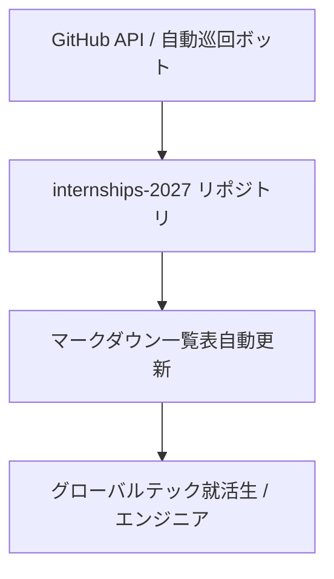

# Internships-2027: 概要と革新性

`zapplyjobs/Internships-2027` は、北米のテック企業を中心とした2027年向けソフトウェアエンジニア・データサイエンス等のインターンシップ採用情報を、10分周期で自動収集・集約するGitHubリポジトリです。本プロジェクトは公開直後からスター数5,200超を獲得し、学生やエンジニアのみならず、テック業界の採用自動化・クローリング技術の文脈でも極めて高い注目を集めています。

このリポジトリの革新性は、単なる「静的な求人リンク集」ではなく、**「Gitリポジトリをデータ配信パイプライン兼コミュニティ接点（Top-of-Funnel）として機能させ、自社SaaS（自動入力拡張機能・専用プラットフォーム）へシームレスに誘導するプロダクト主導型グロース（PLG）の完成形」** である点にあります。

## 解決する主要な課題とアーキテクチャ



### 解決する課題
1. **情報分散と鮮度問題**: 米国の新卒・インターン採用はWorkday、Greenhouse、Ashby、Leverなどの各種Applicant Tracking System (ATS) に分散しており、募集開始から数時間〜数日で応募締め切りとなるケースが多い。
2. **ビザスポンサー枠の不可視性**: 留学生にとって「F-1 OPT/CPTのスポンサーが可能か」は致命的な選別基準だが、各社募集要項の深層に埋もれている。
3. **応募フォーム入力の過度な負荷**: 企業ごとに異なるATSへの多重入力を手作業で行う非効率。

### システムアーキテクチャの推察
本プロジェクトは、バックエンドのクローラー群とGitHub Actions/APIを連携させたデータパイプラインによって運用されています。

```text
[ATS Platforms]
(Workday, Greenhouse, Ashby, Lever)
       │
       ▼ (Scraping & ATS API Monitoring: 10分周期)
[Ingestion & Normalization Engine]
       │
       ├── Visa Sponsorship Parser (自然言語解析/メタデータ抽出)
       ├── Deduplication & Tracking ID付与
       ▼
[Repository Automator (GitHub Actions / Bot)]
       │
       ├── README.md (HTML/Markdown Tables) の動的レンダリング & Commit
       └── Zapply API / Chrome Extension 連携
```

- **ATSエンドポイントの定期ポーリング**: 大手企業の求人APIおよび公開エンドポイントを巡回。
- **データ正規化**: 企業名、ポジション名、勤務地、投稿日時、ビザスポンサー有無を統一フォーマットへマッピング。
- **GitOpsによるUI更新**: 収集したデータをMarkdown/HTML構文で直接`README.md`へプッシュし、サーバーレスで超高速な情報配信を実現。

## 競合ツール/商用SaaSとの徹底比較

| 項目 | Internships-2027 (Zapply) | 従来型求人サイト (LinkedIn, Indeed) | 大学向けプラットフォーム (Handshake) |
| :--- | :--- | :--- | :--- |
| **更新頻度** | **10分毎 (準リアルタイム)** | 数時間〜1日 | 企業側の手動更新依存 |
| **ビザ情報可視性** | 一覧テーブルで一目瞭然 (✅ Sponsor) | 詳細を開くまで不明、記載漏れ多数 | 大学・企業設定による |
| **開発者親和性** | **Git / Markdownベース** (CLI/スクリプトで解析可) | 独自Web UI / 厳格なAPI制限 | クローズドな大学認証必須 |
| **応募UX** | 専用Chrome拡張で自動入力連携 | 各社ATSへリダイレクト後、手動入力 | プラットフォーム内完結 or 手動 |
| **トラフィック獲得** | GitHubスターを活用したバイラル獲得 | SEO / 有料広告依存 | 大学提携依存 |

## 📖 続きと実務キットについて
本記事は Auto Tech Radar の無料解説の抜粋です。

- 📖 **無料**: アーキテクチャ・競合比較・ライセンス考察の全文 → [Auto Tech Radar で読む](https://ssk0224.github.io/auto-tech-radar/radar/internships-2027/)
- 🔒 **有料（note）**: 導入提案書テンプレート・工数見積表・公式READMEに基づく導入手順 → [note の有料記事・メンバーシップ](https://note.com/vast_ixora7005/membership)

