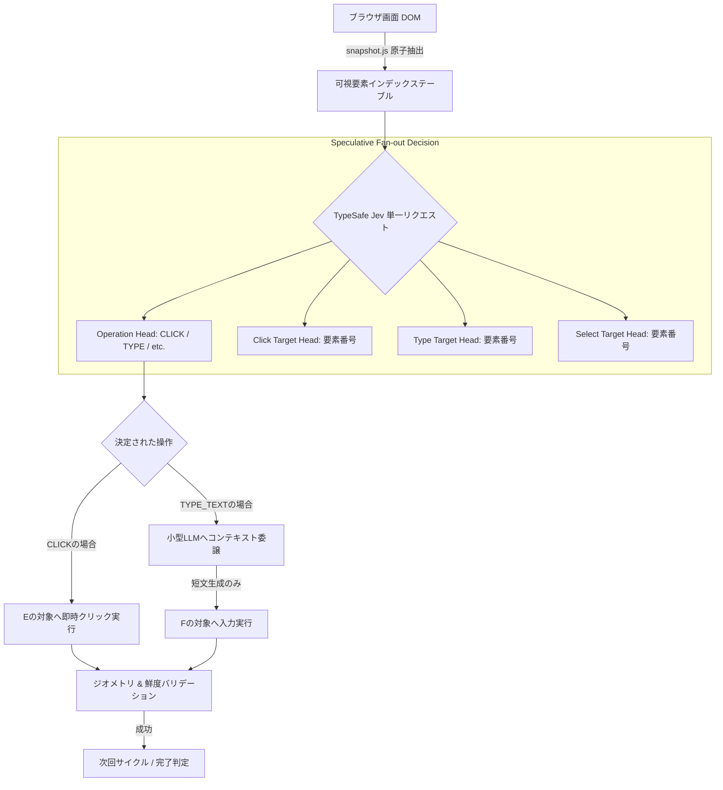

# jev-ultrafast: 概要と革新性

**jev-ultrafast**は、Webブラウザ自動化における最大のボトルネックであった「推論レイテンシ」と「トークンコスト」を劇的に打破するために開発された、超高速・超低コストの自律型ブラウザエージェントフレームワークです。

従来のマルチモーダルWebエージェント（GPT-4VやClaude 3.5 Sonnetなどを用いた画面キャプチャベースの方式）は、1ステップごとに高解像度スクリーンショットをモデルへ送信し、巨大なコンテキストを消費しながら数秒〜十数秒かけて次の操作（座標クリックや入力）を推論していました。このアプローチは精度こそ高いものの、API課金額の爆発と極度の遅延が商用本番導入の致命的な壁となっていました。

jev-ultrafastはこのパラダイムを根本から刷新します。TypeSafeの「Jev」アーキテクチャを採用し、**「1回のネットワーク往復で操作タイプと対象要素を同時に投機的推論」「スクリーンショットを排除した極小DOMスナップショット」「テキスト入力時のみ小型LLMに委譲」**という3段階のハイブリッドパイプラインを構築。Google Flightsでの複雑なフライト検索タスクをわずか**7.1秒**で完結させ、従来のBrowser Use構成と比較してCDP（Chrome DevTools Protocol）コール数を**1,092回から101回へと90%以上削減**、実行速度を25%高速化することに成功しました。

---

## 解決する主要な課題とアーキテクチャ

### 1. 従来型ブラウザエージェントの課題
- **高額なVLMコスト**: スクリーンショット1枚あたり数千トークンを消費し、1タスク数十ステップで数百円のコストが発生。
- **直列的レイテンシ**: 「画面解析 → アクション決定 → ターゲット要素特定 → 入力文字列生成」が直列に行われ、1アクションに3〜5秒を要する。
- **DOM肥大化によるコンテキスト溢れ**: 巨大なHTMLツリーをそのまま投じることによるトークン圧迫とハルシネーション。

### 2. jev-ultrafastのコアアーキテクチャ

jev-ultrafastは、観察（Observation）ごとに可視領域のインタラクティブ要素のみを抽出した「番号付きエレメントテーブル」を原子的に構築し、1リクエスト内で操作（Operation）と各操作ごとのターゲット候補（Target Heads）を投機的に同時取得します。

### 3. 超高速化を支える主要技術
1. **投機的ファンアウト（Speculative Fan-out）**: 
   「次がCLICKならどの要素か」「TYPE_TEXTならどの要素か」を1回の推論パスで並列予測。確定したOperationに応じたTargetをそのまま使うため、ネットワークRTTを半減。
2. **Atomic DOM Snapshot**: 
   JavaScriptフックを用いて、ビューポート内の操作可能ノード（ボタン、入力欄、コンボボックス）のみをインデックス化し、ノード参照を保持したままテーブル化。
3. **小型LLMによるテキスト補完の分離**: 
   ナビゲーションやクリックの決定には汎用大型モデルを使わず、フォーム入力に必要な文脈生成時のみ超軽量LLM（Mercury-2.5、GLM、DeepSeek等）を呼び出すことで、ミリ秒単位の応答と最小コストを両立。

---

## 競合ツール/商用SaaSとの徹底比較

| 評価項目 | jev-ultrafast (OSS) | 従来型 Browser-Use / LangChain | 商用SaaS (MultiOn / Browserbase) |
|---|---|---|---|
| **レイテンシ (平均)** | **1〜2秒 / ステップ**（全体7秒台完結） | 4〜8秒 / ステップ | 3〜6秒 / ステップ |
| **APIコスト / タスク** | **極小（約0.05〜0.3円）** | 高（約5〜30円） | 従量課金＋基本料金（高額） |
| **入力モーダリティ** | 構造化DOMテキスト + 必要時小型LLM | Vision (スクリーンショット) | Vision + DOMハイブリッド |
| **実行環境** | ローカルChrome / セルフホスト | ローカル / クラウド | 完全クラウド閉塞（Vendor Lock-in） |
| **確実性 / 衝突検証** | 実行直前に座標・遮蔽・DOM鮮度を自動検証 | 座標推定のズレによる空振りリスク有 | プロプライエタリ（内部ブラックボックス） |
| **ライセンス** | **MIT License（完全商用フリー）** | MIT / Apache 2.0 | プロプライエタリ（ソース非公開） |

## 📖 続きと実務キットについて
本記事は Auto Tech Radar の無料解説の抜粋です。

- 📖 **無料**: アーキテクチャ・README から転記したインストール手順・ライセンスの確認先 → [Auto Tech Radar で読む](https://ssk0224.github.io/auto-tech-radar/radar/jev-ultrafast/)
- 🔒 **有料（note）**: 導入提案書テンプレート（Markdown）と工数・見積表 → [note の有料記事・メンバーシップ](https://note.com/vast_ixora7005/membership)

