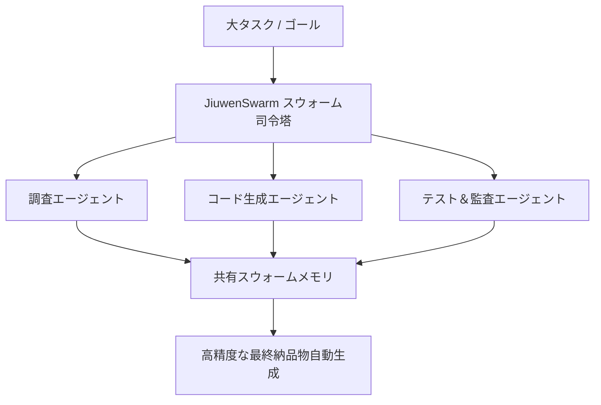

# jiuwenswarm: 概要と革新性

JiuwenSwarmは、オープンソースのAIエージェントシステムであり、大規模言語モデル（LLM）の能力を日常のコミュニケーションアプリを通じて直接利用可能にするインテリジェントなプラットフォームです。GitHubで5900以上のスターを獲得し、その革新的なアプローチが注目されています。

このプロジェクトの核心は、「マルチエージェントコラボレーション」を現実のものにすること。複雑なタスクを自然言語で指示するだけで、AIエージェントが自律的に分解し、専門エージェントチームを編成、協調してタスクを完遂します。さらに、エージェントの「スキル自己進化」機能により、エラーやユーザーの不満を検知して自動的にスキル定義を最適化し、継続的な改善を実現します。

## 解決する主要な課題とアーキテクチャ

現代のビジネス環境では、複雑なタスクの自動化と効率化が喫緊の課題です。しかし、従来のAIエージェントは単一タスクに特化しがちで、複数のステップや専門知識を要する複雑なプロセスには対応が困難でした。JiuwenSwarmは以下の課題を解決します。

*   **複雑なタスクの分解と実行:** リーダーエージェントが複雑なタスクを分解し、専門エージェントチームを動的に編成。各エージェントが連携し、タスクをエンドツーエンドで実行します。
*   **エージェント間の協調とスケーラビリティ:** 分散型エージェントスウォームアーキテクチャにより、リーダーとチームメイトがプロセスやマシンを跨いでデプロイされ、大規模な協調作業を可能にします。
*   **スキルの継続的な最適化:** 「Skill Self-Evolution」機能により、エージェントは実行結果やユーザーフィードバックから学習し、自身のスキル定義を自動で改善します。これにより、一度構築したスキルが陳腐化することなく、常に最新の状態に保たれます。
*   **ヒューマン・イン・ザ・ループ (HITL) の統合:** SwarmflowというPythonスクリプトによる決定論的なマルチステージワークフローを通じて、人間による介入（`human` / `human_session`）を組み込むことができ、AIの自律性と人間の制御のバランスを取ります。
*   **幅広いAIインフラ互換性:** Huawei Cloud MaaS、OpenAI互換API、ローカルモデルなど、多様なAIプラットフォームに対応し、既存のインフラを最大限に活用できます。

## 競合ツール/商用SaaSとの徹底比較

JiuwenSwarmは、既存の商用AIエージェントSaaSや他のオープンソースフレームワークと比較して、いくつかの明確な優位性を持っています。

| 比較項目 | JiuwenSwarm (OSS) | 一般的な商用マルチエージェントSaaS | 単一タスク型AIエージェント |
|---|---|---|---|
| **自律的タスク分解** | ◎ リーダーエージェントによる動的編成 | ○ 定型テンプレート依存 | × 単一指示のみ対応 |
| **スキル自己進化** | ◎ 実行結果・FBからの自動最適化 | × ベンダー側の更新待ち | × なし |
| **デプロイ環境** | ◎ 完全社内閉域・オンプレミス/VPC対応 | × クラウドSaaS固定（機密漏洩リスク） | △ クラウド依存大 |
| **HITL (人間介入)** | ◎ Swarmflowによる決定論的制御 | △ 設定柔軟性が低い | × 制御困難 |
| **導入・運用コスト** | ◎ OSSのためライセンス料ゼロ・API費のみ | × 月額従量課金＋高額シート費用 | △ 機能に対して割高 |

---

## 📖 続きと実務キットについて
本記事は Auto Tech Radar の無料解説の抜粋です。

- 📖 **無料**: アーキテクチャ・競合比較・ライセンス考察の全文 → [Auto Tech Radar で読む](https://ssk0224.github.io/auto-tech-radar/radar/jiuwenswarm/)
- 🔒 **有料（note）**: 導入提案書テンプレート・工数見積表・公式READMEに基づく導入手順 → [note の有料記事・メンバーシップ](https://note.com/vast_ixora7005/membership)
