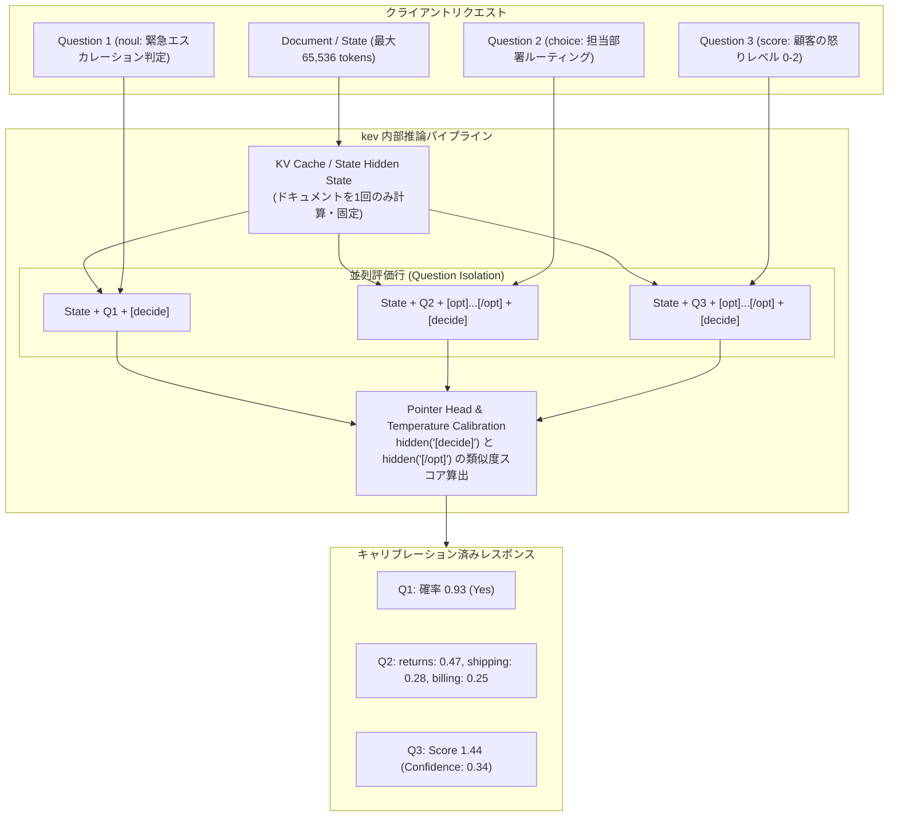

# kev: 概要と革新性

大規模言語モデル（LLM）を実務の自動化パイプラインに組み込む際、最大の障壁となるのが「ハルシネーション（幻覚）」と「確率の不透明さ（信頼度スコアの欠如）」、そして「トークン生成による推論遅延とコスト」です。分類、ルーティング、コンプライアンスチェック、トリアージといった日常の意思決定タスクにおいて、チャット特化型LLMに自由形式で回答を出力させ、それを正規表現やJSON Modeでパースするアプローチは、構造的に不安定であり運用コストも跳ね上がります。

この構造的課題を打破するのが、Vercelの元VP of ProductでありTurborepoの作者としても知られるJared Palmer氏が主導するオープンソースプロジェクト **「kev」** です。

`kev` は、TypeSafe社が提供するクローズドな商用意思決定モデル「Jev（System One）」のアーキテクチャをリバースエンジニアリング・拡張し、オープンウェイトの **Qwen3.5 / Qwen3.8** 上に構築された意思決定（Decision-Making）専用モデルファミリーです。0.8B、4B、9B、27Bの4サイズを展開し、単一のリクエスト内で「Yes/No判定（noul）」「多肢選択（choice）」「多段階評価（score）」を同時に高精度かつキャリブレーション（較正）された信頼度確率付きで実行します。

### 主な特徴と革新性
1. **確率分布を直接出力（Calibrated Probabilities）**: 単一ラベルのテキスト生成ではなく、較正された温度パラメータ（Fitted Temperature）に基づき、数学的に正確な確率分布を出力。信頼度が閾値未満の場合は人間にエスカレーションする運用設計が容易。
2. **質問間の完全な分離（Question Isolation）**: 共通の長文コンテキスト（最大65,536トークン）を参照しつつ、同時に投入された質問同士が互いに影響を与えない独立推論設計。
3. **商用API（TypeSafe System One）とのドロップイン互換**: 公式Python SDKのエンドポイントをローカルホストに向けるだけで、一切のコード変更なしに自前インフラへ移行可能。
4. **極限の推論効率**: H100上で6問の同時判定をわずか18.1msで完了。Apple Silicon（Mシリーズ）向けにはMLXバックエンドによる高速推論を標準サポート。

---

## 解決する主要な課題とアーキテクチャ

従来のLLMを用いたワークフロー自動化では、プロンプトインジェクションへの脆弱性や、複数質問を投じた際のコンテキスト内バイアス（前の回答に引きずられる現象）、出力トークン生成に伴うレイテンシがボトルネックでした。`kev` はこの課題を **「ポインターヘッド（Pointer Head）方式」** と **「独立した状態キャッシュ再利用」** によって根本から解決しています。

### アーキテクチャの要点
- **ハイブリッドバックボーン対応**: Qwen3.5/3.8のハイブリッド構造（Attention層 ＋ 再帰型Gated DeltaNet層）に最適化。DeltaNet層がアテンションマスクを無視する特性に対応するため、共通の`State`計算結果をキャッシュしつつ、質問ごとに独立した行（Row）としてフォワードパスを実行。質問間の完全な推論分離を保証。
- **Pointer Headメカニズム**: 各選択肢末尾の`<opt>...</opt>`トークンの隠れ状態と、質問末尾の`<decide>`トークンの隠れ状態の内積を取り、Softmaxを適用することで選択確率を計算。次トークン予測に依存しないため、ハルシネーションの余地がゼロ。
- **Fitted Temperature**: チェックポイントごとに検証セットを用いて最適なTemperatureパラメータを事前フィッティング。Brierスコアを最小化し、確率値そのものを信頼度メトリクスとして直結可能。

---

## 競合ツール/商用SaaSとの徹底比較

| 評価項目 | kev (Self-Hosted OSS) | TypeSafe Jev (商用API) | 一般的なLLM (OpenAI / Claude) |
|---|---|---|---|
| **提供形態** | 完全OSS (ウェイト・学習コード全公開) | クローズドSaaS | クラウドAPI |
| **ライセンス** | Apache-2.0 | プロプライエタリ | 利用規約準拠（従量課金） |
| **ベースモデル** | Qwen3.5-0.8B/4B/9B, Qwen3.8-27B | 非公開 | GPT-4o / Claude 3.5 Sonnet 等 |
| **確信度 (Confidence)** | キャリブレーション済み確率を出力 | キャリブレーション済み確率を出力 | logprobs等の間接的推定（不正確） |
| **推論レイテンシ** | 18ms〜50ms (H100) / 100ms台 (M5 Mac) | 200ms〜500ms (ネットワーク依存) | 800ms〜3,000ms (生成型) |
| **データプライバシー** | 完全オンプレミス / 自社VPC完結 | 外部送信必須（SOC2等の制約） | 外部送信必須 |
| **ドメイン特化学習** | Modal / 独自GPUで安価にLoRA・FT可能 | 不可（事前提供モデルのみ） | Fine-tuningは高額かつ制御困難 |
| **月額インフラコスト** | ゼロ〜自社GPU代（Modalスケールtoゼロ可）| リクエスト従量課金（大規模運用で高額）| 高額（トークン従量課金） |

---

## 📖 続きと実務キットについて
本記事は Auto Tech Radar の無料解説の抜粋です。

- 📖 **無料**: アーキテクチャ・競合比較・ライセンス考察の全文 → [Auto Tech Radar で読む](https://ssk0224.github.io/auto-tech-radar/radar/kev/)
- 🔒 **有料（note）**: 導入提案書テンプレート・工数見積表・公式READMEに基づく導入手順 → [note の有料記事・メンバーシップ](https://note.com/vast_ixora7005/membership)
