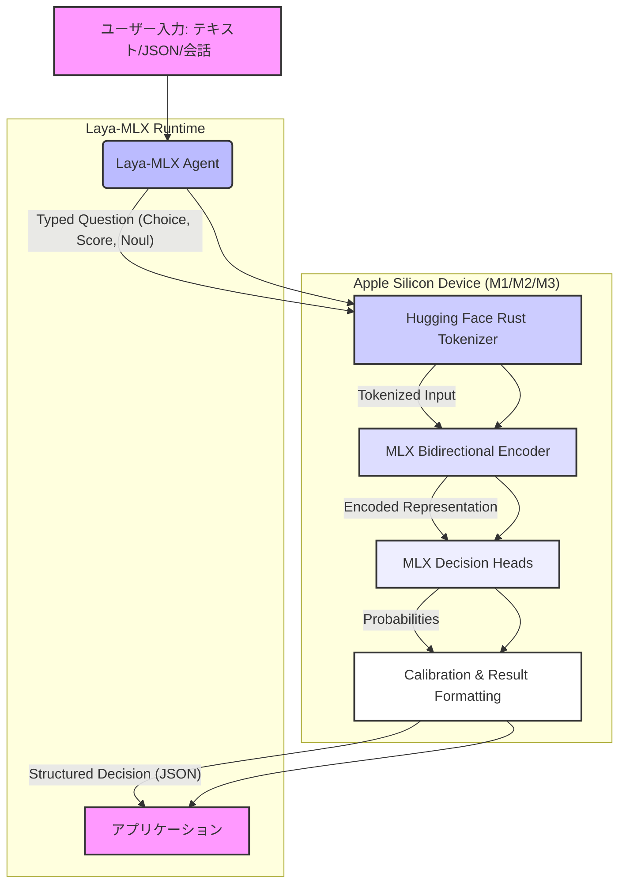

# laya-mlx: 概要と革新性

`laya-mlx`は、Apple Siliconデバイス上でLayaの型付き意思決定モデルをネイティブに実行するための、超高速なMLXランタイムです。従来のLLM（大規模言語モデル）が抱える高遅延、高コスト、クラウド依存といった課題を解決し、ミリ秒単位でのリアルタイムな意思決定を可能にします。テキスト生成を伴わない「選択」「スコア付け」「真偽判定」といった特定のタスクに特化することで、M3 Maxチップ上でわずか7〜14ミリ秒という驚異的な応答速度を実現します。PyTorchやTransformersランタイム、さらにはクラウドAPIへの依存も一切ありません。

## 🎯 ThoughtWorks成熟度リング判定（ADOPT / TRIAL / ASSESS / HOLD）

**判定: TRIAL**

### 根拠
*   **高いパフォーマンスと特化性**: Apple Siliconに最適化され、M3 Maxで7ms台という圧倒的な低遅延を実現しています。特定の「型付き意思決定」タスクに特化することで、LLMのオーバースペック問題を解消しています。
*   **活発なコミュニティと開発**: GitHubスター数6956は、このニッチな分野における高い注目度とコミュニティの活発さを示しています。詳細なベンチマーク、ドキュメント、デモが提供されており、開発の成熟度が高いです。
*   **MLXの採用**: Appleが提供する機械学習フレームワークMLXをネイティブに利用しており、Appleエコシステム内での将来性と最適化の可能性を秘めています。
*   **限定的な適用範囲**: 現時点ではApple Siliconデバイスに特化しており、幅広いハードウェア環境での利用は限定的です。また、汎用的なテキスト生成には対応していません。

### 推奨活用フェーズ
*   **Apple Silicon環境でのAI推論を高速化したい企業**: 特にMシリーズチップを搭載したMacやiPad Proを開発・運用環境として利用している企業にとって、既存のAIワークロードを劇的に高速化する可能性があります。
*   **エッジAI・リアルタイム意思決定システム**: 製造ラインでの品質検査、金融取引のリアルタイム不正検知、ゲームAIの行動決定など、ミリ秒単位の応答が求められるエッジAIアプリケーションやリアルタイムシステムでの採用が推奨されます。
*   **LLMのコスト・遅延問題に直面している企業**: テキスト生成が不要な「分類」「判定」タスクにおいて、高額なLLM API利用料や応答遅延に課題を感じている場合、Laya-MLXは費用対効果の高い代替手段となり得ます。

## 解決する主要な課題とアーキテクチャ

`laya-mlx`が解決する主要な課題は、現代のAIアプリケーションにおける「意思決定」プロセスのボトルネックです。従来のLLMは強力ですが、以下の問題点がありました。

1.  **高遅延**: テキスト生成プロセスは本質的に時間がかかり、リアルタイム性が求められるアプリケーションには不向きです。
2.  **高コスト**: クラウドベースのLLM APIは利用量に応じてコストが増大し、大規模な運用では予算を圧迫します。
3.  **クラウド依存とプライバシー**: センシティブなデータをクラウドに送信する必要があり、データプライバシーやセキュリティの懸念が生じます。
4.  **オーバースペック**: 単純な「分類」や「判定」にLLMを使うのは、機能的に過剰であり、リソースの無駄です。

`laya-mlx`は、これらの課題に対し、Apple Siliconに最適化されたMLXランタイムとLayaの型付き意思決定モデルを組み合わせることで、以下のようなアーキテクチャで解決策を提供します。

**アーキテクチャの主要コンポーネント:**

*   **Laya-MLX Agent**: ユーザーからの入力と型付き質問（`choice`, `score`, `noul`）を受け取ります。
*   **Hugging Face Rust Tokenizer**: 入力テキストを高速にトークン化します。
*   **MLX Bidirectional Encoder**: トークン化された入力を双方向エンコーダで処理し、意味的な表現を生成します。この部分はApple SiliconのGPU上でMLXによって最適化され、高速に実行されます。
*   **MLX Decision Heads**: エンコーダの出力を基に、指定された型（選択肢、スコア、真偽）に応じた確率を計算します。
*   **Calibration & Result Formatting**: 計算された確率をキャリブレーションし、指定されたスキーマに従ってJSON形式の意思決定結果を返します。

このアーキテクチャにより、`laya-mlx`はテキスト生成を伴わない特定の意思決定タスクにおいて、極めて高速かつ効率的なオンデバイスAI推論を実現します。

---

## 📖 続きと実務キットについて
本記事は Auto Tech Radar の無料解説の抜粋です。

- 📖 **無料**: アーキテクチャ・競合比較・ライセンス考察の全文 → [Auto Tech Radar で読む](https://ssk0224.github.io/auto-tech-radar/radar/laya-mlx/)
- 🔒 **有料（note）**: 導入提案書テンプレート・工数見積表・公式READMEに基づく導入手順 → [note の有料記事・メンバーシップ](https://note.com/vast_ixora7005/membership)
