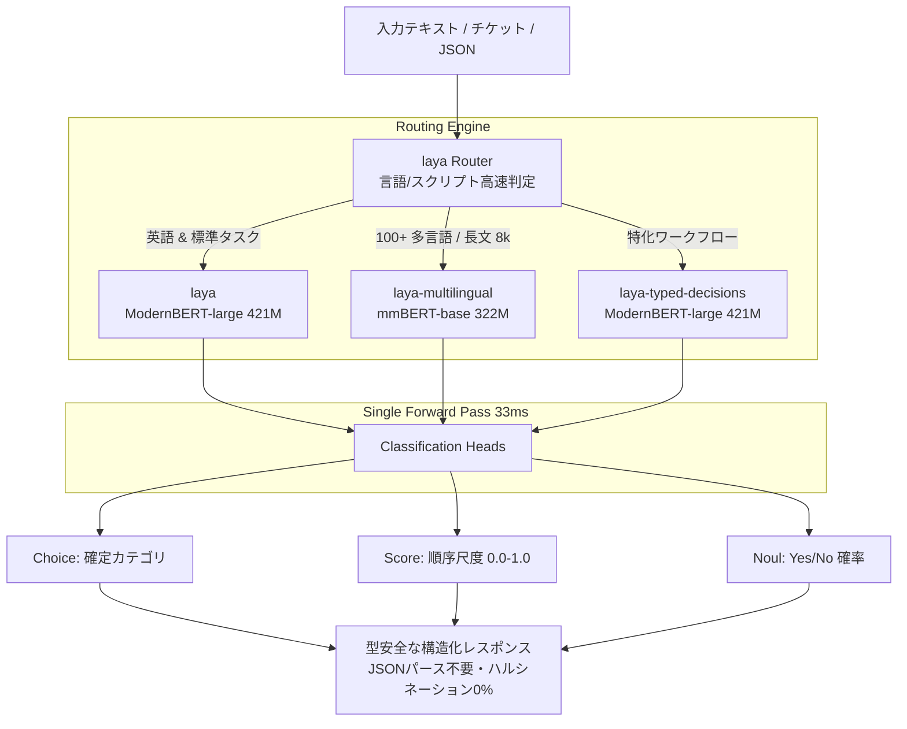

# laya: 概要と革新性

LLM（大規模言語モデル）の台頭により、カスタマーサポートのトリアージ、コンテンツモデレーション、ルーティングなどのテキスト分類タスクにGPT-4やClaude等の生成モデルを組み込む例が急増しました。しかし、そこでエンジニアが直面するのが**「トークン生成による大きなレイテンシ（数百ms〜数秒）」「高額なAPIコスト」「JSONパース失敗」「確率的ハルシネーション」**というSystem 2（熟慮型）推論特有の致命的ペインです。

GitHubで31,000スターを超える急上昇OSS **「laya」** は、この課題を根本から覆す**「Non-autoregressive（非自己回帰型）System 1意思決定エンジン」**です。

Daniel Kahnemanの提唱する「System 1（直感的・瞬時な思考）」をAIアーキテクチャに落とし込み、テキスト生成（Token-by-token generation）を一切行いません。独自のエンコーダ構造（ModernBERT / mmBERT）と、厳密適格スコアリングルール（Strictly Proper Scoring Rules: RLCD）で学習された分類ヘッドにより、**単一のフォワードパス（わずか33ms）**で型付けされた決定（Typed Choice、Score、Yes/No）を出力します。

### 革新的なポイント
- **超低レイテンシ・高スループット**: 単一クエリ33ms、バッチ処理時7.2ms/クエリ（T4 GPU測定）。生成AI比較で10〜30倍の高速化。
- **ゼロ・ハルシネーション & 堅牢な型安全性**: テキストを生成しないため、存在しないラベルの出力やJSONの構文エラーが構造的にゼロ。
- **100以上の言語を自動ルーティング**: サブミリ秒で言語とスクリプトを判定し、最適なチェックポイントへ振り分ける内蔵`Router`。
- **長文対応（最大8,192トークン）**: `laya-multilingual`は最大8,192トークンまでの長文コンテキストに対応。

---

## 解決する主要な課題とアーキテクチャ

従来のLLMベースの意思決定パイプラインでは、プロンプトにJSONスキーマを埋め込み、生成された文字列をPydantic等でバリデーションしていました。この方式はトークン課金が嵩むだけでなく、並列リクエスト時のキュー詰まりを引き起こします。

`laya`は、リクエスト判定を瞬時に行う「Router層」と、特化型エンコーダで構成された「Decision Engine層」の2層構造を採用しています。

### モデルチェックポイントの役割分担
1. **`laya` (421M / ModernBERT-large)**: 英語テキストに最適化されたベースモデル。コンテキスト512トークン。
2. **`laya-multilingual` (322M / mmBERT-base)**: 100以上の言語に対応し、ベースモデルの約2倍の推論速度を誇る。最大8,192トークンまで拡張可能。
3. **`laya-typed-decisions` (421M)**: 業務意思決定ベンチマークでRLCDによりファインチューニングされた高精度モデル。

---

## 競合ツール/商用SaaSとの徹底比較

| 比較項目 | OpenAI GPT-4o-mini | 一般的なBERT/RoBERTa分類 | **laya** |
|---|---|---|---|
| **推論方式** | 自己回帰型（テキスト生成） | 単一分類ヘッド | **非自己回帰型 System 1意思決定** |
| **平均レイテンシ** | 400ms 〜 1,500ms | 20ms 〜 50ms | **33ms（バッチ時7.2ms）** |
| **API/インフラコスト** | トークン従量課金（高額） | 自社サーバー（低〜中） | **自社サーバー / T4やCPUで極小運用** |
| **JSONパース失敗率** | 稀に発生（リトライ必須） | 発生しない（固定ID出力） | **ゼロ（型定義済みChoice/Score）** |
| **多言語ルーティング** | プロンプトで暗黙処理 | 言語ごとにモデル切り替え要 | **ビルトインRouterで100言語自動切替** |
| **長文サポート** | 128kトークン | 通常512トークン固定 | **最大8,192トークン対応** |
| **適応性（ゼロショット）** | 高い | ゼロショット不可（要学習） | **質問と基準を動的に指定可能** |

## 📖 続きと実務キットについて
本記事は Auto Tech Radar の無料解説の抜粋です。

- 📖 **無料**: アーキテクチャ・README から転記したインストール手順・ライセンスの確認先 → [Auto Tech Radar で読む](https://ssk0224.github.io/auto-tech-radar/radar/laya/)
- 🔒 **有料（note）**: 導入提案書テンプレート・工数見積表 → [note の有料記事・メンバーシップ](https://note.com/vast_ixora7005/membership)

