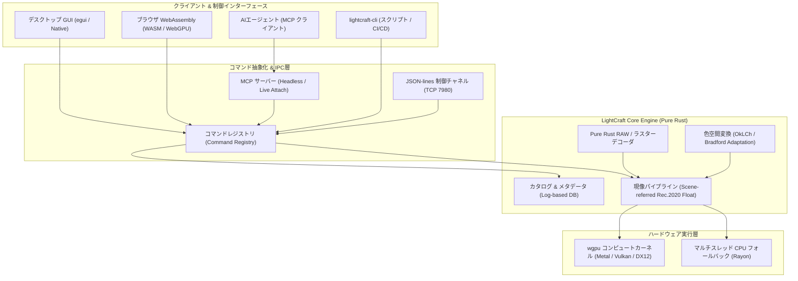

# lightcraft: 概要と革新性

**LightCraft**は、純粋なRust（Pure Rust）のみを用いてゼロからクリーンルーム設計で構築された、オープンソースの非破壊型RAW現像・写真ライブラリ管理エンジンです。Adobe Lightroomのコア機能をオープンソースとして再実装し、デスクトップ（macOS / Windows / Linux）だけでなく、WebAssembly（WASM）によるブラウザ動作、さらにはヘッドレス環境におけるCLIバッチ処理まで完全対応しています。

最大の革新性は、**「Model Context Protocol（MCP）およびJSON-lines制御チャネルのネイティブ統合」**にあります。UIのすべてのスライダー、トグル、マスク描画、書き出し処理が独立したコマンドとして抽象化されており、人間がGUIから操作するのと全く同一のパスで、LLMやAIエージェントがプログラム経由で現像パイプラインをリアルタイム駆動・検証できます。

さらに、C言語依存ライブラリ（LibRawやdcrawなど）を完全に排除し、各種カメラメーカーのRAWデコーダからRec.2020 32-bit浮動小数点リファレンスパイプライン、OkLCh知覚色空間処理、`wgpu`によるGPUコンピュートシェーダーまでを自前で実装。メモリ安全性、並行処理性能、決定論的再現性を兼ね備えた次世代クリエイティブインフラです。

---

## 解決する主要な課題とアーキテクチャ

従来のRAW現像ソフトウェアおよび画像バッチ処理基盤は、以下の深刻なアーキテクチャ的課題を抱えていました：

1. **ベンダーロックインとライセンス・サブスクリプションコスト**: クリエイティブ現場やEC撮影スタジオにおいて、シート数に応じた高額な商用SaaS/ソフトウェアライセンス費が恒常的に発生。
2. **C/C++製レガシーコードの安全性と移植性の低さ**: 既存のOSS現像ツール（RawTherapeeやdarktable等）は歴史的経緯から大量のC/C++ライブラリに依存しており、WebAssembly化やセキュアなマルチテナントクラウド環境への統合が困難。
3. **AI・自動化連携の欠如**: 従来のデスクトップツールはGUI操作を前提としており、外部プログラムやAIエージェントが「パラメータを調整しながら途中プレビューをフィードバックループで確認する」ヘッドレス実行パイプラインが存在しなかった。

LightCraftは、厳格なレイヤードアーキテクチャを採用し、UI層（`ui-egui`）と現像エンジン（`engine` / `pipeline`）を完全に分離することでこれらの課題を解決しています。

パイプラインの各ステージはGPUコンピュートシェーダー（`wgpu`）により並列実行され、24MPのRAW画像であってもスライダー操作の再レンダリングが約4ms、フル解像度エクスポートが約0.3秒で完了します。GPUが存在しないサーバー環境では自動的にCPUマルチスレッドへフォールバックし、1/255以下の誤差でビット完全性を維持した出力が得られます。

---

## 競合ツール/商用SaaSとの徹底比較

| 評価項目 | Adobe Lightroom (Classic/Cloud) | darktable / RawTherapee | **LightCraft (本OSS)** |
| :--- | :--- | :--- | :--- |
| **ソースコード & 実装言語** | クローズドソース (C++ / 独自) | オープンソース (C / C++) | **完全オープンソース (Pure Rust)** |
| **ライセンス形態** | 月額サブスクリプション (高額) | GPL v3+ (制約あり) | **Apache-2.0 / MIT (極めて商用利用しやすい)** |
| **AI/エージェント自動化** | 限定的プラグイン / 手動GUI中心 | スクリプト連携は限定的 | **MCPネイティブ対応・全UI要素へのAPI直接アクセス** |
| **クラウド/ブラウザ実行** | Web版はあるが閉鎖的 | 不可 (デスクトップ専有) | **WebAssembly + WebGPU でブラウザ完全動作** |
| **内部パイプライン** | 独自Floatパイプライン | 32-bit Float パイプライン | **Scene-referred Rec.2020 32-bit Float + OkLCh** |
| **データプライバシー** | クラウド同期・テレメトリ前提 | ローカル完結 | **完全ローカルファースト、通信・テレメトリ皆無** |
| **ヘッドレス実行/CI/CD** | 不可 | CLIはあるが制御性に難 | **CLIおよびJSON-linesプロトコルによる完全外部制御** |

## 📖 続きと実務キットについて
本記事は Auto Tech Radar の無料解説の抜粋です。

- 📖 **無料**: アーキテクチャ・競合比較・ライセンス考察の全文 → [Auto Tech Radar で読む](https://ssk0224.github.io/auto-tech-radar/radar/lightcraft/)
- 🔒 **有料（note）**: 導入提案書テンプレート・工数見積表・公式READMEに基づく導入手順 → [note の有料記事・メンバーシップ](https://note.com/vast_ixora7005/membership)

