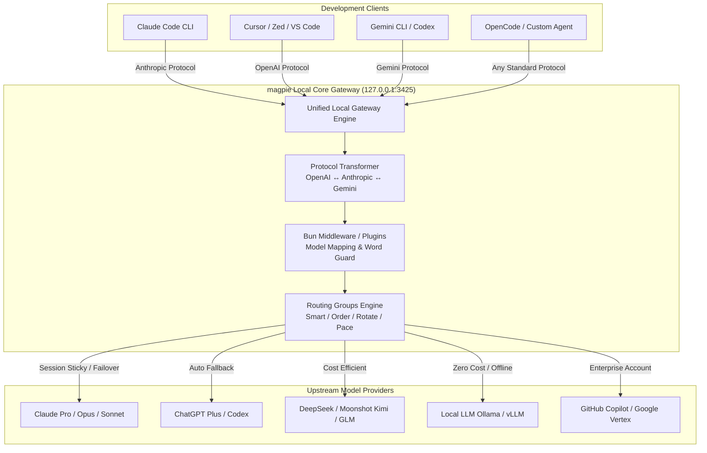

# magpie: 概要と革新性

近年、エンジニアの日常業務には「Claude Code」「Cursor」「Codex」「Gemini CLI」「OpenCode」といった多種多様なAIコーディングエージェントが入り乱れています。しかし、開発現場では深刻な**「エージェント・プロバイダーのサイロ化」**が発生しています。

各エージェントは独自の設定ファイル形式を持ち、有料サブスクリプション（ChatGPT Plus、Claude Pro、GitHub Copilot等）や個別のAPIキーが各ツール内部に閉じ込められています。そのため、「Claude CodeでDeepSeek V4を使いたい」「Cursorの裏側で割安なKimiやローカルLLMを動かしたい」「APIクォータが切れたら別アカウントへシームレスにフェイルオーバーさせたい」という要求に対して、設定ファイルの書き換えやプロトコル変換を泥臭く手作業で行う必要がありました。

このペインを劇的に解決するのが、Go言語製でGitHubスター数11,500を突破したオープンソース・統合ゲートウェイ**「magpie」**です。

### magpieのコア革新性
1. **全主要プロトコルのリアルタイム相互変換**：ローカルポート（`127.0.0.1:3425`）で待受し、OpenAI Chat/Responses、Anthropic Messages、Google GeminiのAPI仕様を自動相互トランスパイル（ストリーミング・Tool Use・Reasoning tags完全対応）。
2. **エージェント設定ファイルの非破壊的自動書き換え**：各CLIエージェントの設定（JSON, TOML, YAML等）の構造・コメントを壊すことなく、ターゲットURLとモデル指定をワンクリック／1コマンドで置換。
3. **インテリジェント・ルーティング＆クォータ・フェイルオーバー**：複数アカウントや異なるLLMをグループ化し、トークン残量、更新タイミング（smart/pace）、推論コスト（Intent Routing）に応じてリクエストを自動分散。
4. **JavaScript/Bunベースのゲートウェイミドルウェア拡張**：`onRequest`、`onResponse`をフックし、プロンプトの注入、マスク、モデルリライトを数行で実装可能。

---

## 解決する主要な課題とアーキテクチャ

従来のエージェント利用環境では、ツールごとに個別のAPI設定やキーの分散管理が必要であり、サブスクリプションの利用制限（Rate Limit）到達による作業停止が日常茶飯事でした。

magpieはローカルプロキシアーキテクチャを採用し、すべてのエージェントとすべてのLLMプロバイダ間に透過的なレイヤーを挟み込みます。

### アーキテクチャの強み
- **セッション維持（Sticky Session）**：プロンプトキャッシュの効果を最大化するため、同一セッションのリクエストはキャッシュが有効な同一プロバイダに固定。
- **意図ルーティング（Intent Routing）**：小型LLMがリクエスト内容を瞬時に判定。単純な質問は格安のDeepSeekやKimiへ、複雑なリファクタリングやテストコード生成はClaude Opus/GPT-4oへ自動振り分け。
- **安全な認証抽出**：OSのKeychainやローカルCLIの既存セッションから安全にサブスクリプション認証を同期し、追加キー発行なしで他エージェントに再利用可能。

---

## 競合ツール/商用SaaSとの徹底比較

| 機能・指標 | magpie (OSS) | LiteLLM (Proxy) | New API / One API | 商用AIゲートウェイ (Portkey等) |
| :--- | :--- | :--- | :--- | :--- |
| **主用途** | 開発エージェント・デスクトップ統合 | サーバーサイドAPI集約 | APIキー転売・リレー | エンタープライズAPI監視 |
| **クライアント設定自動化** | **◎ 完全自動（各エージェントのConfigを直書き換え）** | × 手動設定 | × 手動設定 | × 手動設定 |
| **デスクトップGUI/TUI** | **◎ メニューバー常駐 / TUI完備** | △ Web UIのみ | △ Web UIのみ | ○ クラウドダッシュボード |
| **個人サブスク流用** | **◎ 可能（Claude/Codex認証再利用）** | × APIキーのみ | × APIキーのみ | × APIキーのみ |
| **レイテンシ** | **極小（Goローカルプロセス）** | 低（Python） | 低（Go） | 中（外部クラウド経由） |
| **意図ルーティング** | **◎ ビルトインサポート** | ○ 設定次第 | △ プラグイン依存 | ○ クラウド設定 |
| **コスト** | **完全無料（MIT）** | OSS無料 / 有料版あり | OSS無料 | 月額従量課金（高額） |

## 📖 続きと実務キットについて
本記事は Auto Tech Radar の無料解説の抜粋です。

- 📖 **無料**: アーキテクチャ・README から転記したインストール手順・ライセンスの確認先 → [Auto Tech Radar で読む](https://ssk0224.github.io/auto-tech-radar/radar/magpie/)
- 🔒 **有料（note）**: 導入提案書テンプレート（Markdown）と工数・見積表 → [note の有料記事・メンバーシップ](https://note.com/vast_ixora7005/membership)

