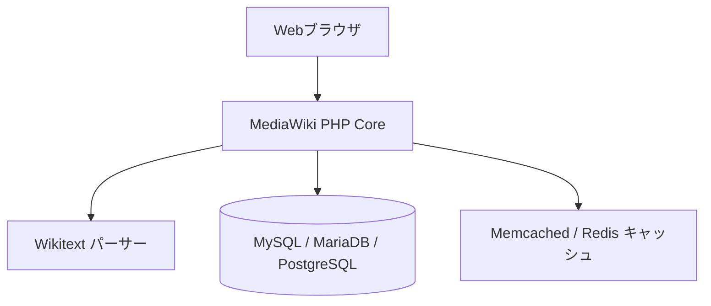

# mediawiki: 概要と革新性

**MediaWiki**は、月間数十億PVを誇る世界最大の百科事典「Wikipedia」およびウィキメディア各プロジェクトの中核基盤として稼働しているオープンソースのナレッジ共有プラットフォームです。

PHPで書かれ、350以上の多言語対応と比類のない堅牢性を備えています。MediaWikiの革新性は、**「完全な分散型コラボレーション編集環境」**と**「極限までのスケーラビリティ」**を両立させている点にあります。何千人もの編集者が同時に差分を更新しても破綻しない排他制御・履歴追跡システム、そして数億人規模の読者トラフィックをキャッシュレイヤー経由で捌くアーキテクチャは、Web黎明期から現代に至るまで分散Webシステムの金字塔として進化を続けています。

---

## 解決する主要な課題とアーキテクチャ

### 1. 解決する課題
- **ナレッジの属人化と改ざんリスク**: 全編集履歴の不変性（イミュータブルな差分管理）により、誰が・いつ・何を編集したかを1クリックで追跡・復元可能。
- **超大規模トラフィックと同時編集のコンフリクト**: 多数のユーザーが同一ドキュメントを同時修正する際の競合を自動/半自動で調停。
- **多言語・大規模ドメイン展開のコスト**: 350以上の言語サポートと柔軟な名前空間（Namespaces）管理により、グローバルな情報集約を単一システムで完結。

### 2. コアアーキテクチャ
MediaWikiはLAMP/LEMPスタックを基盤としつつ、極めて洗練された多層分散キャッシュ構造を採用しています。

- **コアエンジン (PHP)**: 構文解析（Wikitext / Parsoid）、パーミッション制御、イベントフックシステムを提供。
- **ストレージ & DB**: MySQL/MariaDBまたはPostgreSQL。ページ本体のメタデータと、履歴差分テキストを分離して最適化保存。
- **キャッシュレイヤー**: Redis/Memcached（オブジェクト・セッション管理）とVarnish/CDNを組み合わせることで、動的リクエストを最小化。
- **拡張性 (Extensions & Hooks)**: 800以上の公式・非公式拡張機能（Semantic MediaWiki、REST API、VisualEditor等）により、単なるWikiを超えたナレッジベースへ拡張可能。

---

## 競合ツール/商用SaaSとの徹底比較

| 項目 | MediaWiki | Notion / Confluence (商用SaaS) | Docusaurus / MkDocs |
| :--- | :--- | :--- | :--- |
| **データ所有権** | **完全なセルフホスト（完全自社管理）** | ベンダーロックインあり | Gitベース（静的ホスティング） |
| **ライセンスコスト** | **無料（オープンソース）** | ユーザー数課金（月額数百〜数千円/人） | 無料（静的生成） |
| **共同編集・履歴管理** | **超大規模な差分追跡・トークページ機能** | リアルタイムだが大規模監査には不向き | Git履歴ベース（開発者向け） |
| **スケーラビリティ** | **数千万PV/月の大規模対応実績あり** | SaaS側のプラン・制限に依存 | 静的配信のため高負荷に強いが更新頻度に限界 |
| **学習コスト** | 中（Wikitext記法・サーバー運用知識が必要） | 低（直感的なリッチUI） | 中（Markdown + Git運用） |

## 📖 続きと実務キットについて
本記事は Auto Tech Radar の無料解説の抜粋です。

- 📖 **無料**: アーキテクチャ・競合比較・ライセンス考察の全文 → [Auto Tech Radar で読む](https://ssk0224.github.io/auto-tech-radar/radar/mediawiki/)
- 🔒 **有料（note）**: 導入提案書テンプレート・工数見積表・公式READMEに基づく導入手順 → [note の有料記事・メンバーシップ](https://note.com/vast_ixora7005/membership)

