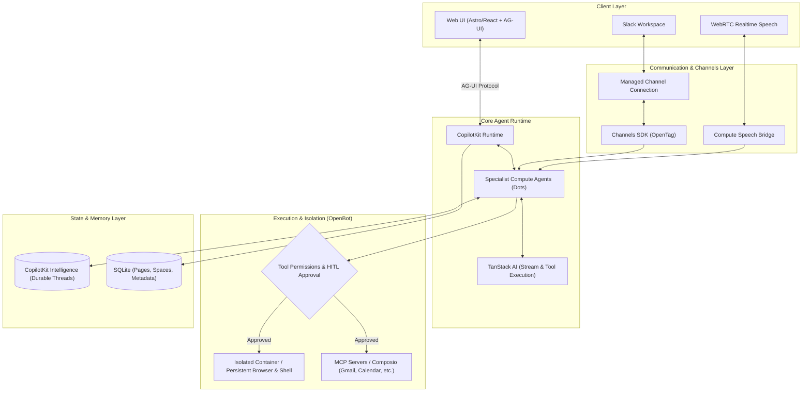

# OpenDots: 概要と革新性

OpenDotsは、CopilotKitチームが開発したオープンソースの常駐型AIエージェント（AI Coworker）ワークスペーステンプレートです。単なるチャットボットではなく、「各エージェント（Dot）が独立したLinuxコンテナ/ブラウザ環境（Dot Computer）を持ち、Web UI・音声通話・Slackの間をシームレスに行き来しながら永続的にタスクを遂行する」という次世代のエージェントアーキテクチャを具現化しています。

従来のAIアシスタントは単一のチャットセッションで完結し、外部ツールの実行状態やファイルシステムを保持できませんでした。OpenDotsは、コンテナスーパーバイザー「OpenBot」と連携することで、エージェントごとに永続化されたブラウザプロファイル・ワークスペースストレージ・シェル環境を提供。さらに、人間による承認（Human-in-the-loop）フローをネイティブで組み込むことで、実務に投入可能な信頼性を担保しています。

## 🎯 成熟度の目安（AI による見立て）

**判定: TRIAL（検証・PoC推奨）**

### 根拠
- **スター数・モメンタム**: GitHubスター数5,500超、TrendshiftでもTypeScript部門で急浮上しており、CopilotKitエコシステムの中核テンプレートとして開発が活発。
- **アーキテクチャの先進性**: AG-UI（Agent-User Interface）プロトコル、TanStack AI、Channels SDKによるSlack連携、WebRTCによるリアルタイム音声会話など、2026年の最先端エージェントスタックを網羅。
- **留意点**: 本リポジトリは「ホステッド製品」ではなく「フルスタックテンプレート」。マルチテナント認証や共有編集は未実装のシングルオーナー仕様であり、本番商用利用には追加の認証基盤やインフラ構築が必要。社内DX検証や特定業務自動化の受託PoCフェーズ（TRIAL）として導入するのが最適です。

---

## 解決する主要な課題とアーキテクチャ

OpenDotsは以下の3つの大きな課題を解決します：
1. **コンテキストの分断**: チャット、Slack、音声通話で別々のボットが立ち上がり、記憶や作業状態が同期しない問題。
2. **ツールの実行権限と安全性**: AIが勝手に外部APIやシェルを叩いて破壊的操作を行うリスク（Human-in-the-loopカードで解決）。
3. **作業環境の揮発性**: タスク完了後にブラウザ状態やダウンロードしたファイルが消失し、後続タスクに活かせない問題。

## 📖 続きと実務キットについて
本記事は Auto Tech Radar の無料解説の抜粋です。

- 📖 **無料**: アーキテクチャ・競合比較・ライセンス考察の全文 → [Auto Tech Radar で読む](https://ssk0224.github.io/auto-tech-radar/radar/opendots/)
- 🔒 **有料（note）**: 導入提案書テンプレート・工数見積表・公式READMEに基づく導入手順 → [note の有料記事・メンバーシップ](https://note.com/vast_ixora7005/membership)

