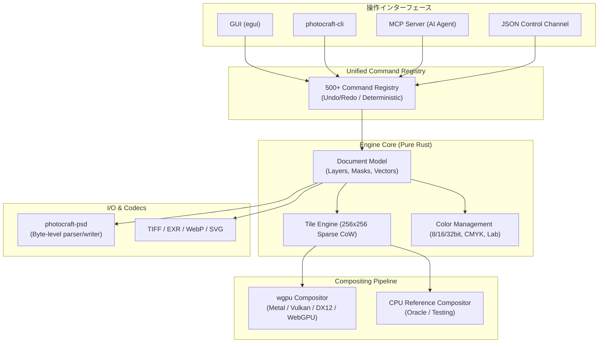

# photocraft: 概要と革新性

**PhotoCraft**（フォトクラフト）は、Adobe Photoshopをクリーンルーム設計（仕様の分析と振る舞い観察のみに基づき、プロプライエタリなコードを一切参照しない完全新規実装）により、**Pure Rust**で再構築したオープンソースの本格的画像編集アプリケーションです。

単なる「Photoshop風のUIを持つペイントソフト」にとどまらず、PSDファイルの高精度な可逆性（psd-toolsテストセット309件中307件で描画完全一致）、非破壊調整レイヤー、レイヤースタイル、高度なベクターパス、スマートオブジェクト、カラーマネジメント（ICC、CMYK/Lab、32bit HDR対応）を完全再現しています。さらに最大の革新点として、**「AIエージェント対応（MCP / CLI / JSON制御）」**を中核に設計されており、人間がGUIから操作するツールとしてだけでなく、LLMや自動化パイプラインが完全自律制御できるグラフィックエンジンとして機能します。

---

## 解決する主要な課題とアーキテクチャ

### 1. 解決する技術課題
- **ベンダーロックインと月額コストの高騰**: 商用SaaSやAdobe CCの高額ライセンス、クラウド強制同期、データ主権の問題を完全ローカル・オフライン動作で解決。
- **リソース過剰消費と非効率なUIスタック**: 近年のデスクトップアプリに多いElectron/Chromiumベースではなく、Pure Rustとegui、GPUネイティブコンポジタを採用し、省メモリ・超高速起動を実現。
- **自動化とヘッドレス運用の障壁**: 従来のDTP/グラフィックツールはGUI主導であり、サーバーサイドでのバッチ処理やAI連携が困難だったが、全機能をコマンド駆動化。

### 2. コアアーキテクチャ設計
PhotoCraftは24のクレートから構成される強固なレイヤードアーキテクチャを持ち、UI層とドキュメントエンジン層が完全に分離されています。

- **統一コマンドレジストリ**: 500以上の全操作がコマンドとして抽象化され、GUIクリックもMCP経由のプロンプト指示も全く同じ内部関数を叩きます。
- **Copy-on-Write (CoW) タイルエンジン**: キャンバスを256×256ピクセルのスパースタイルで管理。大解像度キャンバスでも変更部分のみを複製するため、ヒストリー（Undo）がメモリを圧迫しません。
- **デュアルコンポジタ**: CPUリファレンスコンポジタ（テスト用正解オラクル）と、`wgpu`を用いたマルチバックエンド（Vulkan, Metal, DirectX 12, WebGPU）GPUコンポジタを備え、画質の完全性とミリ秒単位の描画を両立。

---

## 競合ツール/商用SaaSとの徹底比較

| 評価軸 | PhotoCraft | Adobe Photoshop | GIMP | Photopea |
|---|---|---|---|---|
| **コア言語** | Pure Rust | C++ / Proprietary | C | JavaScript (ブラウザ) |
| **ランタイム** | ネイティブ / Wasm | ネイティブ | ネイティブ (GTK) | ブラウザ / WebAssembly |
| **ライセンス** | MIT / Apache-2.0 | 商用プロプライエタリ | GPLv3 | 商用（広告/サブスク） |
| **PSD互換性** | 極めて高い (99.3%) | 公式標準 | 部分的（エフェクト欠落有） | 高い |
| **ヘッドレス・CLI** | ネイティブ対応 (CLI/MCP) | ExtendScript (制約大) | Script-Fu / Python | 不可（ブラウザ依存） |
| **AIエージェント統合** | MCPサーバー内蔵 | Firefly (クラウドのみ) | なし | なし |
| **動作環境** | Win / Mac / Linux / Web | Win / Mac / iPad | Win / Mac / Linux | ブラウザ |

## 📖 続きと実務キットについて
本記事は Auto Tech Radar の無料解説の抜粋です。

- 📖 **無料**: アーキテクチャ・README から転記したインストール手順・ライセンスの確認先 → [Auto Tech Radar で読む](https://ssk0224.github.io/auto-tech-radar/radar/photocraft/)
- 🔒 **有料（note）**: 導入提案書テンプレート・工数見積表 → [note の有料記事・メンバーシップ](https://note.com/vast_ixora7005/membership)

