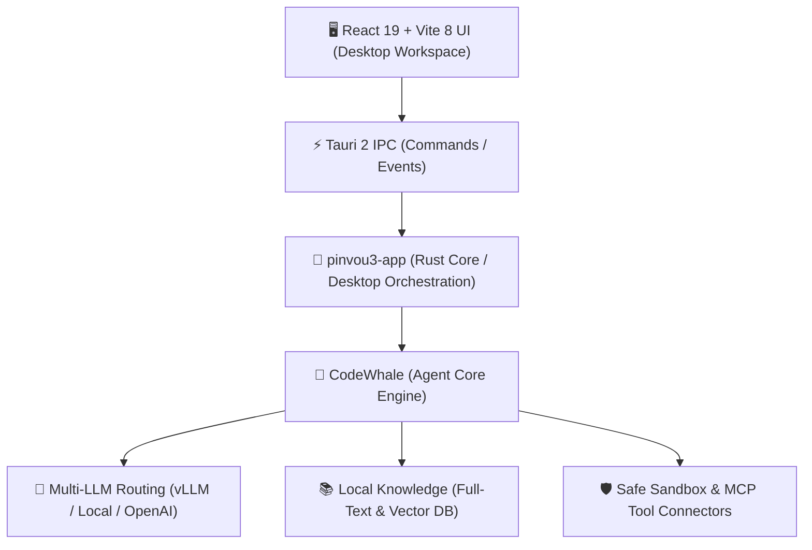

# pinvou-agent: 概要と革新性

**pinvou-agent**は、「対話して終わり」のチャットボットから脱却し、実務における**具体的成果物（Deliverables）の生成・編集・反復作業**を完結させるために設計されたオープンソースのデスクトップAIエージェント環境です。

デスクトップランタイムには最新の**Tauri 2**と**Rust**を採用し、フロントエンドに**React 19 / Vite 8**を組み合わせています。軽量・高速かつ強固なセキュリティ境界を維持しつつ、MCP（Model Context Protocol）、ローカルナレッジ（RAG）、ACP（Agent Communication Protocol）を統合した「3-in-1（Work / Design / Code）」ワークスペースを提供します。

### 革新的なコアバリュー
1. **チャットから成果物（Artifact）中心のアプローチへ**: 生成されたMarkdown、ポスター、図解、コードを専用の「Artifact Panel」で即座にプレビュー・直接編集可能。
2. **ACP（Agent Communication Protocol）によるマルチエージェント協調**: Codex、Claude Code、Kimiなどの独立コーディングエージェントをローカルプロジェクトに安全に接続・常駐。
3. **ローカルファーストなプライバシー設計**: vLLM等のローカル推論基盤と組み合わせることで、完全エアギャップ（オフライン）環境でのエンタープライズ実行が可能。

---

## 解決する主要な課題とアーキテクチャ

### 既存AIツールの課題
- **コンテキストの断片化**: ドキュメント作成、デザイン、コーディングでツールが分断され、コピペの往復が発生する。
- **実行権限と安全性のジレンマ**: 自律エージェントにシェル権限を渡す際、不透明な実行によるシステム破壊リスクが存在する。
- **データプライバシーの懸念**: 機密コードや社内ナレッジを外部SaaSへアップロードすることへのコンプライアンス制限。

### アーキテクチャ構成

- **UI層とエンジン層の完全分離**: デスクトップ制御を担う`pinvou3-app`と、モデル推論・ツール呼び出し・コンテキスト圧縮を司る`CodeWhale`エンジンが疎結合に設計されており、拡張性と保守性に優れています。
- **MCP & コネクタエコシステム**: Lark（飛書）、DingTalk、Obsidianなどの企業内ツールや、ローカル/リモートのMCPサーバーを統一管理ストアから導入可能です。

---

## 競合ツール/商用SaaSとの徹底比較

| 評価軸 | pinvou-agent | Cursor / Claude Code | 汎用AIチャット (ChatGPT等) |
| :--- | :--- | :--- | :--- |
| **主要領域** | Work / Design / Code（統合型） | ソフトウェアエンジニアリング特化 | テキスト対話（汎用） |
| **成果物管理** | Artifactパネル + 直接WYSIWYG編集 | ファイルツリー直接編集 | コードブロック・プレビューのみ |
| **推論基盤** | ローカルvLLM / 任意OpenAI互換 | 専用クラウド（一部ローカル設定可） | ベンダー固定クラウド |
| **拡張規格** | MCP / CLI / Skills / Workflows | 専用プラグイン / CLI | API / GPTs |
| **ランタイム負荷** | 極小（Rust + Tauri 2） | 中〜重（Electronベース） | ブラウザ依存 |
| **価格・ライセンス** | 無料・オープンソース（MIT） | 有料サブスクリプション | 有料サブスクリプション |

## 📖 続きと実務キットについて
本記事は Auto Tech Radar の無料解説の抜粋です。

- 📖 **無料**: アーキテクチャ・README から転記したインストール手順・ライセンスの確認先 → [Auto Tech Radar で読む](https://ssk0224.github.io/auto-tech-radar/radar/pinvou-agent/)
- 🔒 **有料（note）**: 導入提案書テンプレート（Markdown）と工数・見積表 → [note の有料記事・メンバーシップ](https://note.com/vast_ixora7005/membership)

