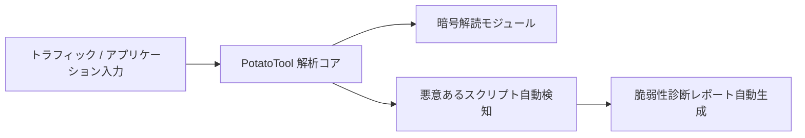

# PotatoTool: 概要と革新性

GitHubで1200以上のスターを獲得し、急速に注目を集めているオープンソースプロジェクト「PotatoTool」は、ネットワークセキュリティの専門家、レッドチーム・ブルーチームのメンバー、そしてセキュリティ愛好家のために設計された、多機能な総合セキュリティツールです。JavaFXをベースとしたデスクトップアプリケーションとして提供され、直感的で使いやすいインターフェースを通じて、多様なセキュリティタスクを効率的に実行できます。

## 解決する主要な課題とアーキテクチャ

現代のサイバーセキュリティ環境は複雑化の一途を辿り、セキュリティ担当者はWebshellの解析、トラフィックの監視、脆弱性スキャン、インシデントの追跡など、多岐にわたるタスクに直面しています。これらのタスクには通常、複数の専門ツールが必要となり、ツールの切り替えやデータ連携に手間がかかることが課題でした。

PotatoToolは、これらの課題を解決するために、以下の主要機能を一つのアプリケーションに統合しています。

-   **一括解読機能**: Webshellのインタラクティブトラフィック、ネットワークトラフィック、多様な暗号化方式（AES, DES, RSA, XOR, Base64など）、強固な難読化、コンポーネントやミドルウェアの暗号化データなどを一括で解読します。AI分析による悪意あるスクリプトの検出もサポート。
-   **情報収集**: Fofa, Hunter, Quake, ZoomEye, Shodanといった主要なサイバー測量プラットフォームと連携し、IP、ドメイン、企業情報などを効率的に収集・整理します。スマート拡散検索や敏感情報検索も可能です。
-   **脆弱性スキャン**: 内蔵されたPOCスクリプトと高い言語互換性により、多様な脆弱性スキャンをサポートします（現在テスト版）。
-   **逆コンパイル**: Javaの逆コンパイル機能を提供し、コード分析を支援します。
-   **AI分析**: 独自のAIモデルを搭載し、悪意あるスクリプトの分析やコマンドのインテリジェントな解答を提供します。ChatGPTの手動設定も可能です。
-   **その他**: IPフィルタリング、ブロックチェーン追跡、帰属地照会、ファイルメタ情報抽出、免殺（アンチウイルス回避）、カスタムメモリコード生成、コマンド生成・照会、KB昇格照会、プロセス分析、情報生成など、幅広い補助機能が利用できます。

アーキテクチャはJavaFXを基盤としたデスクトップアプリケーションであり、Java 8またはJava 11+（推奨）で動作します。これにより、Windows、Linux、Macといった主要なOSでクロスプラットフォームな利用が可能です。

## 競合ツール/商用SaaSとの徹底比較

| 特徴/ツール | PotatoTool (OSS) | 単機能OSSツール | 商用SaaSセキュリティプラットフォーム |
| :---------- | :--------------- | :-------------- | :--------------------------------- |
| **機能統合** | **◎ (非常に高い)** | △ (低い) | 〇 (高い) |
| **コスト** | **◎ (無料)** | ◎ (無料) | ✕ (高額なライセンス費用) |
| **カスタマイズ性** | **◎ (ソースコードから可能)** | 〇 (一部可能) | △ (限定的) |
| **AI連携** | **〇 (内蔵AI, ChatGPT連携)** | ✕ (ほとんどなし) | 〇 (高度なAI機能) |
| **データ主権** | **◎ (ローカル実行)** | ◎ (ローカル実行) | ✕ (クラウドにデータ送信) |
| **利用シーン** | レッド/ブルーチーム、セキュリティ研究、インシデントレスポンス | 特定タスクのみ | 企業全体のセキュリティ管理、SOC |
| **学習コスト** | 〇 (多機能ゆえの初期学習) | 〇 (単機能で低い) | 〇 (機能が多岐にわたり高い) |

PotatoToolの最大の強みは、その**多機能性とオープンソースであること**にあります。商用SaaSが高額なライセンス費用を要求するのに対し、PotatoToolは無料で利用でき、ソースコードが公開されているため、特定のニーズに合わせてカスタマイズや機能拡張が可能です。これにより、企業はコストを抑えつつ、自社のセキュリティ要件に合致したツールを構築できます。

また、単機能のOSSツールと比較しても、PotatoToolは解読、情報収集、スキャン、AI分析といった複数の主要機能を一貫したUIで提供するため、セキュリティ業務のワークフローを劇的に効率化します。

## 📖 続きと実務キットについて
本記事は Auto Tech Radar の無料解説の抜粋です。

- 📖 **無料**: アーキテクチャ・README から転記したインストール手順・ライセンスの確認先 → [Auto Tech Radar で読む](https://ssk0224.github.io/auto-tech-radar/radar/potatotool/)
- 🔒 **有料（note）**: 導入提案書テンプレート・工数見積表 → [note の有料記事・メンバーシップ](https://note.com/vast_ixora7005/membership)

