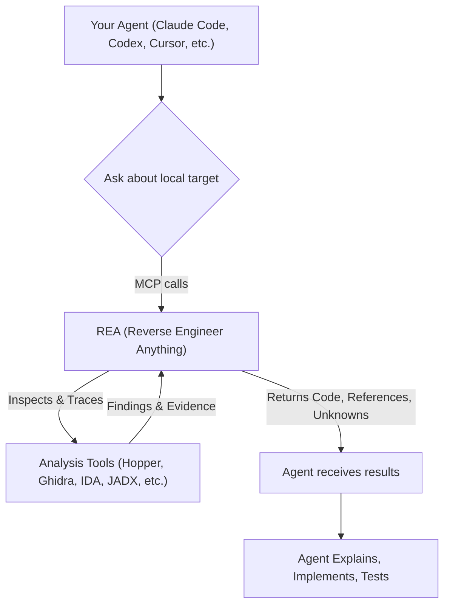

# rea: 概要と革新性
`rea` (Reverse Engineer Anything) は、エージェントを活用してアプリケーションの挙動からネイティブバイナリまで、あらゆるものをリバースエンジニアリングするためのオープンソースプロジェクトです。単一のMCP（Multi-tool Coordination Protocol）を通じて、バイナリ、アプリケーション、ランタイム挙動を横断的に解析できる点が特徴です。

## 🎯 成熟度の目安（AI による見立て）
`rea` はGitHubで35万を超えるスターを獲得しており、非常に高いコミュニティの関心と活発な開発が伺えます。多言語対応のREADME、詳細なドキュメント、FAQ、具体的なショーケースが提供されており、プロジェクトとしての成熟度は高いと見られます。特に、AIエージェントとの連携を前提とした設計は、今後のリバースエンジニアリングワークフローの標準となる可能性を秘めています。

このプロジェクトは、以下のような用途で検証候補になります。
- AIエージェントを活用したアプリケーション挙動解析の自動化
- ソースコードがない状態での機能理解やセキュリティ分析
- 複数のリバースエンジニアリングツール（Hopper, Ghidra, IDAなど）の統合的な利用
- さまざまなターゲット（JavaScript/Electron、.NET、Android、ネイティブバイナリなど）に対する統一的な解析インターフェースの構築

## 解決する主要な課題とアーキテクチャ
`rea` は、アプリケーションの特定の機能がどのように動作するかを、ソースコードなしで理解し、その証拠を提示し、自分のプロジェクト向けに再構築するという課題を解決します。従来、手動で行われていた複雑なリバースエンジニアリングプロセスを、AIエージェントと連携させることで効率化します。

### アーキテクチャ概要
`rea` の中核は、AIエージェントと多様な分析ツールをMCP（Multi-tool Coordination Protocol）を介して連携させる点にあります。エージェントはREAに解析要求を送り、REAはそれに応じて適切な分析ツール（Hopper、Ghidra、IDA、JADXなど）を起動し、ターゲットを検査します。解析結果は、コード、参照、不明点といった形でエージェントに返され、エージェントはこれらを利用して挙動の説明、実装、テストを行います。CLIコマンドも同様のワークフローで動作します。

このアーキテクチャにより、ユーザーは単一のエージェントインターフェースから、バイナリ、アプリケーション、ランタイム挙動といった多岐にわたるターゲットに対して、一貫したリバースエンジニアリングワークフローを適用できます。分析はローカルで実行され、結果には各結論の根拠と限界が含まれます。

## 競合ツール/商用SaaSとの徹底比較
`rea` は、既存のリバースエンジニアリングツールや商用SaaSとは異なるアプローチを提供します。

- **エージェント中心のアプローチ**: 従来のツールが手動操作やスクリプト記述に依存するのに対し、`rea` はAIエージェント（Claude Code, Codex, Cursor, Gemini CLI, Grok Buildなど）との連携を前提としています。これにより、自然言語での指示による解析や、解析結果に基づいた自動的な実装提案が可能になります。
- **MCPによるツール統合**: `rea` は、Hopper、Ghidra、IDAといったネイティブバイナリ解析ツールから、JADXによるAndroid APK解析、Chromeベースのブラウザ解析、さらには.NETアセンブリやJavaScript/Electronアプリケーションの静的解析まで、多種多様なツールを単一のプロトコルで統合します。これにより、ユーザーは個々のツールの使い方を深く知らなくても、エージェントを通じてそれらの機能を活用できます。
- **広範な分析ターゲット**: デスクトップアプリケーション、ネイティブバイナリ、Goバイナリ、GPUコードオブジェクト、モデルアーティファクト、IL2CPPメタデータ、Godot PCK、Rustバイナリ、WASM、EVMバイトコード、SQLiteデータベース、Linuxクラッシュ、JavaScript/Electron、Webサイト、ネットワークキャプチャ、.NETアセンブリ、Android APK/デバイス、JEBプロジェクト、Flutterアプリ、ファームウェア、パケット、プロセス挙動、PyInstaller実行ファイルなど、非常に幅広いターゲットに対応しています。
- **ローカルでの分析実行と証拠の提示**: 分析はユーザーのローカル環境で実行されるため、機密性の高いコードやデータも安全に扱えます。また、解析結果には必ずその根拠となる証拠が含まれるため、結論の信頼性が高まります。

`rea` は、個々のリバースエンジニアリングツールの代替というよりは、それらを統合し、AIエージェントの能力を最大限に引き出すための「オーケストレーションレイヤー」として機能します。これにより、リバースエンジニアリングの専門家だけでなく、開発者やセキュリティアナリストも、より効率的に高度な解析を行える可能性を秘めています。

## 商用利用可否 & ライセンス考察
`rea` のライセンスは **MIT License** です。
ライセンスの確認先: [https://github.com/morluto/rea/blob/main/LICENSE](https://github.com/morluto/rea/blob/main/LICENSE)

MITライセンスは非常に寛容なオープンソースライセンスであり、以下の条件を満たせば、商用利用、改変、再配布が可能です。
- ソフトウェアのすべてのコピーまたは実質的な部分に、著作権表示と本許諾表示を含めること。

ただし、`rea` はIDA Pro / Hex-Rays decompilers、Hopper、JEBなどの商用ツールと連携して動作する場合があります。これらの**商用ツールは、それぞれの適用されるライセンスに基づいて合法的に取得し、使用する権限がある必要があります**。`rea` はこれらのツールのライセンス、キー、またはアクティベーションの権利を付与するものではありません。試用版やデモ版もベンダーの規約に従う必要があります。

したがって、`rea` 自体は商用利用が可能ですが、連携する商用ツールを使用する場合は、そのツールのライセンスを別途確認し、遵守することが必須となります。

---

## 📖 続きと実務キットについて
本記事は Auto Tech Radar の無料解説の抜粋です。

- 📖 **無料**: アーキテクチャ・競合比較・ライセンス考察の全文 → [Auto Tech Radar で読む](https://ssk0224.github.io/auto-tech-radar/radar/rea/)
- 🔒 **有料（note）**: 導入提案書テンプレート・工数見積表・公式READMEに基づく導入手順 → [note の有料記事・メンバーシップ](https://note.com/vast_ixora7005/membership)

