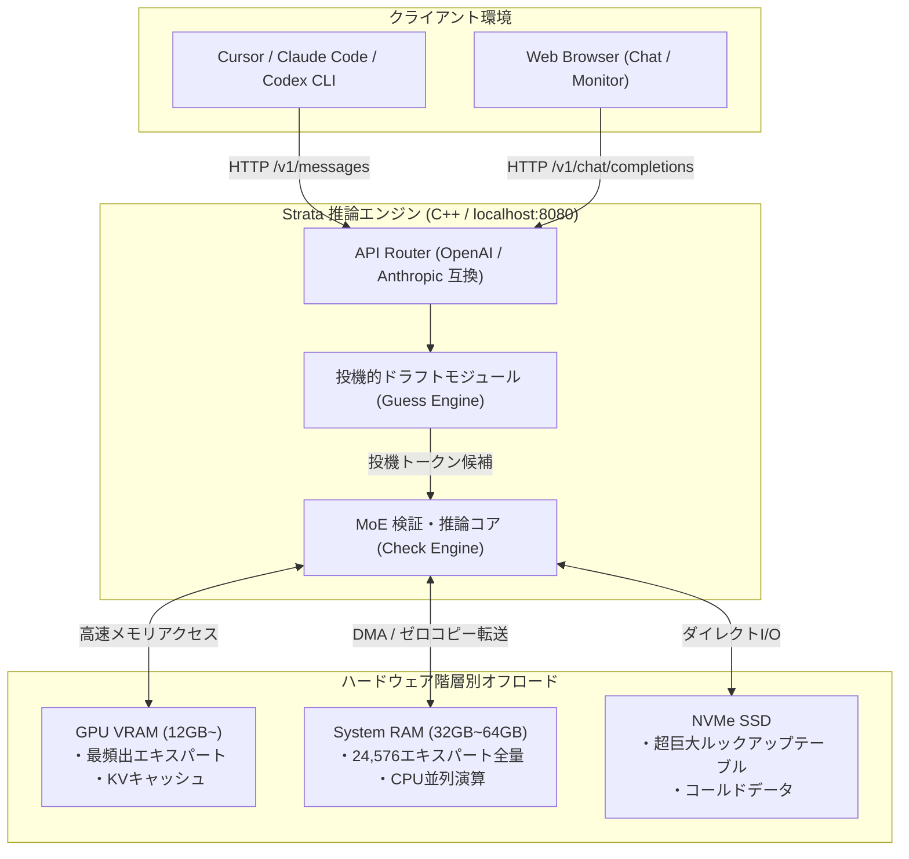

# Strata: 概要と革新性

**Strata** は、1250億パラメータ規模の次世代オープンウェイトモデル「Qwen3.8-Flash-Next」を、一般的なコンシューマー向けゲーミングPC（VRAM 12GB〜）上で高速推論させるC++製オープンソース推論エンジンです。

従来のローカルLLM運用では、100Bを超える超巨大モデルを実行するために数十万円から数百万円規模のエンタープライズ向けGPU（NVIDIA A100/H100など）やマルチGPU環境が必須でした。Strataは独自の階層型メモリ管理アーキテクチャと投機的デコーディング（Speculative Decoding）を融合させることで、RTX 4070/5070やRadeon RX 7800 XTといった市販の12GB GPU環境で、毎秒50〜90トークン以上の実用的な生成速度を実現しています。

さらに、`localhost:8080`上でOpenAI API互換（`/v1/chat/completions`、`/v1/responses`）およびAnthropic API互換（`/v1/messages`）のエンドポイントを透過的に提供するため、Claude Code、Cursor、Codex CLIといった既存の開発エコシステムへ一切のコード改変なしで接続可能です。

---

## 解決する主要な課題とアーキテクチャ

超巨大モデル（100B+クラス）の推論における最大のボトルネックは「GPU VRAM容量の不足」と「メモリ帯域幅」です。StrataはMoE（Mixture of Experts）構造のスパース性を極限まで活用し、ハードウェア資源（VRAM・メインメモリ・NVMe SSD）を階層的に最適配置する設計を採用しています。

### 1. 24,576エキスパートの階層的オフロード（Pantry & Counterモデル）
モデル全体が内包する24,576のエキスパートのうち、各トークン生成で活性化するのはごく一部（約10エキスパート）です。Strataは頻出する「コア・エキスパート」のみを高速なGPU VRAM（Counter）に常駐させ、全エキスパート実体をシステムRAM（Pantry）に、巨大ルックアップテーブルをNVMe SSDに分散配置します。

### 2. 投機的推論（Speculative Guess & Check）
軽量なドラフトモデルが数トークン先を投機的に予測（Guess）し、巨大な本体モデルが一括検証（Check）を行うことで、推論速度を従来の1.6〜1.8倍に引き上げています。

---

## 競合ツール/商用SaaSとの徹底比較

| 評価項目 | OpenAI / Anthropic API (商用SaaS) | 一般的なローカルLLM (Ollama / vLLM) | Strata (Qwen3.8-Flash-Next) |
|---|---|---|---|
| **月額・従量課金コスト** | 高額（トークン従量課金、月数万〜数十万円） | インフラコストのみ | **完全無料（電気代のみ）** |
| **機密データ漏洩リスク** | クラウド送信による規約・漏洩懸念 | なし（オンプレミス） | **ゼロ（全処理がローカル完結）** |
| **100B+ MoE実行要件** | 不要（クラウド完結） | VRAM 80GB〜（A100クラス必須） | **コンシューマーGPU（12GB VRAM〜）で動作** |
| **生成速度 (12GB GPU時)** | 40〜80 tokens/s (回線依存) | 動作不可または < 5 tokens/s | **53〜94 tokens/s (爆速推論)** |
| **API互換性** | 独自規格（標準） | OpenAI互換のみが主流 | **OpenAI ＋ Anthropic 両互換** |
| **セットアップ工数** | APIキー発行のみ | Docker/CUDAビルド等の知識が必要 | **ワンクリック実行（.bat / .sh）** |

## 📖 続きと実務キットについて
本記事は Auto Tech Radar の無料解説の抜粋です。

- 📖 **無料**: アーキテクチャ・README から転記したインストール手順・ライセンスの確認先 → [Auto Tech Radar で読む](https://ssk0224.github.io/auto-tech-radar/radar/strata/)
- 🔒 **有料（note）**: 導入提案書テンプレート（Markdown）と工数・見積表 → [note の有料記事・メンバーシップ](https://note.com/vast_ixora7005/membership)

