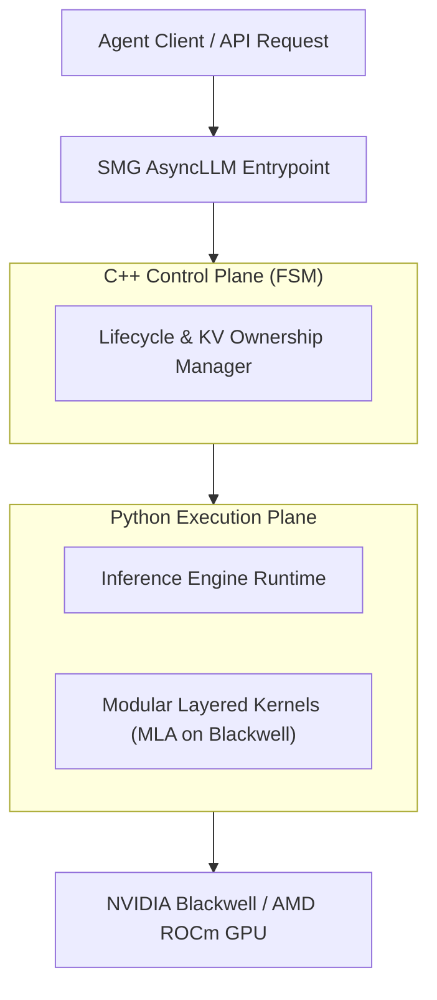

# tokenspeed: 概要と革新性

## 概要
`tokenspeed`は、GitHubで2200以上のスターを獲得している、Python製のオープンソースLLM推論エンジンです。その名の通り「光速」のLLM推論を実現することを目指し、特に**エージェントワークロード**に最適化されています。TensorRT-LLMレベルのパフォーマンスとvLLMレベルの使いやすさを両立させることを目標に掲げ、プロダクション環境でのエージェントワークロードにおいて最も高性能な推論エンジンとなることを目指しています。

README によると、PyTorch Foundation は TokenSpeed を PyTorch Ecosystem Landscape に迎えた際に、そのアーキテクチャ上の特徴（コントロールプレーンと実行プレーンの分離など）を紹介しています（[PyTorch のブログ](https://pytorch.org/blog/pytorch-ecosystem-landscape-q3-update/)）。また README には、非営利団体の LightSeek Foundation が支援し、NVIDIA や AMD などのベンダーからハードウェア・エンジニアリング面の支援を受けていると記載されています。

## 解決する主要な課題とアーキテクチャ

現代のLLMアプリケーション、特に複雑なタスクを自律的に実行するエージェントAIにおいては、推論速度と安定性がビジネスの成否を大きく左右します。従来のLLM推論エンジンは、汎用性や開発の容易さを追求する一方で、エージェントワークロード特有の動的なリクエストパターンやKVキャッシュ管理の課題に対して、最適なパフォーマンスを提供しきれていないケースがありました。

TokenSpeedは、この課題に対し根本的に異なるアーキテクチャアプローチで挑みます。

### 革新的なアーキテクチャの核心

1.  **コントロールプレーンと実行プレーンの分離:**
    *   **コントロールプレーン (C++):** リクエストのライフサイクル、KVキャッシュの所有権、オーバーラップタイミングなどを有限状態機械（FSM）としてC++で実装。コンパイル時に型システムによって安全なKVリソースの再利用を強制し、実行時のエラーリスクを最小限に抑え、高い信頼性とパフォーマンスを実現します。
    *   **実行プレーン (Python):** 実際の推論実行ロジックはPythonで実装されており、研究者やエンジニアが迅速なイテレーションと低い認知負荷で開発を進められる柔軟性を提供します。
    この分離により、コアスケジューリングシステムの強力な正確性保証と、高レベルな実行レイヤーの開発速度を両立させています。

2.  **モジュール化されたカーネルシステム:**
    *   プラグイン可能なレイヤードカーネルシステムを採用し、ポータブルな公開APIと集中型レジストリを通じて、コアエンジンからカーネルを分離しています。
    *   README によると、カーネルのレジストリには Blackwell 世代 GPU 向けのエージェントワークロード用 **MLA (Multi-head Latent Attention)** 実装が含まれます（README ではこの実装を "one of the fastest" と説明しています）。カーネルは公開 API とプラグインの仕組みで分離されており、異なるアクセラレータへの拡張を想定しています。

3.  **SMG統合AsyncLLMによる低オーバーヘッドなリクエスト処理:**
    *   エントリーポイントとしてSMG (Shared Memory Group) 統合のAsyncLLMを採用し、CPU側のリクエストハンドリングにおけるオーバーヘッドを最小限に抑え、全体的なスループット向上に貢献しています。

## 競合ツール/商用SaaSとの徹底比較

LLM推論エンジンには、vLLM、TensorRT-LLM、OpenVINOなど、様々な選択肢があります。以下は README などの公開情報をもとにした比較で、性能を当サイトで計測したものではありません。

| 特徴/エンジン | TokenSpeed | vLLM | TensorRT-LLM |
| :------------ | :--------- | :--- | :----------- |
| **主要ターゲット** | エージェントワークロード | 汎用LLM推論 | NVIDIA GPU向け最適化 |
| **パフォーマンス** | README では「TensorRT-LLM レベルの性能」とし、本番のエージェントワークロードで最も高性能なエンジンになることを目標に掲げる | 高い | 非常に高い (NVIDIA最適化) |
| **使いやすさ** | vLLMレベル (Python実行プレーン) | 非常に高い | 中程度 (NVIDIAエコシステム依存) |
| **安定性/信頼性** | C++コントロールプレーンによるコンパイル時保証 | 実行時管理 | 高い |
| **アーキテクチャ** | コントロール/実行プレーン分離、モジュール型カーネル | 統合型、Python中心 | NVIDIA固有最適化 |
| **ベンダー中立性** | 高い (LightSeek Foundationによる非営利支援) | 中程度 | 低い (NVIDIA依存) |
| **ハードウェアサポート** | NVIDIA, AMDなど広範なベンダーからの支援 | GPU (NVIDIA, AMD) | NVIDIA GPU |
| **ライセンス** | MIT License | Apache 2.0 | Apache 2.0 |

### TokenSpeedの特徴（README の記載に基づく）

> TokenSpeed is a speed-of-light LLM inference engine designed for **agentic workloads**, with TensorRT-LLM-level performance and vLLM-level usability. The goal is to be the most performant inference engine for production agentic workloads.
> — [TokenSpeed README](https://github.com/lightseekorg/tokenspeed#readme)

*   **エージェントワークロード向けの設計:** README はエージェントワークロード向けの推論エンジンと説明し、Kimi K2.5（B200）のエージェントワークロードでの TensorRT-LLM とのパレート曲線の比較図を掲載しています。図の条件（モデル・GPU・ワークロード）以外での性能は、当サイトでは検証していません。
*   **性能と開発速度の両立:** C++ のコントロールプレーンでリソース管理を行い、Python の実行プレーンで開発の柔軟性を確保する構成です。
*   **ベンダー中立性と信頼性:** 非営利団体LightSeek Foundationの支援と、NVIDIA、AMDといった複数ベンダーからのサポートは、特定のベンダーにロックインされるリスクを低減し、長期的なプロジェクトにおける信頼性を高めます。
*   **モジュール性と拡張性:** カーネルのモジュール化により、将来的な新しいハードウェアや最適化技術への対応が容易であり、システムの寿命と適応性を向上させます。

## 📖 続きと実務キットについて
本記事は Auto Tech Radar の無料解説の抜粋です。

- 📖 **無料**: アーキテクチャ・競合比較・ライセンス考察の全文 → [Auto Tech Radar で読む](https://ssk0224.github.io/auto-tech-radar/radar/tokenspeed/)
- 🔒 **有料（note）**: 導入提案書テンプレート・工数見積表・公式READMEに基づく導入手順 → [note の有料記事・メンバーシップ](https://note.com/vast_ixora7005/membership)

