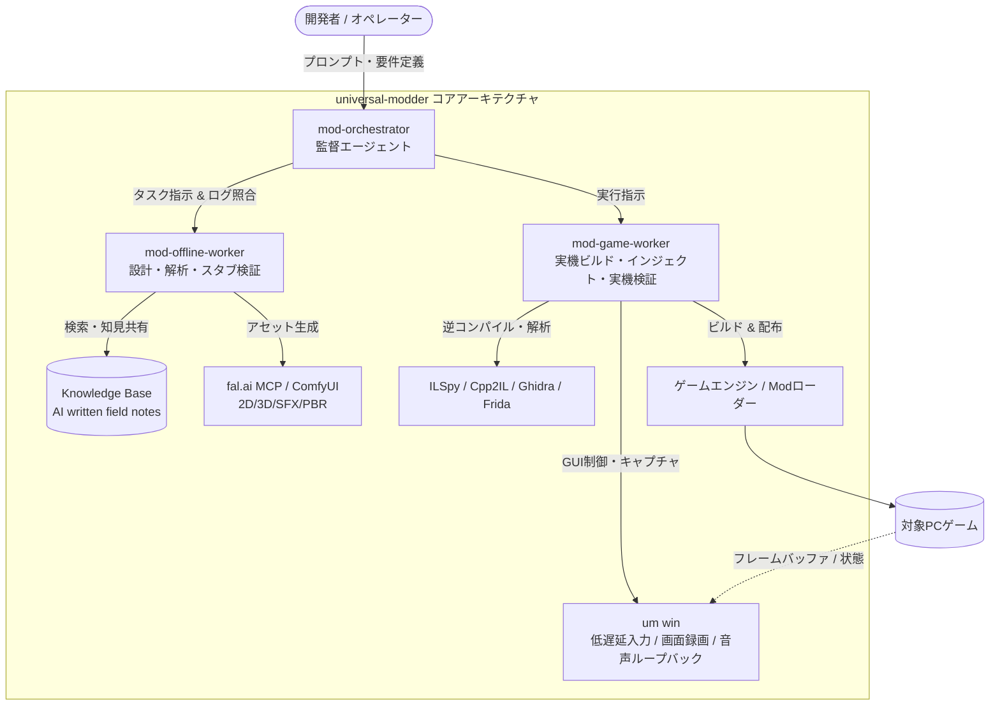

# universal-modder: 概要と革新性

`universal-modder`（GitHubスター数7,900超）は、Claude Code、Codex、Cursor、Gemini CLIなどのLLMコーディングエージェントに対して、**PCゲームのリバースエンジニアリング、コード生成、生成AIアセット作成、ゲーム内実機テスト、紹介動画作成**までの一連のMod開発パイプラインを統合実行させるオープンソースの自律型エージェント環境です。

従来、ゲームMod制作はアセンブリ解析、バイナリパッチ、ゲームエンジン固有の非公開データ構造調査、ピクセルアートや3Dモデル制作など、高度かつ多分野にわたる職人芸を要求されてきました。`universal-modder`は、Agent Skills仕様に準拠したツールチェーン、専用CLI（`um`）、fal.aiと連携するMCP（Model Context Protocol）サーバー、そして過去の解析知見を蓄積する自律型ナレッジベース（KB）を組み合わせることで、**「ゲームのパスとModの要件を自然言語で渡すだけで、AIが実バイナリを調査し、稼働するModを実装・検証する」**という異次元の開発体験を実現しています。

---

## 解決する主要な課題とアーキテクチャ

ゲームMod開発やレガシーバイナリのカスタマイズにおいて、エンジニアは以下の重大なボトルネックに直面していました。

1. **極度の文脈断片化**: ゲームエンジンの特定（Unity/Unreal/.NET/C++）、ローダー選定（BepInEx, Harmony, Fabric等）、逆コンパイルコードの解読という前工程の工数が膨大。
2. **クリエイティブアセットの調達コスト**: スプライト、3Dモデル、BGM/SFXの制作に別個のツールとスキルが必要。
3. **インゲーム検証のフィードバックループ欠如**: AIがコードを生成しても、実ゲーム内でクラッシュせず意図通り動くかを自律的にテストできない。

`universal-modder`は、これらを**3層マルチエージェント構造**と**OSレベルの低レイヤー自動化パイプライン**によって解決します。

### アーキテクチャの3大中核
1. **監督・分業型サブエージェント（Multi-Agent Roles）**
   - `mod-orchestrator`: 全体計画立案、各ワーカーの報告内容と実ログの監査、進行管理。
   - `mod-offline-worker`: 実機を汚さず、逆コンパイル結果の解析、SDK調査、パッチ設計、アセット生成を実施。
   - `mod-game-worker`: ゲームプロセスへのMod投入、実機プロセスメモリのプローブ計測、クラッシュログ解析を専任。
2. **OS/ゲーム自動化エンジン（`um win` CLI）**
   - DirectInput/RawInputをエミュレートし、バックグラウンドでも対象ゲームウィンドウのみに安全にキーストローク・マウス操作を送信。
   - プロセス単位のDirectX/Vulkanフレームキャプチャおよびオーディオループバック録音を行い、AIが目視・聴覚で挙動を検証。
3. **AI間ナレッジ蓄積ループ（Self-Updating Knowledge Base）**
   - 解決困難なエンジン固有の落とし穴（例: 特定バージョンのアンチチート挙動、メモリレイアウト）をMarkdown形式のフィールドノートとして自動生成。次世代のセッションへフィードバックされるエコシステムを形成。

---

## 競合ツール/商用SaaSとの徹底比較

| 評価軸 | universal-modder (OSS) | 従来のMod制作ツール群 (Vortex/ModOrganizer) | 一般的なAIコーディング (Cursor/Copilot単体) |
|---|---|---|---|
| **対象レイヤー** | 調査・バイナリ解析〜コード〜アセット〜実機QA | パッケージ配置・競合管理のみ | コード生成・補完のみ |
| **リバースエンジニアリング連携** | ILSpy / Ghidra / Cpp2IL をMCP/CLI経由で自律駆動 | なし（人間が外部ツールで実施） | なし（バイナリ入力不可） |
| **マルチモーダルアセット生成** | fal.ai / ComfyUI連携で2Dスプライト・3D・音声を一括生成 | なし | テキストのみ（外部SaaS手動併用） |
| **実機フィードバック検証** | OSレベルのプロセス制御・画面キャプチャによる自律QA | なし | なし |
| **知見の永続化** | AIがAIのために書くKB（Pull Request自動起票） | 人間向けフォーラム/Wiki | 会話コンテキスト終了で揮発 |
| **導入コスト** | 完全無料（MITライセンス / API実費のみ） | 無料 | 月額サブスクリプション |

## 📖 続きと実務キットについて
本記事は Auto Tech Radar の無料解説の抜粋です。

- 📖 **無料**: アーキテクチャ・README から転記したインストール手順・ライセンスの確認先 → [Auto Tech Radar で読む](https://ssk0224.github.io/auto-tech-radar/radar/universal-modder/)
- 🔒 **有料（note）**: 導入提案書テンプレート・工数見積表 → [note の有料記事・メンバーシップ](https://note.com/vast_ixora7005/membership)

