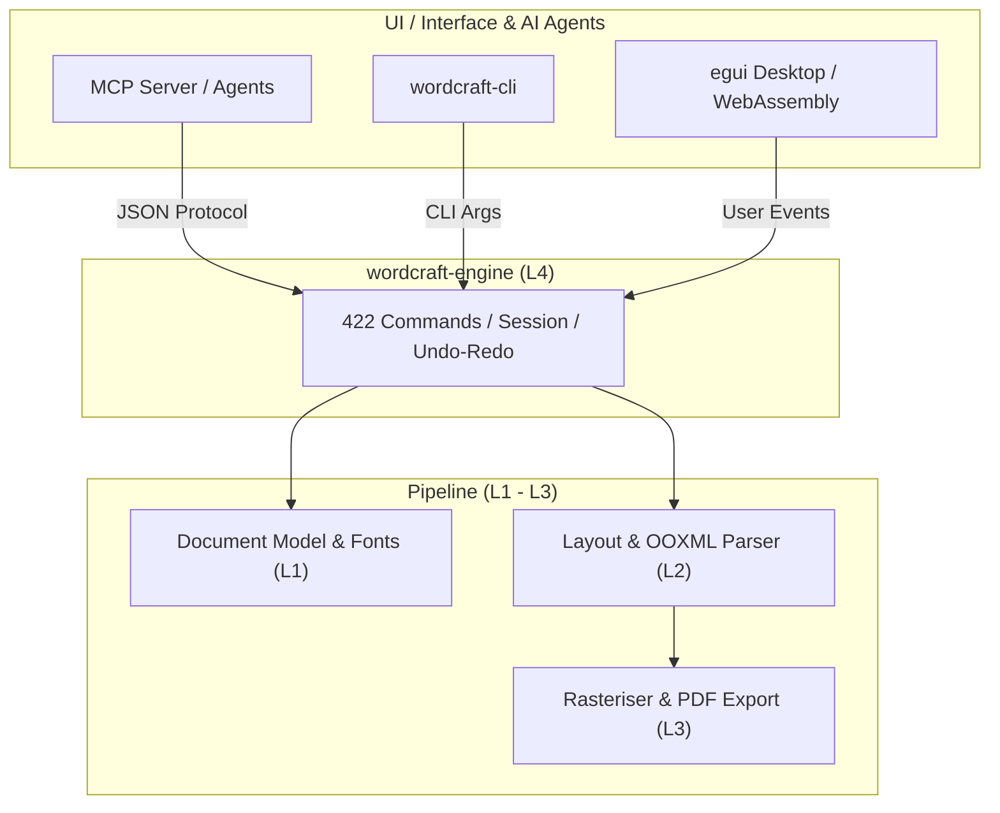

# wordcraft: 概要と革新性

`storytold/wordcraft` は、Microsoft Word のワークフロー、UI（リボンUI）、そしてファイル仕様（.docx / OOXML）を、依存関係なしに **Pure Rust** でゼロからクリーンルーム再実装したオープンソースのデスクトップ・Web向けワードプロセッサです。

従来のオープンソースオフィス（LibreOffice等）が抱えていた「起動の重さ」「レガシーC++コードベース」「ヘッドレス運用の難しさ」「Electron製ツールのメモリ浪費」というペインを、Rustのメモリ安全性とGPUネイティブ描画（egui）、そしてレイアウトキャッシュ技術によって根本から解決しています。

### 主な革新性
1. **圧倒的なパフォーマンス**: 188ページに及ぶ大規模ドキュメントの再レイアウト処理を約 **1.4ms** で完了。ElectronやWeb技術のラッパーではなくGPU直接描画。
2. **AIエージェント・ファースト設計**: 全422種類のUIアクションがユニークなコマンドIDとして公開されており、**MCP（Model Context Protocol）** サーバーまたはCLIを通じて、Claude等のAIモデルがヘッドレスで人間と同等以上の精度で帳票・ドキュメント作成・校正を実行可能。
3. **オフライン・完全プライベート**: 校閲・文法チェック・PDF/DOCX変換が外部API通信なしにローカルで完結。

---

## 解決する主要な課題とアーキテクチャ

オフィスドキュメントの自動化において、従来の headless LibreOffice や Python-docx は「レイアウトの崩れをリアルタイムに検知できない」「フォントレンダリングや改ページ判定が本家Wordとズレる」という決定的な弱点を抱えていました。

WordCraftは、下図のように厳格なレイヤード・アーキテクチャを採用しており、レンダリングエンジン（`vello_cpu`）とレイアウトエンジン（`wordcraft-layout`）を分離しつつ、AIエージェントプロトコル（MCP）を最上位コントロール層に標準統合しています。

### アーキテクチャの特徴
- **L0〜L3（コアエンジン）**: 幾何計算（`wordcraft-geom`）、フォントシェーピング・ドキュメント構造（`wordcraft-doc`）、禁則処理・ページネーション・数式・表計算（`wordcraft-layout`）を完全分離。
- **L4（エンジン層）**: 422個のコマンドカタログで全操作を正規化。UIのクリックイベントも、エージェントからのMCPリクエストも同一のエントリポイントを通過。
- **L5〜L6（配信・フロント）**: ネイティブeguiとWasm対応。ヘッドレスサーバーでもGUIクライアントでも同一のバイナリコアで稼働。

---

## 競合ツール/商用SaaSとの徹底比較

| 項目 | Microsoft Word / 365 | LibreOffice / OpenOffice | Google Docs API | **WordCraft (本リポジトリ)** |
|---|---|---|---|---|
| **ライセンス** | プロプライエタリ（月額課金） | MPL 2.0 / LGPL | プロプライエタリ（Cloud依存） | **MIT / Apache 2.0 (デュアル)** |
| **ランタイム** | C++ / 大型ランタイム | レガシーC++ / Java依存 | Web / REST API | **Pure Rust (シングルバイナリ)** |
| **起動・動作速度** | 普通〜やや重い | 重い（起動に数秒） | ネットワーク依存 | **極小（ミリ秒単位起動・1.4ms再描画）** |
| **AIエージェント連携** | Copilot (要追加料金/閉域) | プラグイン拡張が困難 | スクリプトベース | **MCP / CLI / JSON制御が標準装備** |
| **メモリ消費量** | 500MB〜1.5GB | 300MB〜800MB | ブラウザ依存（大） | **数十MB〜（GPUネイティブ）** |
| **データプライバシー** | クラウド同期が基本 | ローカル完結 | クラウド送信必須 | **100% オフライン完全動作** |

---

## 📖 続きと実務キットについて
本記事は Auto Tech Radar の無料解説の抜粋です。

- 📖 **無料**: アーキテクチャ・競合比較・ライセンス考察の全文 → [Auto Tech Radar で読む](https://ssk0224.github.io/auto-tech-radar/radar/wordcraft/)
- 🔒 **有料（note）**: 導入提案書テンプレート・工数見積表・公式READMEに基づく導入手順 → [note の有料記事・メンバーシップ](https://note.com/vast_ixora7005/membership)
