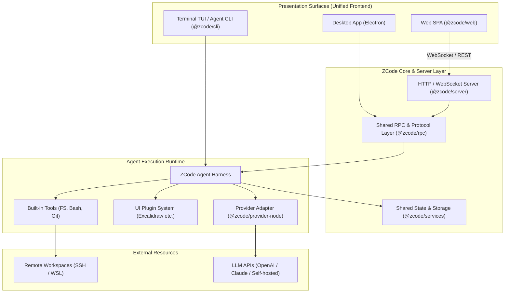

# ZCode: 概要と革新性

近年、CursorやGitHub Copilot Workspace、Devinに代表される自律型コーディングエージェントがソフトウェア開発の現場を塗り替えています。しかし、商用クラウドサービスへのソースコード転送に対するセキュリティ懸念や、月額シート課金による運用コスト肥大化が多くのエンタープライズにとってのボトルネックとなっていました。

**ZCode** は、Z.aiがオープンソース（Apache License 2.0）として公開している統合コーディングエージェント・ハーネス（Harness）です。GitHubスター数は既に7,800を超え、世界中のAI開発者・プラットフォームエンジニアから強烈な支持を集めています。

ZCodeの最大の特徴は、**「デスクトップ（Electron）」「Webブラウザ（SPA/Remote Server）」「ターミナル（TUI/CLI）」という3つの実行サーフェスを、単一のTypeScriptモノレポから同一のコアランタイムとして提供している点**です。これにより、開発者はローカルマシンの閉域環境、社内の踏み台サーバー、クラウドコンテナなど、インフラ制約に合わせた柔軟なデプロイと拡張が可能になります。

---

## 解決する主要な課題とアーキテクチャ

ZCodeは、従来のAI開発ツールが抱えていた以下の課題を根本から解決します。

1. **インフラ・環境の断絶**: ローカル専用ツール（Cursor等）とリモート開発環境（SSH/WSL/コンテナ）の間の機能格差を解消。
2. **ベンダーロックインの排除**: 特定のモデルプロバイダに依存せず、独自のLLMエンドポイントやローカルモデルを差し替え可能なProviderレイヤー。
3. **拡張性の欠如**: UI Pluginアーキテクチャにより、Excalidraw等のホワイトボードや社内独自のデザインシステムをシームレスにエージェントワークスペースへ統合可能。

### システムアーキテクチャとデータフロー

以下は、ZCodeの主要コンポーネントとリクエスト実行フローを示すアーキテクチャ図です。

ZCodeはTypeScriptで統一されたモノレポ構成（`pnpm workspace`）を採用。コアとなる状態管理（ZustandベースのUI共有パッケージ）、RPC通信レイヤー、Provider抽象化レイヤーが疎結合に設計されており、ヘッドレスなCI/CDパイプラインからGUI重視のローカル開発まで、同一のAgent Harnessを使い回すことができます。

---

## 競合ツール/商用SaaSとの徹底比較

| 評価軸 | ZCode (OSS) | Cursor / GitHub Copilot | Devin / Commercial Agents |
| :--- | :--- | :--- | :--- |
| **ライセンス** | **Apache-2.0 (完全オープンソース)** | プロプライエタリ | プロプライエタリ |
| **データプライバシー** | **完全オンプレミス / 閉域網対応** | ベンダー規定に依存 (送信必須) | ベンダー規定に依存 (クラウド実行) |
| **インターフェース** | **Desktop / Web / TUI / Headless** | Desktop (VS Code Fork) のみ | Webコンソールのみ |
| **リモート開発連携** | **SSH / WSL / 自社サーバー直接マウント** | ポート転送経由 | サンドボックスコンテナ限定 |
| **プラグイン拡張性** | **ReactベースのUI Plugin対応** | VS Code拡張に依存 | 不可 (クローズド) |
| **月額コスト** | **インフラ・LLMトークン実費のみ** | $20〜/月/ユーザー | $500〜/月（高額サブスク） |

## 📖 続きと実務キットについて
本記事は Auto Tech Radar の無料解説の抜粋です。

- 📖 **無料**: アーキテクチャ・競合比較・ライセンス考察の全文 → [Auto Tech Radar で読む](https://ssk0224.github.io/auto-tech-radar/radar/zcode/)
- 🔒 **有料（note）**: 導入提案書テンプレート・工数見積表・公式READMEに基づく導入手順 → [note の有料記事・メンバーシップ](https://note.com/vast_ixora7005/membership)

