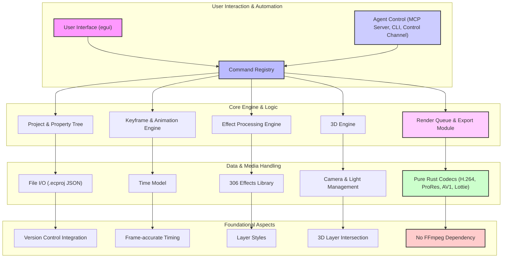

# 海外急上昇OSS「EffectCraft」商用化マニュアル｜社内DX提案書 ＆ 自社SaaS構築手順付き

## はじめに

storytold/effectcraft は 2026-10-01 に GitHub で作成されたリポジトリです。2026-10-18 時点のスター数は 7,161 です。

## 主な機能とアーキテクチャ概要

EffectCraftは、既存の商用モーショングラフィックスツールの抱える以下の主要な課題を解決しようとしています。

1.  **高コストとベンダーロックイン**: Adobe After Effectsなどの商用ツールは高額なサブスクリプション費用がかかり、特定のベンダーに依存するリスクがあります。EffectCraftはオープンソースであるため、ライセンス費用が不要で、コミュニティ主導で開発が進められます。
2.  **パフォーマンスと安定性**: 純粋なRustでゼロから構築されているため、メモリ安全性と実行時のパフォーマンスが最適化されています。FFmpegに依存せず、独自のRust製コーデックを使用することで、より制御された高速な処理が期待できます。
3.  **自動化とCI/CD連携の困難さ**: 従来のGUI中心のツールは、スクリプトによる自動化やCI/CDパイプラインへの統合が難しい場合があります。EffectCraftは、全ての操作がコマンドレジストリを介し、コマンドライン、JSONコントロールチャンネル、MCPサーバーからアクセス可能であるため、ヘッドレスでの自動レンダリングやAIエージェントによる操作が容易です。
4.  **Web/アプリ連携の複雑さ**: Webやモバイルアプリで利用されるLottieアニメーションへの変換には、通常プラグインや追加のワークフローが必要でした。EffectCraftはLottieのインポート/エクスポートをネイティブでサポートし、このプロセスを大幅に簡素化します。
5.  **プロジェクトファイルの可読性**: 商用ツールのプロジェクトファイルはバイナリ形式が多く、バージョン管理システムでの差分比較が困難です。EffectCraftのプロジェクトファイルは人間が読めるJSON形式（`.ecproj`）であり、Gitなどのバージョン管理システムとの親和性が高いです。

### アーキテクチャ概要

EffectCraftは「Engine first」のアプローチを採用しており、厳格なレイヤリングを持つ小さなクレートのスタックで構成されています。UI層（egui）は最上位に位置し、その下のエンジン層はUIに依存しません。これにより、ヘッドレス実行や異なるUIフレームワークへの対応が容易になっています。

**主要コンポーネント:**

*   **User Interface (egui)**: クロスプラットフォーム対応のGUIフレームワークeguiを使用。
*   **Command Registry**: 全てのユーザー操作やエージェントからのコマンドを処理する中心ハブ。
*   **Project & Property Tree**: プロジェクト構造、レイヤー、プロパティを管理。`.ecproj` (JSON) 形式で保存。
*   **Keyframe & Animation Engine**: キーフレーム補間、グラフエディタ、エクスプレッションなどを処理。
*   **Effect Processing Engine**: 306種類のエフェクトと9種類のレイヤースタイルを適用。
*   **3D Engine**: クラシック3Dレイヤー、カメラ、ライト、シャドウをサポート。
*   **Render Queue & Export Module**: H.264, ProRes, AV1, Lottieなど多様な形式でのレンダリングとエクスポートを管理。
*   **Pure Rust Codecs**: FFmpegに依存しない、自社開発のRust製ビデオ/オーディオコーデック。
*   **Agent Control**: MCPサーバー、コマンドラインインターフェース、コントロールチャンネルを通じて、外部システムやAIエージェントからの操作を可能にする。

### 🔒 有料エリアの内容
- 導入提案書テンプレート（Markdown）
- 工数・見積表

> 💡 **【価格と経費精算について】**
> 本記事の価格は **980円** です。
> ※noteは購入後、「購入・チップ履歴」から領収書を発行できます。経費精算の可否は所属先の規程をご確認ください。

--------------------------------------------------
【有料ライン（推奨販売価格: 980円 / 月額1,980円メンバーシップ特典）ここから先は有料会員限定】
<!-- PAID_SEALED: effectcraft_note.paid.enc 有料エリアは暗号化保存されています（復号はオーナー端末のみ: npm run vault:open） -->
---
### 🎁 【メンバーシップのご案内】
Auto Tech Radar noteメンバーシップ（月額1,980円）では、メンバーシップ特典に追加した有料記事を読むことができます。日々の技術キャッチアップや新規事業のネタ帳としてぜひご活用ください。

---
**【note出品時用 推奨ハッシュタグ】**
#AI #OSS #エンジニア #プログラミング #スタートアップ #最新技術 #GitHub #Rust
