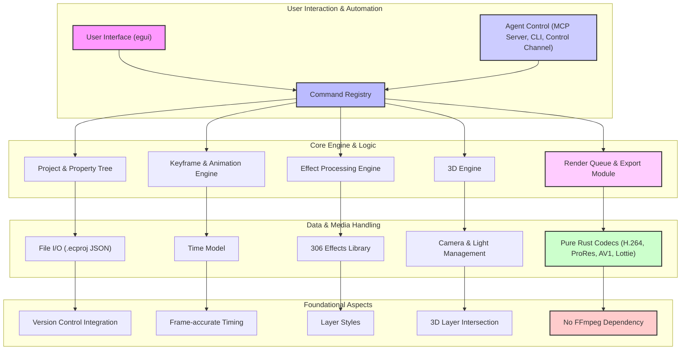

# effectcraft: 概要と革新性

## 🎯 ThoughtWorks成熟度リング判定（ADOPT / TRIAL / ASSESS / HOLD）

**判定: TRIAL**

**根拠と推奨活用フェーズ:**
EffectCraftは、Adobe After Effectsのクリーンルーム再実装という野心的な目標を掲げ、純粋なRustでゼロから構築されたオープンソースのモーショングラフィックス・コンポジティングツールです。GitHubで7,000を超えるスターを獲得し、コミュニティからの注目度は非常に高いです。Lottieのネイティブサポート、プロジェクトファイルの人間が読めるJSON形式、そしてコマンドラインやMCP（Model Context Protocol）を介した高度なスクリプト・エージェント連携機能は、CI/CDパイプラインへの統合やAI駆動型コンテンツ生成の可能性を秘めており、将来性が非常に高いと評価できます。

しかし、開発者自身が「まだalpha版であり、プロフェッショナルな仕事でのAfter Effects代替には至らない」と明言している通り、After Effectsプロジェクトの直接的な互換性がない点、動作の差異が残る点、macOSが最もテストされているプラットフォームである点など、プロダクション環境での全面的な採用にはまだ課題があります。

これらの状況を鑑み、ThoughtWorks成熟度リングでは「TRIAL」と判定します。
**推奨活用フェーズ**としては、新規プロジェクトにおけるPoC（概念実証）、社内での自動化ツールとしての試験導入、After Effectsの代替を模索する研究開発、そしてRustエコシステムへの貢献を目的とした開発参加が挙げられます。特に、AIエージェントとの連携によるコンテンツ自動生成や、Lottieアニメーションの効率的なワークフロー構築を目指す企業にとっては、先行者利益を得るための重要なツールとなるでしょう。

## 解決する主要な課題とアーキテクチャ

EffectCraftは、既存の商用モーショングラフィックスツールの抱える以下の主要な課題を解決しようとしています。

1.  **高コストとベンダーロックイン**: Adobe After Effectsなどの商用ツールは高額なサブスクリプション費用がかかり、特定のベンダーに依存するリスクがあります。EffectCraftはオープンソースであるため、ライセンス費用が不要で、コミュニティ主導で開発が進められます。
2.  **パフォーマンスと安定性**: 純粋なRustでゼロから構築されているため、メモリ安全性と実行時のパフォーマンスが最適化されています。FFmpegに依存せず、独自のRust製コーデックを使用することで、より制御された高速な処理が期待できます。
3.  **自動化とCI/CD連携の困難さ**: 従来のGUI中心のツールは、スクリプトによる自動化やCI/CDパイプラインへの統合が難しい場合があります。EffectCraftは、全ての操作がコマンドレジストリを介し、コマンドライン、JSONコントロールチャンネル、MCPサーバーからアクセス可能であるため、ヘッドレスでの自動レンダリングやAIエージェントによる操作が容易です。
4.  **Web/アプリ連携の複雑さ**: Webやモバイルアプリで利用されるLottieアニメーションへの変換には、通常プラグインや追加のワークフローが必要でした。EffectCraftはLottieのインポート/エクスポートをネイティブでサポートし、このプロセスを大幅に簡素化します。
5.  **プロジェクトファイルの可読性**: 商用ツールのプロジェクトファイルはバイナリ形式が多く、バージョン管理システムでの差分比較が困難です。EffectCraftのプロジェクトファイルは人間が読めるJSON形式（`.ecproj`）であり、Gitなどのバージョン管理システムとの親和性が高いです。

### アーキテクチャ概要

EffectCraftは「Engine first」のアプローチを採用しており、厳格なレイヤリングを持つ小さなクレートのスタックで構成されています。UI層（egui）は最上位に位置し、その下のエンジン層はUIに依存しません。これにより、ヘッドレス実行や異なるUIフレームワークへの対応が容易になっています。

**主要コンポーネント:**

*   **User Interface (egui)**: クロスプラットフォーム対応のGUIフレームワークeguiを使用。
*   **Command Registry**: 全てのユーザー操作やエージェントからのコマンドを処理する中心ハブ。
*   **Project & Property Tree**: プロジェクト構造、レイヤー、プロパティを管理。`.ecproj` (JSON) 形式で保存。
*   **Keyframe & Animation Engine**: キーフレーム補間、グラフエディタ、エクスプレッションなどを処理。
*   **Effect Processing Engine**: 306種類のエフェクトと9種類のレイヤースタイルを適用。
*   **3D Engine**: クラシック3Dレイヤー、カメラ、ライト、シャドウをサポート。
*   **Render Queue & Export Module**: H.264, ProRes, AV1, Lottieなど多様な形式でのレンダリングとエクスポートを管理。
*   **Pure Rust Codecs**: FFmpegに依存しない、自社開発のRust製ビデオ/オーディオコーデック。
*   **Agent Control**: MCPサーバー、コマンドラインインターフェース、コントロールチャンネルを通じて、外部システムやAIエージェントからの操作を可能にする。

## 競合ツール/商用SaaSとの徹底比較

| 特徴/ツール | EffectCraft (OSS) | Adobe After Effects (商用SaaS) | DaVinci Resolve Fusion (商用/無料版) | Blender Grease Pencil (OSS) |
| :--- | :--- | :--- | :--- | :--- |
| **コスト** | 無料 (OSS) | 高額なサブスクリプション | 無料版あり、Studio版は買い切り | 無料 (OSS) |
| **ライセンス** | MIT OR Apache-2.0 | プロプライエタリ | プロプライエタリ | GPL |
| **開発言語** | Rust | C++など | C++など | C/C++, Python |
| **パフォーマンス** | Rustによる高速処理、メモリ安全性 | 高性能だが、複雑なプロジェクトで重くなることも | 高性能、ノードベースで効率的 | 3D統合、リアルタイム性 |
| **主要機能** | モーションG、VFX、コンポジット、3D、306エフェクト、Lottie入出力 | モーションG、VFX、コンポジット、3D、豊富なエフェクト、プラグイン | ノードベースコンポジット、VFX、3D、カラーグレーディング | 2Dアニメーション、3D統合、モデリング |
| **Lottie対応** | **ネイティブ入出力** | プラグインが必要 | 非対応 | 非対応 |
| **自動化/スクリプト** | **CLI, MCP, JSONコントロールチャンネルで高度に自動化可能** | ExtendScript (JavaScript) で限定的に自動化 | Fusion Script (Python, Lua) | Pythonスクリプトで高度に自動化可能 |
| **プロジェクトファイル** | `.ecproj` (人間が読めるJSON) | `.aep` / `.aepx` (バイナリ/XML) | `.drp` (バイナリ) | `.blend` (バイナリ) |
| **FFmpeg依存** | **なし (純粋Rustコーデック)** | あり | あり | あり |
| **成熟度** | Alpha版、開発初期段階 | 業界標準、非常に成熟 | 高機能、プロフェッショナル向け | 高機能、活発なコミュニティ |
| **互換性** | After Effectsプロジェクトは開けない | 業界標準、広範な互換性 | 他のResolveモジュールとシームレス | 独自のファイル形式 |
| **コミュニティ** | 活発なDiscordコミュニティ | 非常に大規模 | 大規模 | 非常に大規模 |

**EffectCraftの優位点:**

*   **コストとオープンソース性**: 完全無料で、ライセンスの制約なく利用・改変・再配布が可能。ベンダーロックインのリスクがない。
*   **Rustによるパフォーマンスと信頼性**: メモリ安全性と高速な実行が保証され、大規模なプロジェクトでも安定した動作が期待できる。
*   **Lottieネイティブ対応**: Webやモバイルアプリ向けアニメーションのワークフローを劇的に簡素化。
*   **高度な自動化とAI連携**: CLI、MCP、JSONコントロールチャンネルにより、CI/CDやAIエージェントとの統合が容易。
*   **FFmpegからの脱却**: 純粋なRust製コーデックにより、依存関係の複雑さを排除し、セキュリティとパフォーマンスを向上。
*   **可読性の高いプロジェクトファイル**: JSON形式のため、バージョン管理システムでの差分管理が容易。

**EffectCraftの課題点:**

*   **成熟度**: まだAlpha版であり、After Effectsの完全な代替には至っていない。
*   **After Effectsプロジェクト互換性**: 既存のAfter Effectsプロジェクトを開けないため、移行には手動での再構築が必要。
*   **プラグインエコシステム**: After Effectsのような豊富なサードパーティ製プラグインは存在しない。

--------------------------------------------------
> 💡 **【投資対効果（ROI）と会社経費精算について】**
> 本記事の価格は **980円** です。有料エリアには、受託提案や社内導入の検討にそのまま使える『提案書テンプレート』『工数見積表』『公式READMEに基づく導入手順』をまとめています。
> ※noteは購入後、マイページよりインボイス対応領収書が即時発行可能です。会社の「技術調査費」「自己研鑽費」として経費精算いただけます。

【有料ライン（推奨販売価格: 980円 / 月額1,980円メンバーシップ特典）ここから先は有料会員限定】
<!-- PAID_SEALED: effectcraft_note.paid.enc 有料エリアは暗号化保存されています（復号はオーナー端末のみ: npm run vault:open） -->
---
### 🎁 【メンバーシップのご案内】
Auto Tech Radar noteメンバーシップ（月額1,980円）では、メンバーシップ特典に追加した有料記事を読むことができます。日々の技術キャッチアップや新規事業のネタ帳としてぜひご活用ください。

---
**【note出品時用 推奨ハッシュタグ】**
#AI #OSS #エンジニア #プログラミング #副業 #受託開発 #スタートアップ #最新技術 #GitHub #Rust
