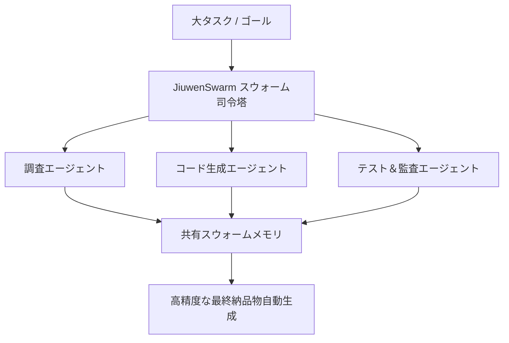

# 海外急上昇OSS「JiuwenSwarm」商用化マニュアル｜社内DX提案書 ＆ 自社SaaS構築手順付き

## はじめに

openJiuwen-ai/jiuwenswarm は 2026-03-05 に GitHub で作成されたリポジトリです。2026-10-09 時点のスター数は 5,978 です。

## 主な機能とアーキテクチャ概要

現代のビジネス環境では、複雑なタスクの自動化と効率化が喫緊の課題です。しかし、従来のAIエージェントは単一タスクに特化しがちで、複数のステップや専門知識を要する複雑なプロセスには対応が困難でした。JiuwenSwarmは以下の課題を解決します。

*   **複雑なタスクの分解と実行:** リーダーエージェントが複雑なタスクを分解し、専門エージェントチームを動的に編成。各エージェントが連携し、タスクをエンドツーエンドで実行します。
*   **エージェント間の協調とスケーラビリティ:** 分散型エージェントスウォームアーキテクチャにより、リーダーとチームメイトがプロセスやマシンを跨いでデプロイされ、大規模な協調作業を可能にします。
*   **スキルの継続的な最適化:** 「Skill Self-Evolution」機能により、エージェントは実行結果やユーザーフィードバックから学習し、自身のスキル定義を自動で改善します。これにより、一度構築したスキルが陳腐化することなく、常に最新の状態に保たれます。
*   **ヒューマン・イン・ザ・ループ (HITL) の統合:** SwarmflowというPythonスクリプトによる決定論的なマルチステージワークフローを通じて、人間による介入（`human` / `human_session`）を組み込むことができ、AIの自律性と人間の制御のバランスを取ります。
*   **幅広いAIインフラ互換性:** Huawei Cloud MaaS、OpenAI互換API、ローカルモデルなど、多様なAIプラットフォームに対応し、既存のインフラを最大限に活用できます。

### 🔒 有料エリアの内容
- 導入提案書テンプレート（Markdown）
- 工数・見積表
- 活用・収益化の考え方
- 導入時の想定問答

> 💡 **【価格と経費精算について】**
> 本記事の価格は **980円** です。
> ※noteは購入後、「購入・チップ履歴」から領収書を発行できます。経費精算の可否は所属先の規程をご確認ください。

--------------------------------------------------
【有料ライン（推奨販売価格: 980円 / 月額1,980円メンバーシップ特典）ここから先は有料会員限定】
<!-- PAID_SEALED: jiuwenswarm_note.paid.enc 有料エリアは暗号化保存されています（復号はオーナー端末のみ: npm run vault:open） -->
---
### 🎁 【メンバーシップのご案内】
Auto Tech Radar noteメンバーシップ（月額1,980円）では、メンバーシップ特典に追加した有料記事を読むことができます。日々の技術キャッチアップや新規事業のネタ帳としてぜひご活用ください。

---
**【note出品時用 推奨ハッシュタグ】**
#AI #OSS #エンジニア #プログラミング #スタートアップ #最新技術 #GitHub #Agent
