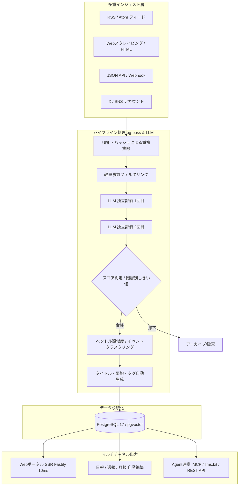

# AIHOT: 概要

KKKKhazix/AIHOT は 2026-09-29 に GitHub で作成されたリポジトリです。2026-10-16 時点のスター数は 7,887 です。

**AIHOT**は、指定した複数の情報源から自動で最新情報を収集し、大規模言語モデル（LLM）を用いて重複排除・多段階スコアリング・要約を行い、業界特化型のポータルサイトや自動日報・週報・月報を生成するフルスタックWebフレームワークです。

従来のRSSリーダーや情報集約スクリプトと決定的に異なるのは、単なる情報の集約（アグリゲーション）にとどまらず、**「専門家レベルの選定ノウハウ（Know-How）をプロンプトとして組み込める選別パイプライン」**と**「同一ニュースの複数メディア報道を束ねるイベントクラスタリング機能」**を標準実装している点です。

### 解決する主要な課題
1. **情報過多によるキュレーションコストの肥大化**:
   業界ニュースを網羅しようとすると、公式発表・テック系メディア・SNS（X/Twitter）・専門ポータルなど同一事象に関する重複記事が溢れ、人間による手動選別に多大な工数がかかっていました。
2. **LLM要約におけるハルシネーションと品質のバラつき**:
   1回のLLM呼び出しだけで要約と評価を行うと、宣伝記事の過大評価や誤認が発生しがちでした。AIHOTは同一基準に対して**独立した2回のスコアリング**を行い、一定のしきい値を超えたものだけを厳選するセーフティネットを敷いています。
3. **最新AI Agentへの対応（MCP / llms.txt）**:
   人間がWebブラウザで閲覧するだけでなく、自律型AI Agentが最新業界動向を参照できるように、MCP、Agent Markdown、`llms.txt`、REST APIなどのインターフェースをネイティブ提供しています。

## 解決する主要な課題とアーキテクチャ

AIHOTは、高スループットな非同期ジョブキュー（`pg-boss`）とPostgreSQL、Node.js 24、Fastify、React Router（SSR）を中核に据え、README の実測値として、ページの 95% を 50 毫秒（50ms）以内に返すと記載されています。

### アーキテクチャのハイライト
- **独立多段階評価アーキテクチャ**:
  `industry/prompts/selection-score.md` に記載されたドメイン固有の評価基準に基づき、同一記事を独立して2回スコアリング。公式1次ソース、準公式、メディア/個人といった情報源の格付け（Tier 1〜3）に応じて通過基準を動的に変更します。
- **イベントベースのクラスタリングと熱度（Hotness）アルゴリズム**:
  同一トピックに関して48時間以内に報じられた記事を1つの「イベント」に束ねます。熱度スコアは「記事の数」ではなく「言及している独立ソースの数」をベースに算出され、24時間で半減期を迎える減衰ロジックを採用しているため、特定のPRメディアによる連投スパムを自然に無効化します。
- **高速SSRとエッジフレンドリーな設計**:
  Fastify + React Router SSRを採用し、README には、ページの中央値 10ms・API の中央値 6ms という実測値が記載されています。

## インストール（README からの転記）

README にインストール手順のコードブロックが見つかりませんでした。導入方法は [README](https://github.com/KKKKhazix/AIHOT#readme) を確認してください。

## ライセンス

- ライセンス: MIT License（SPDX: MIT）
- 確認先: [LICENSE ファイル](https://github.com/KKKKhazix/AIHOT/blob/main/LICENSE)

この節はライセンスの名称と確認先を示すもので、法的な助言ではありません。利用の可否は、LICENSE ファイルの本文と利用する状況に照らして確認してください。
