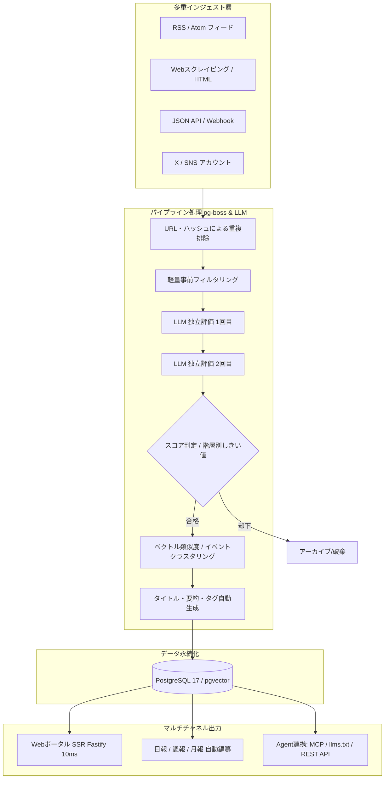

# AIHOT: 概要と革新性

**AIHOT**は、指定した複数の情報源から自動で最新情報を収集し、大規模言語モデル（LLM）を用いて重複排除・多段階スコアリング・要約を行い、業界特化型のポータルサイトや自動日報・週報・月報を生成するフルスタックWebフレームワークです。

従来のRSSリーダーや情報集約スクリプトと決定的に異なるのは、単なる情報の集約（アグリゲーション）にとどまらず、**「専門家レベルの選定ノウハウ（Know-How）をプロンプトとして組み込める選別パイプライン」**と**「同一ニュースの複数メディア報道を束ねるイベントクラスタリング機能」**を標準実装している点です。

### 解決する主要な課題
1. **情報過多によるキュレーションコストの肥大化**:
   業界ニュースを網羅しようとすると、公式発表・テック系メディア・SNS（X/Twitter）・専門ポータルなど同一事象に関する重複記事が溢れ、人間による手動選別に多大な工数がかかっていました。
2. **LLM要約におけるハルシネーションと品質のバラつき**:
   1回のLLM呼び出しだけで要約と評価を行うと、宣伝記事の過大評価や誤認が発生しがちでした。AIHOTは同一基準に対して**独立した2回のスコアリング**を行い、一定のしきい値を超えたものだけを厳選するセーフティネットを敷いています。
3. **最新AI Agentへの対応（MCP / llms.txt）**:
   人間がWebブラウザで閲覧するだけでなく、自律型AI Agentが最新業界動向を参照できるように、Model Context Protocol（MCP）、Agent Markdown、`llms.txt`、REST APIなどのインターフェースをネイティブ提供しています。

## 解決する主要な課題とアーキテクチャ

AIHOTは、高スループットな非同期ジョブキュー（`pg-boss`）とPostgreSQL、Node.js 24、Fastify、React Router（SSR）を中核に据え、95%のリクエストを50ms以内で返す超高速な配信性能を達成しています。



### アーキテクチャのハイライト
- **独立多段階評価アーキテクチャ**:
  `industry/prompts/selection-score.md` に記載されたドメイン固有の評価基準に基づき、同一記事を独立して2回スコアリング。公式1次ソース、準公式、メディア/個人といった情報源の格付け（Tier 1〜3）に応じて通過基準を動的に変更します。
- **イベントベースのクラスタリングと熱度（Hotness）アルゴリズム**:
  同一トピックに関して48時間以内に報じられた記事を1つの「イベント」に束ねます。熱度スコアは「記事の数」ではなく「言及している独立ソースの数」をベースに算出され、24時間で半減期を迎える減衰ロジックを採用しているため、特定のPRメディアによる連投スパムを自然に無効化します。
- **高速SSRとエッジフレンドリーな設計**:
  Fastify + React Router SSRを採用し、APIレスポンス中央値6ms、ページレンダリング中央値10msという超高速応答を実現しています。

## 競合ツール/商用SaaSとの徹底比較

| 機能・指標 | AIHOT (OSS) | Feedly Leo (商用SaaS) | 自前Pythonスクリプト開発 |
|---|---|---|---|
| **導入・運用コスト** | **LLM API実費のみ (月数十ドル〜)** | 月額数万円〜数十万円/席 | 開発人件費 + サーバー保守 |
| **ドメイン知見の注入** | **Prompt / 閾値ファイルを直接編集可能** | 一部キーワード指定に限定 | コード内にロジックが散乱しがち |
| **同一事件の束ね (クラスタリング)** | **標準搭載 (48h熱度減衰ロジック)** | トピック抽出のみ | ベクトルDB等の個別設計が必要 |
| **日報・週報・月報の自動編纂** | **定時自動実行 (朝8時/週初め)** | メール通知程度 | 個別スケジューラ・バッチ実装 |
| **Agent / MCP対応** | **ネイティブ対応 (MCP, llms.txt)** | APIオプションは高額プラン限定 | 完全手動実装が必要 |
| **データ所有権** | **自社DB内に完全保持 (オンプレ可)** | クラウドベンダー依存 | 自社環境で保持 |

## 💡 ビジネス・マネタイズ活用アイデア（実践例）

1. **特定業界特化型の有料インテリジェンスポータル（SaaS化）**:
   - 医療機器、法務テック、暗号資産、半導体など、キャッチアップ負荷が高い高付加価値業界に特化。
   - `industry/sources.json` と `industry/prompts/` を業界仕様にカスタマイズし、月額サブスクリプションで業界関係者に日報メール・Slack通知・Webポータルを提供。
2. **エンタープライズ向け「社内DX・競合監視基盤」の受託導入**:
   - 大手企業の広報部、知財部、新規事業開発室向けに、競合他社や関連特許、海外動向を網羅する専用監視基盤を構築。
   - 社内イントラネット内にDockerで構築し、機密性を保ちながら運用引き継ぎを実施。
3. **自社AI Agent向けのリアルタイムナレッジ基盤（MCPサーバー）**:
   - 社内業務自動化Agentの外部ナレッジハブとしてAIHOTを活用。MCP経由で常に整理された最新の業界動向をAgentに供給。

## インストール & クイックスタート手順

### 必須要件
- Node.js 24 以上
- Docker & Docker Compose
- OpenAI互換のLLM APIキー（DeepSeek、Qwen、OpenAIなど）

### セットアップコマンド

```bash
# 1. リポジトリのクローン
git clone https://github.com/KKKKhazix/AIHOT.git myhot
cd myhot

# 2. 初期設定スクリプトの実行（APIキーの注入）
node scripts/init-env.ts --llm-key <YOUR_LLM_API_KEY>

# 3. コンテナのビルドと起動
docker compose up -d --build
```

起動後、ブラウザで `http://localhost:3000` にアクセスするとポータルが表示されます。管理画面は `http://localhost:3000/admin` で、初期パスワードは生成された `.env` ファイル内の `ADMIN_PASSWORD` に記載されています。

## 商用利用可否 & ライセンス考察

AIHOTのソースコードは **MIT License** のもとで公開されており、商用利用、改変、受託開発、自社SaaSへの組み込みは法的に完全に許可されています。

**重要な注意点**:
- **名称とロゴの非商用規約**: 公式READMEにて明記されている通り、「AIHOT」という名称およびロゴ画像はライセンス対象外です。商用サービスや受託納品を行う際は、必ず自社のオリジナルブランド（例: 「TechRadar Pro」「LegalWatch AI」など）に変更し、`site/site.ts` や `site/brand/` のアセットを置き換えて利用してください。
