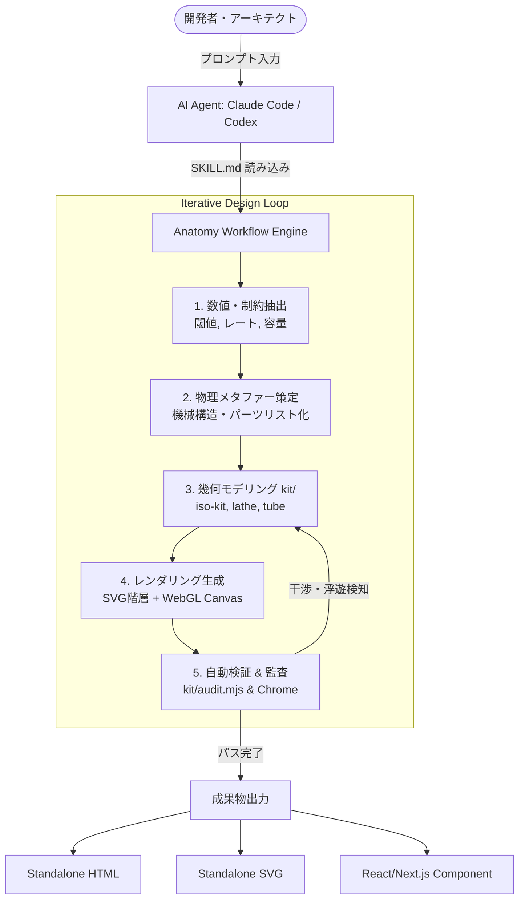

# anatomy: 概要

wheresryan22/anatomy は 2026-10-08 に GitHub で作成されたリポジトリです。2026-10-14 時点のスター数は 9,975 です。

ソフトウェアアーキテクチャや分散システムの内部動作を説明する際、多くのエンジニアは「四角と矢印」で構成された抽象的なブロック図（C4モデルやフローチャート）に頼りがちです。しかし、キャッシュヒット率の挙動、トークンバケットによるレート制限、データベース接続プーリングといった動的なアルゴリズムは、静止した図形だけでは直感的な理解に限界があります。

**「anatomy」**は、この課題を根本から覆すアプローチを採用したAIエージェント向けスキル（Claude Code、OpenCode、Codex等に対応）です。抽象的な技術コンセプトを入力すると、その概念を模した「実在しそうな精密機械」を物理モデルとしてメタファー化。数十〜数百のソリッドパーツからなる等角投影図（Isometric Illustration）を、ピュアSVG、WebGLシェーダー、3D投影技術を駆使してコードとして自動生成します。

最大の革新性は以下の点にあります：
- **概念の物理機械化**: キャッシュ検証を「ピンタンブラー錠」、複数キャンバスのGPU描画を「ガントリープロッター」のように、動作原理が直感的に伝わる物理ギミックへ自律的に再設計。
- **純粋なゼロ依存（Zero-Dependency）**: 外部npmライブラリを一切使わず、Node.js標準モジュールのみで幾何計算からレンダリングまで完結。
- **自律的幾何学監査（Geometry Audit）**: 生成したパーツ同士の干渉（パイプの衝突、浮遊オブジェクト、描画順序の破綻）をヘッドレスChromeと幾何解析スクリプトで自己テストし、厳密に修正。

---

## 解決する主要な課題とアーキテクチャ

システム設計書の作成において、高品質なインタラクティブ図解を作成するには、3Dモデラー（Blender等）やUIデザイナー（Figma）、フロントエンドエンジニアが数週間かけて共同作業を行う必要がありました。anatomyはこの制作パイプラインをAIエージェントの自律ループへ統合します。

### アーキテクチャと実行フロー

anatomyは、Agent Skills仕様に準拠したプロンプトフレームワークと、自社開発の軽量幾何エンジン（`kit/`）で構成されています。



#### コアコンポーネント構成
1. **`SKILL.md`**: エージェントに「まず真の数値を集め、機械を発明し、背面から前面へ描画せよ」という職人的制約を与えるシステムプロンプト。
2. **`kit/iso-kit.ts`**: 等角カメラ変換、4トーンシェーディング、深度ソート（Painter's Algorithm）を司るコア描画基盤。
3. **`kit/tube.mjs` & `lathe.mjs`**: 任意の3次元軸に沿った配管・配線、旋盤加工のような回転体のパラメトリック生成。
4. **`kit/gl.mjs`**: 火炎、排気、液体、波紋などベクターでは表現不可能な流体を表現するため、SVGのレイヤー間にアイソメトリック視点で挟み込むWebGLシェーダー。
5. **`kit/audit.mjs`**: 部品間のクリッピングや貫通バグ、未接合ラインを幾何数学的にチェックする監査システム。

---

## インストール（README からの転記）

以下は [README](https://github.com/wheresryan22/anatomy#readme) のインストール手順のコードブロックを、そのまま転記したものです。当サイトでは動作を確認していません。最新の手順は README を確認してください。

```sh
npx skills add wheresryan22/anatomy -g
```

```text
/anatomy explain how a token bucket rate limiter works, interactive
```

```sh
mkdir -p ~/.claude/skills/anatomy && curl -L https://github.com/wheresryan22/anatomy/archive/refs/heads/main.tar.gz | tar -xz --strip-components=1 -C ~/.claude/skills/anatomy
```

```sh
mkdir -p ~/.gemini/antigravity/skills/anatomy && curl -L https://github.com/wheresryan22/anatomy/archive/refs/heads/main.tar.gz | tar -xz --strip-components=1 -C ~/.gemini/antigravity/skills/anatomy
```

## ライセンス

- ライセンス: MIT License（SPDX: MIT）
- 確認先: [LICENSE ファイル](https://github.com/wheresryan22/anatomy/blob/main/LICENSE)

この節はライセンスの名称と確認先を示すもので、法的な助言ではありません。利用の可否は、LICENSE ファイルの本文と利用する状況に照らして確認してください。
