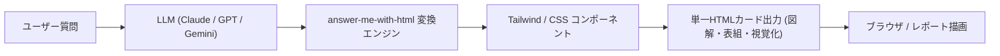

# answer-me-with-html: 概要

QingYunA/answer-me-with-html は 2026-10-02 に GitHub で作成されたリポジトリです。2026-10-09 時点のスター数は 2,358 です。

LLMやAIエージェントが高度化するにつれ、開発現場では「出力される膨大なテキスト（Wall of Text）の認知的負荷」が最大のボトルネックになりつつあります。Andrej Karpathy氏が指摘したように、LLMの自律性が高まるほど、その出力を人間がいかに高速に咀嚼できるかが重要になります。

**`answer-me-with-html`** は、Claude Code、Cursor、Codex、OpenCodeといった各種AIエージェントに組み込むオープンソースの「エージェント・スキル（Agent Skill）」です。複雑なアーキテクチャの質問、TCPのハンドシェイク、DBの比較検討などを尋ねた際、端末画面を埋め尽くす長文テキストではなく、シーケンス図、フローチャート、状態遷移表、比較マトリクスが美しくレイアウトされた**完全スタンドアロンの1枚のHTMLファイル**を瞬時に生成・表示します。

### 本ツールのコアメカニズム
従来、LLMに「HTMLで出力して」と指示した場合、数千行におよぶインラインCSSやSVGの座標計算を出力させることになり、以下のような深刻な問題が生じていました：
1. **生成待ち時間が長い**
2. **トークン消費量が膨大**（出力トークン枯渇やコスト高騰）
3. **SVG図解の崩壊**（LLMは座標計算が苦手なため、矢印があらぬ方向を指す）

`answer-me-with-html` はこの責務を完全に分離しました。
- **LLMの役割**: 専用Markdownドラフト（データ構造とテキストのみ）を書くだけ。
- **バンドルCLIの役割**: レイアウト計算、カラーパレット適用、`dagre` によるグラフ自動配置、SVG描画、ASD-STE100準拠の構文チェックをローカル（約50ms）で実行。

README の比較では、出力トークン数は平均 4,893 tokens から平均 612 tokens に、生成完了までの速度は 2.6x と記載されています（README の計測で、当サイトでは検証していません）。

---

## 解決する主要な課題とアーキテクチャ


### 1. 解決する課題
- **認知的オーバーロード**: 端末上のモノスペースフォントによる長文ログを読む苦痛の解消。
- **LLMのトークン生成オーバーヘッド**: CSS/SVGタグ出力によるAPIレイテンシと課金増の抑制。
- **外部依存とセキュリティ**: 外部SaaSやCDNに依存せず、完全ローカルかつ単一の自己完結HTMLファイルで閲覧・共有可能。

### 2. システムアーキテクチャ
本ツールはランタイムに Node.js（20以上）のみを要求し、外部CDNや追加のnpmインストールを必要としません（`marked` や `@dagrejs/dagre` などの必要ライブラリは `am.mjs` に事前バンドル済み）。

### 3. 主なサポートコンポーネント
- `flow`: アーキテクチャ図、決定分岐、コールグラフの自動階層レイアウト
- `sequence`: メッセージの時系列シーケンス図
- `er`: 主キー・外部キーおよび多重度（Crow's foot記法）対応のER図
- `timeline` / `tree`: 歴史的経緯やリポジトリのディレクトリ構造
- `ask`: HTML上でユーザーが選択肢をクリックしてエージェントに逆フィードバックできるフォーム
- `video`: 3Blue1Brownスタイルの音声ナレーション付き解説動画（WebM/MP4）自動生成

---

## インストール（README からの転記）

以下は [README](https://github.com/QingYunA/answer-me-with-html#readme) のインストール手順のコードブロックを、そのまま転記したものです。当サイトでは動作を確認していません。最新の手順は README を確認してください。

```
/plugin marketplace add QingYunA/answer-me-with-html
/plugin install answer-me-with-html@answer-me-with-html
```

```bash
dsh plugin --profile web add github:QingYunA/answer-me-with-html
```

```bash
npx skills add QingYunA/answer-me-with-html
```

```bash
git clone --depth 1 https://github.com/QingYunA/answer-me-with-html.git /tmp/answer-me-with-html
cp -R /tmp/answer-me-with-html/skills/answer-me-with-html ~/.claude/skills/answer-me-with-html
```

## ライセンス

- ライセンス: MIT License（SPDX: MIT）
- 確認先: [LICENSE ファイル](https://github.com/QingYunA/answer-me-with-html/blob/main/LICENSE)

この節はライセンスの名称と確認先を示すもので、法的な助言ではありません。利用の可否は、LICENSE ファイルの本文と利用する状況に照らして確認してください。
