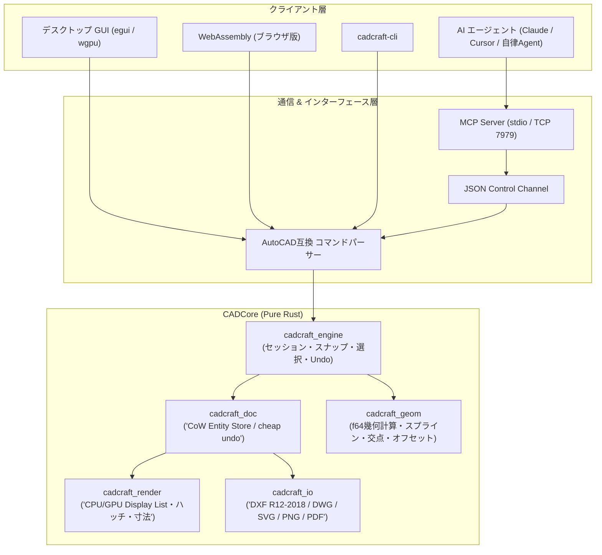

# cadcraft: 概要と革新性

CADソフトウェアの世界は数十年にわたり、Autodesk社のAutoCADをはじめとする独占的な商用プロプライエタリ製品が支配してきました。オープンソースの世界でもLibreCADやFreeCADなどが存在したものの、旧来のC++ベースの重厚なUIフレームワークへの依存や、スクリプト自動化・ヘッドレス運用の難しさが課題でした。

この現状を根本から打破するために登場したのが **「CADCraft」** です。
CADCraftは、クリーンルーム設計でPure Rustを用いて開発されたAutoCAD互換の2D/3D CADアプリケーションです。ElectronやWebViewを一切使わず、Rustの即時モードGUIフレームワーク「egui」と「wgpu」をダイレクトに駆動させることで、超軽量・瞬時起動・ゼロクラッシュの堅牢性を達成しています。

さらに最大の革新性は、**「AIエージェントによる自律設計（Agent-drivable over MCP）」** を設計思想の中核に据えている点です。コマンドライン、JSONコントロールチャネル、そして業界標準のMCP（Model Context Protocol）サーバーがネイティブ統合されており、LLM（ClaudeやGPTなど）が図面生成・編集・視覚的検証を完全自動で実行可能です。

## 🎯 成熟度の目安（AI による見立て）

- **根拠**:
  - **アーキテクチャの完成度**: C++のレガシーコードを持たず、Pure Rustで幾何計算（geom）、DXFパーサー（dxf）、エンティティDB（doc）、レンダラー（render）が分離されており、依存関係が極めてクリーン。
  - **互換性とパラメトリック機能**: DXF（R12〜2018）、DWG読み込み、拘束ソルバー、TrueType/OpenTypeフォントレンダリング、複線寸法（DIMSTYLE）をすでに網羅。
  - **早期開発（Early Development）フェーズ**: コア機能は完成度が高いものの、3Dソリッドモデリングや一部の高度な拡張エンティティは開発途上。
- **検証候補になる用途**:
  - README で開発初期（early development）とされているため、製造業・建築業における「図面フォーマット変換」「バッチレンダリング」「定型図面の自動生成」などの限られた用途で検証候補になります。本格的な作図環境の置き換えを検討する場合は、README の機能の状況（ROADMAP.md）を確認したうえで段階的に検証してください。

## 解決する主要な課題とアーキテクチャ

CADCraftは以下の課題を解決します。
1. **高額な年間サブスクリプションコスト**: 1シートあたり年間数十万円のライセンス費をゼロに。
2. **プラットフォーム縛り**: Windows、macOS（Apple Silicon/Intel）、Linux、FreeBSD、さらにはWebAssembly（ブラウザ内完全動作）まで同一バイナリ・コードベースで稼働。
3. **AI連携の断絶**: 従来のCADはGUI手作業が前提でしたが、CADCraftは全コマンドがJSONおよびMCP経由で実行可能。

### システムアーキテクチャ図



## 競合ツール/商用SaaSとの徹底比較

| 項目 | CADCraft (本OSS) | Autodesk AutoCAD | FreeCAD | LibreCAD |
|---|---|---|---|---|
| **コア言語** | Pure Rust | C++ / .NET | C++ / Python | C++ (Qt) |
| **起動速度 / メモリ** | 即時（< 0.2秒）/ ~50MB | 15〜30秒 / 1GB超 | 5〜10秒 / 400MB超 | 1〜2秒 / 150MB |
| **ライセンス費用** | 無料（MIT / Apache 2.0） | 約30万円/年/シート | 無料（LGPL） | 無料（GPLv2） |
| **AutoCAD CLI互換** | 完全準拠（プロンプト・スナップ） | 本家仕様 | なし（独自GUI） | 部分的 |
| **AI/MCPネイティブ** | **◎ 標準搭載 (MCP / JSON)** | △ アドオン・COM依存 | △ Pythonスクリプト要 | × 非対応 |
| **Webブラウザ稼働** | **◎ Wasm完全対応** | △ 限定的クラウド版 | × 不可 | × 不可 |

## 💡 ビジネス・マネタイズ活用アイデア（実践例）

1. **建設・製造業向け「2D図面自動積算・出力SaaS」のコアエンジン**
   - 顧客が入力したパラメータ（建屋の幅、階高、ドア位置など）から、CADCraft-CLIをバックエンドコンテナで走らせ、数ミリ秒で確認申請用DXFおよび高解像度PDF/PNGを自動出力。
2. **AIエージェントによる図面修正代行ボット（B2B受託）**
   - 「この図面の全ボルト穴をM6からM8に変更して中心座標を出力して」という指示をSlackから受領。LLMがMCP経由でCADCraftを操作し、修正後DXFと差分PNGを自動返信。

## インストール & クイックスタート手順

### ビルド前提条件
- Rust 1.95以上（デスクトップ/Web UI）

### デスクトップアプリのビルドと起動
```bash
# リポジトリ取得
git clone https://github.com/storytold/cadcraft.git
cd cadcraft

# サンプル図面を開いて起動
cargo run --release -p cadcraft -- --sample
```

### CLIでのバッチ処理（例: DXFからSVG/PNGへの一括変換）
```bash
# 図面情報のダンプ
cadcraft-cli info drawing.dxf

# ヘッドレスで円を作図してDXF保存 & PNGエクスポート
cadcraft-cli run --sample --script 'CIRCLE 20,20 5\n' --save out.dxf --export out.png
```

## 商用利用可否 & ライセンス考察

CADCraftのソースコードは **MIT License または Apache License 2.0 のデュアルライセンス** で提供されています。
商用利用、ソースコードの改変、プロプライエタリな製品への組み込み、自社SaaSバックエンドとしての利用が無償かつ自由に認められています。

**注意点**:
- `docs/brand/` に含まれる「ArtCraft」のロゴ・商標は除外されているため、自社製品としてリブランディング（フォーク）して再配布する場合は、商標やロゴを独自のものに差し替える必要があります。
