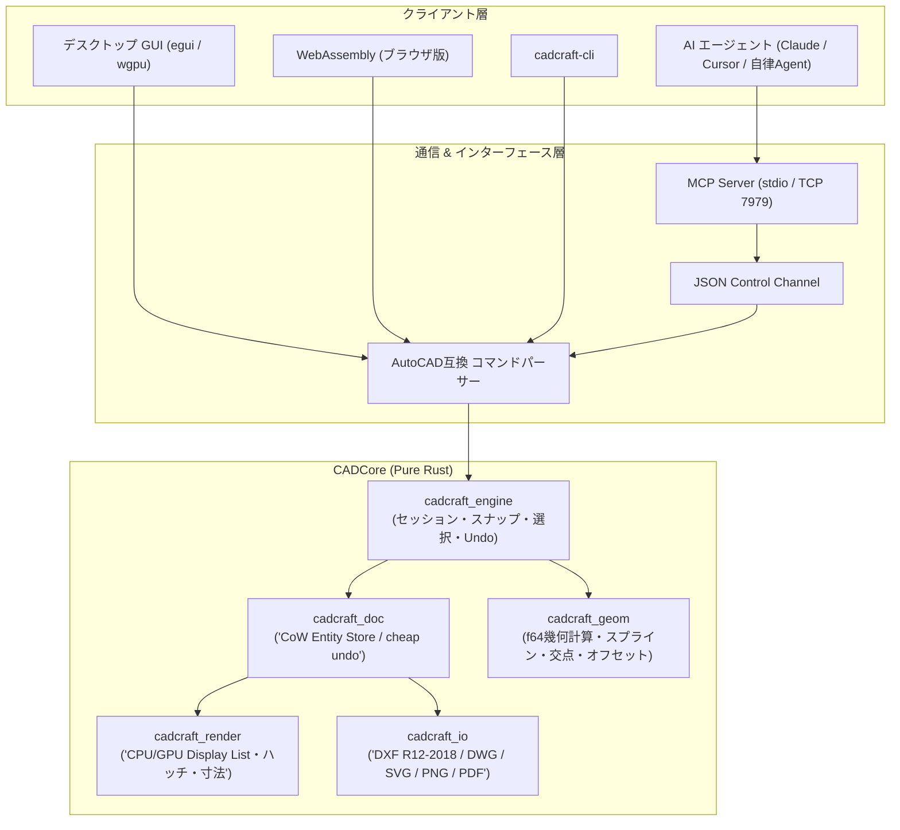

# cadcraft: 概要

storytold/cadcraft は 2026-10-07 に GitHub で作成されたリポジトリです。2026-10-18 時点のスター数は 5,766 です。

CADソフトウェアの世界は数十年にわたり、Autodesk社のAutoCADをはじめとする独占的な商用プロプライエタリ製品が支配してきました。オープンソースの世界でもLibreCADやFreeCADなどが存在したものの、旧来のC++ベースの重厚なUIフレームワークへの依存や、スクリプト自動化・ヘッドレス運用の難しさが課題でした。

この現状を根本から打破するために登場したのが **「CADCraft」** です。
CADCraftは、クリーンルーム設計でPure Rustを用いて開発されたAutoCAD互換の2D/3D CADアプリケーションです。ElectronやWebViewを一切使わず、Rustの即時モードGUIフレームワーク「egui」と「wgpu」を使っています。README のバッジは開発状況を early development としており、一部のグラフィックドライバでクラッシュしうることも記載されています。

さらに最大の革新性は、**「AIエージェントによる自律設計（Agent-drivable over MCP）」** を設計思想の中核に据えている点です。コマンドライン、JSONコントロールチャネル、そして業界標準のMCPサーバーがネイティブ統合されており、LLM（ClaudeやGPTなど）が図面生成・編集・視覚的検証を完全自動で実行可能です。

## 🎯 成熟度の目安（AI による見立て）

- **根拠**:
  - **アーキテクチャの完成度**: C++のレガシーコードを持たず、Pure Rustで幾何計算（geom）、DXFパーサー（dxf）、エンティティDB（doc）、レンダラー（render）が分離されており、依存関係が極めてクリーン。
  - **互換性とパラメトリック機能**: DXF（R12〜2018）、DWG読み込み、拘束ソルバー、TrueType/OpenTypeフォントレンダリング、複線寸法（DIMSTYLE）をすでに網羅。
  - **早期開発（Early Development）フェーズ**: コア機能は完成度が高いものの、3Dソリッドモデリングや一部の高度な拡張エンティティは開発途上。
- **検証候補になる用途**:
  - README で開発初期（early development）とされているため、製造業・建築業における「図面フォーマット変換」「バッチレンダリング」「定型図面の自動生成」などの限られた用途で検証候補になります。本格的な作図環境の置き換えを検討する場合は、README の機能の状況（ROADMAP.md）を確認したうえで段階的に検証してください。

## 解決する主要な課題とアーキテクチャ

CADCraftは以下の課題を解決します。
1. **高額な年間サブスクリプションコスト**: 1シートあたり年間数十万円のライセンス費をゼロに。
2. **プラットフォーム縛り**: Windows、macOS（Apple Silicon/Intel）、Linux、FreeBSD、さらにはWebAssembly（ブラウザ内完全動作）まで同一バイナリ・コードベースで稼働。
3. **AI連携の断絶**: 従来のCADはGUI手作業が前提でしたが、CADCraftは全コマンドがJSONおよびMCP経由で実行可能。

### システムアーキテクチャ図



## インストール（README からの転記）

以下は [README](https://github.com/storytold/cadcraft#readme) のインストール手順のコードブロックを、そのまま転記したものです。当サイトでは動作を確認していません。最新の手順は README を確認してください。

```sh
git clone https://github.com/storytold/cadcraft
cd cadcraft
cargo run --release -p cadcraft -- --sample       # opens the sample drawing
```

```text
line 0,0 @10,0 @0,5 c          a closed triangle
circle 5,2 1                    a circle
offset 0.25                     then pick the circle and a side
zoom e                          zoom to extents
```

## ライセンス

- ライセンス: Apache License 2.0（SPDX: Apache-2.0）
- 確認先: [LICENSE ファイル](https://github.com/storytold/cadcraft/blob/main/LICENSE-APACHE)

この節はライセンスの名称と確認先を示すもので、法的な助言ではありません。利用の可否は、LICENSE ファイルの本文と利用する状況に照らして確認してください。
