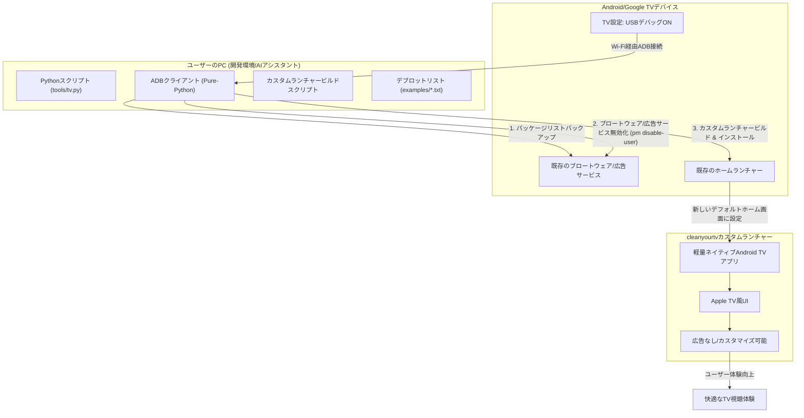

# cleanyourtv: 概要

Gathin23/cleanyourtv は 2026-10-17 に GitHub で作成されたリポジトリです。2026-10-21 時点のスター数は 11,608 です。

## 🎯 成熟度の目安（AI による見立て）
**根拠:**
記事作成時点で GitHub のスター数は 11,000 を超えています。[README](https://github.com/Gathin23/cleanyourtv#readme) には、対応機種（158 モデル・52 ブランド）と、TechCrunch・Mashable・Android Authority などでの紹介（README の記載では 21 か国・73 記事）が掲載されています。スター数や紹介記事の数は関心の高さを示すもので、品質や安定性を保証するものではありません。この記事は README などの公開情報をもとに書いており、実機での動作検証は行っていません。

**検証候補になる用途:**
Android TV / Google TV の不要なプリインストールアプリやホーム画面の広告を減らしたい場合の検証候補になります。業務用の端末や多数の端末に適用する前に、対象機種で README の手順（変更前の記録と復元スクリプトを含む）を少数台で試し、メーカー保証や社内の端末管理ルールとの関係も確認してください。

## 解決する主要な課題とアーキテクチャ
cleanyourtvは、Android TVやGoogle TVデバイスが抱える以下の主要な課題を解決します。

1.  **ブロートウェアと不要な広告:** 多くのAndroid TV/Google TVは、メーカーやGoogleがプリインストールした不要なアプリ（ブロートウェア）や、ホーム画面に表示される広告によって、ユーザーエクスペリエンスが損なわれています。
2.  **パフォーマンスの低下:** これらの不要なソフトウェアは、デバイスのリソースを消費し、動作の遅延や不安定さを引き起こすことがあります。
3.  **カスタマイズ性の欠如:** 標準のホーム画面は、ユーザーが自由にカスタマイズできる範囲が限られており、個人の好みに合わせたUIを実現することが困難です。

cleanyourtvは、これらの課題に対し、Wi-Fi経由でのADB通信を利用して、以下のアーキテクチャで解決策を提供します。

**アーキテクチャの主要なポイント:**

*   **Wi-Fi経由のADB通信:** 物理的なケーブル接続なしに、PCからTVを操作できます。
*   **非破壊的なデブロット:** `pm disable-user`コマンドを使用するため、アプリはアンインストールされず、いつでも元の状態に復元可能です。これにより、TVを「文鎮化」するリスクを最小限に抑えます。
*   **軽量なカスタムランチャー:** README によるとインストール後のサイズが約 429 KB のネイティブ Android TV アプリで、Apple TV 風のホーム画面を提供します。
*   **AIアシスタント連携:** Claude Codeなどのコーディングアシスタントと連携することで、TVモデルに応じたデブロットリストの作成や、手順の実行を任せる使い方が README で紹介されています。

## インストール（README からの転記）

README にインストール手順のコードブロックが見つかりませんでした。導入方法は [README](https://github.com/Gathin23/cleanyourtv#readme) を確認してください。

## ライセンス

- ライセンス: MIT License（SPDX: MIT）
- 確認先: [LICENSE ファイル](https://github.com/Gathin23/cleanyourtv/blob/main/LICENSE)
- 追加の表示: 一部のファイル（フォント等）は SIL Open Font License 1.1（LICENSE ファイルに記載）

この節はライセンスの名称と確認先を示すもので、法的な助言ではありません。利用の可否は、LICENSE ファイルの本文と利用する状況に照らして確認してください。
