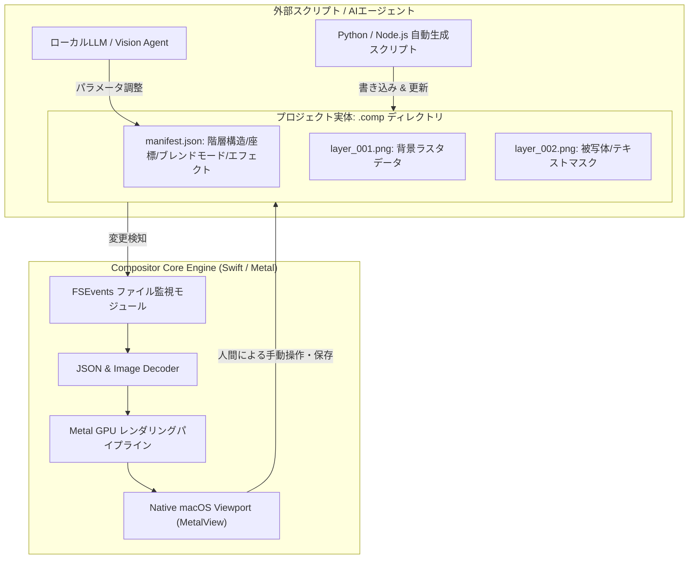

# Compositor: 概要

robbietilton/Compositor は 2026-09-17 に GitHub で作成されたリポジトリです。2026-10-11 時点のスター数は 15,455 です。

近年、Adobe Creative Cloudのサブスクリプションコスト高騰やクラウド依存への反発から、ローカルネイティブかつ軽量なクリエイティブツールの需要が急速に高まっています。「Compositor」は、macOS（Apple Silicon）専用にゼロからSwiftで設計された、完全オープンソース（MITライセンス）のPhotoshopオルタナティブです。

従来のGIMPのようなマルチプラットフォームOSSが抱えていた「UI/UXの非直感性」「macOS独自機能への非対応」「描画レスポンスの遅延」といった課題を、macOS専用設計（MetalやAccelerateフレームワークのフル活用）により完全に克服。さらに特筆すべき革新性として、**「AIエージェントフレンドリーなアーキテクチャ」**を標準搭載している点が挙げられます。独自プロジェクト形式（`.comp`）をファイルシステム直結のJSONマニフェストとPNG群で構成することで、外部スクリプトや生成AIモデルがバックグラウンドから画像編集をリアルタイムに駆動できる設計になっています。

## 解決する主要な課題とアーキテクチャ

Compositorが解決する中核的な技術課題は以下の3点です：

1. **高負荷なGPU非破壊レンダリングのローカル完結**:
   各レイヤーの調整レイヤー（Curves, Levels, LUT）、レイヤースタイル（Drop Shadow, Stroke等）をMetalパイプライン上でリアルタイム計算。メモリ消費を動的にスケーリングし、大容量PSD/PSBファイルも即座に展開。
2. **Photoshop風のワークフロー**:
   ブレンドモードの計算順序、クリッピングマスク、非破壊変形、Camera Raw風フィルターパネルなど、プロが違和感なく移行できる操作系を提供。
3. **人間とAIエージェントのハイブリッド制作基盤**:
   `.comp`ファイルの実体はディレクトリ構造（`manifest.json` + `layer_*.png`）であり、OSのファイル監視（FSEvents）と連動。AIスクリプトがレイヤーを追加・変形すると、エディタ側がリロードなしで即座にビューポートを更新します。



## インストール（README からの転記）

以下は [README](https://github.com/robbietilton/Compositor#readme) のインストール手順のコードブロックを、そのまま転記したものです。当サイトでは動作を確認していません。最新の手順は README を確認してください。

```sh
brew install --cask robbietilton-compositor
```

## ライセンス

- ライセンス: MIT License（SPDX: MIT）
- 確認先: [LICENSE ファイル](https://github.com/robbietilton/Compositor/blob/main/LICENSE)

この節はライセンスの名称と確認先を示すもので、法的な助言ではありません。利用の可否は、LICENSE ファイルの本文と利用する状況に照らして確認してください。
