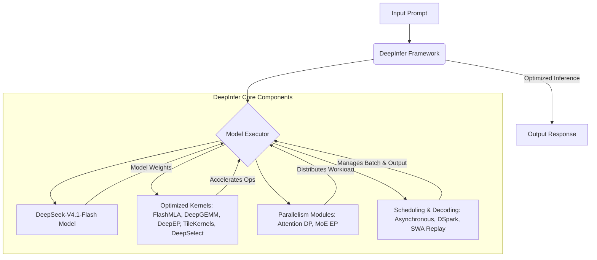

# DeepInfer: 概要と革新性

DeepInferは、DeepSeek AIが大規模なプロダクションサービスを支えるために開発した、高性能な推論フレームワークです。このオープンソースリリースは、DeepSeekモデルのオフライン推論に特化しており、大規模なサービス提供に必要なコア機能を網羅しています。特に、LLMの推論におけるパフォーマンスと効率を最大化するための革新的な技術が多数組み込まれています。

## 🎯 成熟度の目安（AI による見立て）

**根拠:**
記事作成時点で GitHub のスター数は 12,000 を超えています。[README](https://github.com/deepseek-ai/DeepInfer#readme) には、DeepSeek の大規模な本番サービスを支える推論フレームワークであり、今回のオープンソース版はオフライン推論向けであると記載されています。ライセンスは Apache License 2.0 です。本番サービスでの利用は DeepSeek 社内での実績で、公開版の動作や性能を当サイトで検証したものではありません。

**検証候補になる用途:**
DeepSeek のモデルのオフライン推論の検証候補になります。公開版はオフライン推論向けのため、オンラインのサービス提供に使う場合に必要な機能がそろっているかは README で確認してください。自社の GPU / NPU 環境での動作と性能は、事前の検証が必要です。

## 解決する主要な課題とアーキテクチャ

DeepInferが解決する主要な課題は、大規模言語モデル（LLM）の推論における「パフォーマンス」「スケーラビリティ」「効率性」です。特に、DeepSeekモデルのような大規模モデルを実サービスで利用する際、高いスループットと低いレイテンシを両立させることは極めて困難です。DeepInferは、以下の革新的なアーキテクチャと機能によってこれらの課題を克服します。

1.  **最適化されたカーネル群:** FlashMLA, DeepGEMM, DeepEP, TileKernels, DeepSelect, およびカスタムのTileLangカーネルといった、GPU/NPUに特化した低レベル最適化カーネルを多数統合。これにより、計算効率を飛躍的に向上させます。
2.  **高度な並列処理:** Attention DP (Data Parallelism) / balanced CP (Context Parallelism)、MoE EP (Expert Parallelism) + EPLB (Expert Parallelism Load Balancing) などの並列化戦略をサポートし、複数のデバイスにわたる効率的なワークロード分散を実現します。
3.  **インテリジェントなスケジューリング:**
    *   **DSparkと信頼度に基づく検証:** ドラフトトークンを用いたデコーディングを高速化し、信頼度推定に基づいて検証をスケジュールすることで、推論速度を向上させます。
    *   **SWA (Sliding Window Attention) バウンドリプレイ:** デコーダのプリフィル作業を、境界のあるサフィックスのみをリプレイすることで削減します。
    *   **非同期スケジューリング:** CPUのバッチスケジューリングとデバイス実行をオーバーラップさせ、ゼロオーバーヘッドのバッチ処理を実現します。
4.  **出力制御と再現性:**
    *   **バッチ不変推論:** 異なるバッチ構成でもモデル結果を同一に保ちます（NVIDIAのみ）。
    *   **決定論的サンプリング:** 同一の入力トークンとサンプリングパラメータに対して同一の出力を生成します（NVIDIAのみ）。
    *   **構造化出力:** 正規表現、JSONスキーマ、EBNF文法に基づいて生成を制約し、特定のフォーマットに沿った出力を保証します。

これらの機能は、DeepInferがDeepSeekモデルの推論を極限まで最適化し、大規模なプロダクション環境での要求に応えるための基盤となっています。

**注意点:** DeepInferのオープンソースリリースには、完全な推論サービスに必要な以下のコンポーネントは含まれていません。これらは別途構築が必要です。
-   KVキャッシュシステム
-   VE/Prefill/Decodeの分離（エンジン機能の大部分は実装済み）
-   プリフィルとデコードの両方におけるデータ並列レプリカ間のロードバランシング

## 競合ツール/商用SaaSとの徹底比較

DeepInferは、LLM推論最適化の分野で先行するvLLM、SGLang、TensorRT-LLMといったフレームワークからインスピレーションを受けていますが、DeepSeekモデルに特化し、独自の最適化を施すことで差別化を図っています。

| 特徴/フレームワーク | DeepInfer | vLLM | SGLang | TensorRT-LLM |
| :------------------ | :-------- | :--- | :----- | :----------- |
| **主要ターゲット** | DeepSeekモデルの大規模推論 | 汎用LLM推論 | LLM推論とプロンプトエンジニアリング | NVIDIA GPU向けLLM推論 |
| **最適化カーネル** | FlashMLA, DeepGEMM, DeepEPなどDeepSeek独自の最適化 | PagedAttentionなど | SGLang独自の最適化 | NVIDIA TensorRTによる最適化 |
| **並列処理** | Attention DP, MoE EP + EPLB | テンソル並列、パイプライン並列など | - | テンソル並列、パイプライン並列など |
| **スケジューリング** | DSpark, SWA bounded replay, 非同期スケジューリング | vLLM独自の連続バッチ処理 | SGLang独自の並列処理 | - |
| **構造化出力** | 正規表現, JSONスキーマ, EBNF | JSONモードなど | JSONモードなど | - |
| **ハードウェアサポート** | NVIDIA SM100, Huawei Ascend 950 | NVIDIA GPU | NVIDIA GPU | NVIDIA GPU |
| **強み** | DeepSeekモデルに特化した最高峰のパフォーマンスと効率性、Ascend NPUサポート | 汎用性と使いやすさ、高いスループット | プロンプトエンジニアリングとの統合、柔軟な制御 | NVIDIAハードウェアでの最高性能、低レイテンシ |
| **弱み** | DeepSeekモデル以外への汎用性は限定的、完全なサービスには追加コンポーネントが必要 | 特定のモデルに特化した最適化はDeepInferに劣る可能性 | 大規模な並列処理やスケーラビリティはDeepInferに劣る可能性 | NVIDIAエコシステムに限定、設定の複雑さ |

DeepInferの特徴は、DeepSeek のモデルに特化した推論フレームワークである点です。README によると、DeepSeek の本番サービスを支えるフレームワークのオープンソース版です（他のフレームワークとの性能比較は当サイトでは検証していません）。また、Huawei Ascend NPUをサポートしている点も、特定の市場やインフラを持つ企業にとっては大きなメリットとなります。

## 商用利用可否 & ライセンス考察

DeepInferは、**Apache License 2.0** の下でリリースされています。

**Apache License 2.0の主な特徴:**
-   **商用利用:** 完全に許可されています。
-   **改変:** 許可されています。
-   **再配布:** 許可されています。
-   **サブライセンス:** 許可されています。
-   **特許権:** ライセンス対象のソフトウェアに含まれる特許権を、利用者が無償で利用することを許可します。
-   **表示義務:** 派生製品や再配布を行う場合、元のライセンスと著作権表示を含める必要があります。また、変更を加えた場合はその旨を明記する必要があります。

このライセンスにより、企業はDeepInferを安心して商用製品やサービスに組み込むことができます。自社サービスの一部として利用したり、DeepInferを基盤とした受託開発を行ったりすることも可能です。ただし、ライセンスの表示義務や変更点の明記といった要件は遵守する必要があります。