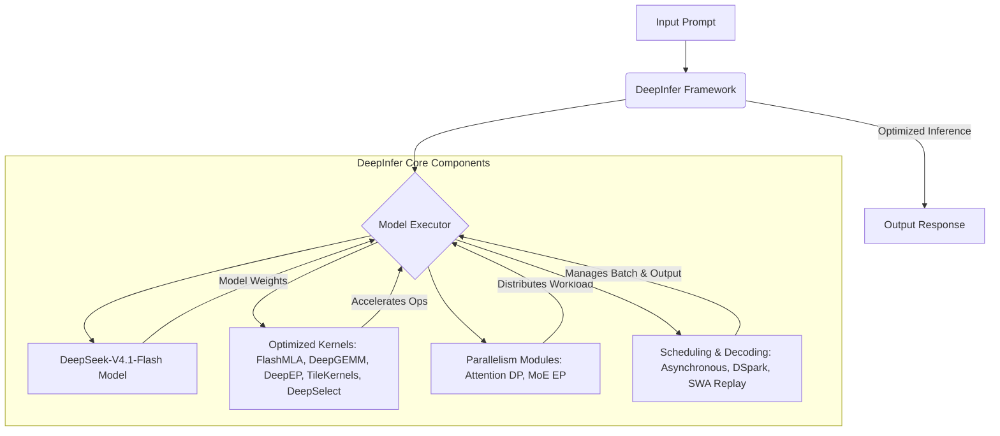

# DeepInfer: 概要

deepseek-ai/DeepInfer は 2026-10-16 に GitHub で作成されたリポジトリです。2026-10-21 時点のスター数は 12,071 です。

DeepInferは、DeepSeek AIが大規模なプロダクションサービスを支えるために開発した、高性能な推論フレームワークです。このオープンソースリリースは、DeepSeekモデルのオフライン推論に特化しており、大規模なサービス提供に必要なコア機能を網羅しています。README には、推論の性能と効率のための最適化カーネルや並列化・スケジューリングの機能が挙げられています。

## 🎯 成熟度の目安（AI による見立て）

**根拠:**
記事作成時点で GitHub のスター数は 12,000 を超えています。[README](https://github.com/deepseek-ai/DeepInfer#readme) には、DeepSeek の大規模な本番サービスを支える推論フレームワークであり、今回のオープンソース版はオフライン推論向けであると記載されています。ライセンスは Apache License 2.0 です。本番サービスでの利用は DeepSeek 社内での実績で、公開版の動作や性能を当サイトで検証したものではありません。

**検証候補になる用途:**
DeepSeek のモデルのオフライン推論の検証候補になります。公開版はオフライン推論向けのため、オンラインのサービス提供に使う場合に必要な機能がそろっているかは README で確認してください。自社の GPU / NPU 環境での動作と性能は、事前の検証が必要です。

## 解決する主要な課題とアーキテクチャ

DeepInferが解決する主要な課題は、大規模言語モデル（LLM）の推論における「パフォーマンス」「スケーラビリティ」「効率性」です。特に、DeepSeekモデルのような大規模モデルを実サービスで利用する際、高いスループットと低いレイテンシを両立させることは極めて困難です。README に記載されている主なアーキテクチャと機能は次のとおりです。

1.  **最適化されたカーネル群:** FlashMLA, DeepGEMM, DeepEP, TileKernels, DeepSelect, およびカスタムのTileLangカーネルといった、GPU/NPUに特化した低レベル最適化カーネルを多数統合。計算効率の向上を目的としています。
2.  **高度な並列処理:** Attention DP / balanced CP、MoE EP + EPLB などの並列化戦略をサポートし、複数のデバイスにわたる効率的なワークロード分散を実現します。
3.  **インテリジェントなスケジューリング:**
    *   **DSparkと信頼度に基づく検証:** ドラフトトークンを用いたデコーディングを高速化し、信頼度推定に基づいて検証をスケジュールすることで、推論速度を向上させます。
    *   **SWA バウンドリプレイ:** デコーダのプリフィル作業を、境界のあるサフィックスのみをリプレイすることで削減します。
    *   **非同期スケジューリング:** CPUのバッチスケジューリングとデバイス実行をオーバーラップさせ、ゼロオーバーヘッドのバッチ処理を実現します。
4.  **出力制御と再現性:**
    *   **バッチ不変推論:** 異なるバッチ構成でもモデル結果を同一に保ちます（NVIDIAのみ）。
    *   **決定論的サンプリング:** 同一の入力トークンとサンプリングパラメータに対して同一の出力を生成します（NVIDIAのみ）。
    *   **構造化出力:** 正規表現、JSONスキーマ、EBNF文法に基づいて生成を制約し、特定のフォーマットに沿った出力を保証します。

これらは、DeepSeek のモデルの推論を最適化するための機能として README に記載されています。



**注意点:** DeepInferのオープンソースリリースには、完全な推論サービスに必要な以下のコンポーネントは含まれていません。これらは別途構築が必要です。
-   KVキャッシュシステム
-   VE/Prefill/Decodeの分離（エンジン機能の大部分は実装済み）
-   プリフィルとデコードの両方におけるデータ並列レプリカ間のロードバランシング

## インストール（README からの転記）

以下は [README](https://github.com/deepseek-ai/DeepInfer#readme) のインストール手順のコードブロックを、そのまま転記したものです。当サイトでは動作を確認していません。最新の手順は README を確認してください。

```bash
# Use `ascend` instead for the Ascend platform
# Keep it exported in the environment where you run DeepInfer
export DEEPINFER_ACCELERATOR=nvidia
./build.sh
```

```bash
python examples/offline_inference.py
```

## ライセンス

- ライセンス: Apache License 2.0（SPDX: Apache-2.0）
- 確認先: [LICENSE ファイル](https://github.com/deepseek-ai/DeepInfer/blob/main/LICENSE)

この節はライセンスの名称と確認先を示すもので、法的な助言ではありません。利用の可否は、LICENSE ファイルの本文と利用する状況に照らして確認してください。
