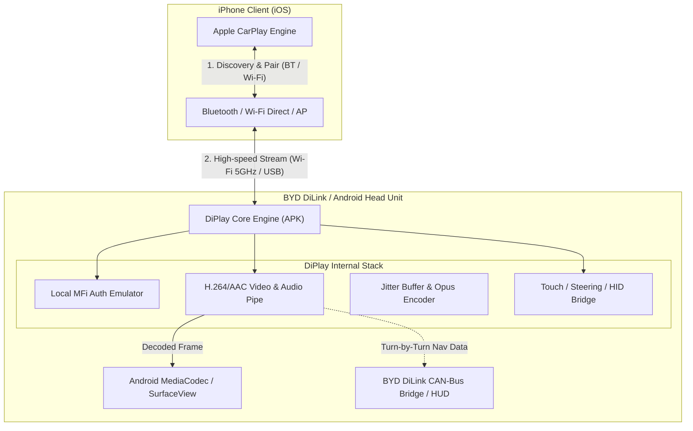

# DiPlay: 概要

shihabal3amri/DiPlay は 2026-09-25 に GitHub で作成されたリポジトリです。2026-10-14 時点のスター数は 10,296 です。

**DiPlay**は、Androidベースの車載インフォテインメント（IVI）システム（特にBYD製車両のDiLinkシステム向けに最適化）上でネイティブに動作する独立型Apple CarPlayレシーバーアプリケーションです。

従来の車載Android端末におけるCarPlay利用は、Carlinkitなどの「外付けUSBハードウェアドングル（プロトコル変換アダプター）」を物理接続することが事実上の業界標準でした。しかしDiPlayは、追加ハードウェアを一切介さず、Android車載機のAPKレイヤー単体でCarPlayプロトコルのハンドシェイク、Wi-Fi Direct / 車載ホットスポット経由のワイヤレスリンク確立、映像デコード、オーディオバッファリング、HID入力を完結させます。

---

## 解決する主要な課題とアーキテクチャ

### 従来の車載プロジェクションの課題
1. **追加ハードウェアへの依存**: 物理ドングル故障リスク、USBポートの占有、熱暴走による接続瞬断。
2. **車載ハードウェアとの統合不足**: 外部ドングル経由では車両側のHUD（ヘッドアップディスプレイ）やメータクラスタ（メーターパネル）へのルート案内表示（交差点名・矢印）、ステアリングスイッチ連動が困難。
3. **高遅延・オーディオアンダーラン**: 2重の変換レイヤーによる音声遅延、通話時のエコー、Siri入力の脱落。

### システムアーキテクチャと通信フロー
DiPlayは、Kotlinおよび低レイヤーNativeコードを用いてAndroid端末上にCarPlay Accessory Daemonを自律展開します。

DiPlayは外部認証サーバーや常時インターネット接続を必要とせず、ローカル認証シーケンスを車載機内で完結。受信したH.264ストリームをAndroid標準の`MediaCodec`へダイレクトに流し込むことで、超低遅延描画とBYD DiLink特有の画面回転・HUD連携を実現しています。

---

## インストール（README からの転記）

README にインストール手順のコードブロックが見つかりませんでした。導入方法は [README](https://github.com/shihabal3amri/DiPlay#readme) を確認してください。

## ライセンス

- ライセンス: GNU General Public License v3.0（SPDX: GPL-3.0）
- 確認先: [LICENSE ファイル](https://github.com/shihabal3amri/DiPlay/blob/main/LICENSE)

この節はライセンスの名称と確認先を示すもので、法的な助言ではありません。利用の可否は、LICENSE ファイルの本文と利用する状況に照らして確認してください。
