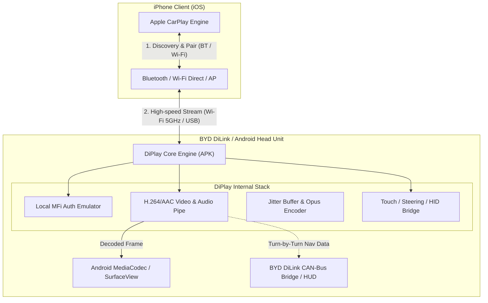

# DiPlay: 概要と革新性

**DiPlay**は、Androidベースの車載インフォテインメント（IVI）システム（特にBYD製車両のDiLinkシステム向けに最適化）上でネイティブに動作する独立型Apple CarPlayレシーバーアプリケーションです。

従来の車載Android端末におけるCarPlay利用は、Carlinkitなどの「外付けUSBハードウェアドングル（プロトコル変換アダプター）」を物理接続することが事実上の業界標準でした。しかしDiPlayは、追加ハードウェアを一切介さず、Android車載機のAPKレイヤー単体でCarPlayプロトコルのハンドシェイク、Wi-Fi Direct / 車載ホットスポット経由のワイヤレスリンク確立、映像デコード、オーディオバッファリング、HID入力を完結させます。

GitHubスター数は1万を超え、車載組み込み・車載Android（AOSP/AAOS）ハッキングコミュニティを中心に注目を集めています。

---

## 解決する主要な課題とアーキテクチャ

### 従来の車載プロジェクションの課題
1. **追加ハードウェアへの依存**: 物理ドングル故障リスク、USBポートの占有、熱暴走による接続瞬断。
2. **車載ハードウェアとの統合不足**: 外部ドングル経由では車両側のHUD（ヘッドアップディスプレイ）やメータクラスタ（メーターパネル）へのルート案内表示（交差点名・矢印）、ステアリングスイッチ連動が困難。
3. **高遅延・オーディオアンダーラン**: 2重の変換レイヤーによる音声遅延、通話時のエコー、Siri入力の脱落。

### システムアーキテクチャと通信フロー
DiPlayは、Kotlinおよび低レイヤーNativeコードを用いてAndroid端末上にCarPlay Accessory Daemonを自律展開します。



DiPlayは外部認証サーバーや常時インターネット接続を必要とせず、ローカル認証シーケンスを車載機内で完結。受信したH.264ストリームをAndroid標準の`MediaCodec`へダイレクトに流し込むことで、超低遅延描画とBYD DiLink特有の画面回転・HUD連携を実現しています。

---

## 競合ツール/商用SaaSとの徹底比較

| 項目 | DiPlay (本OSS) | Carlinkit / AutoKit (市販ドングル) | 自動車メーカー純正CarPlay |
|---|---|---|---|
| **必要ハードウェア** | 車載Android端末のみ（ドングル不要） | 専用USBハードウェア（約7,000〜15,000円） | メーカー純正ファームウェア |
| **接続方式** | 有線USB / Wi-Fi Direct / 車載AP / 外部LAN | 専用ドングル経由（USB/無線） | 有線USB / 無線 (Wi-Fi) |
| **HUD / メーター連携** | **可能**（BYD向けプロトコル解析済み） | 原則不可（単一画面出力のみ） | 完全ネイティブ対応 |
| **レイテンシ** | 極小（ダイレクトハードウェアデコード） | 中〜大（ドングル変換オーバーヘッド有） | 最小 |
| **導入コスト** | 完全無料（OSS） | ハードウェア購入費 | オプション費用（数万円〜数十万円） |
| **カスタマイズ性** | ソースコード改修・解像度/FPS変更可能 | ブラックボックス（設定変更制限あり） | 不可 |

---

## 💡 ビジネス・マネタイズ活用アイデア（実践例）

1. **中古輸入車・EV専門のインフォテインメント改修受託**
   - 日本国内へ並行輸入されたテスラ以外の海外EV（BYD等）や並行輸入Android搭載車のIVIに対して、日本語ローカライズとCarPlay環境を後付けセットアップする施工パッケージ（1台あたり3万〜8万円の施工マージン）。
2. **商用フリート・タクシー/配送車両向け車載端末の統合ソリューション**
   - 配車専用AndroidタブレットにDiPlayを組み込み、ドライバー自身の社用iPhoneとシームレスに連携。ナビ画面と運行管理アプリをマルチウィンドウ・PIPで共存させるフリートDXソリューション。
3. **キャンピングカー・建機向けスマートコンソールカスタム**
   - 汎用Android車載ディスプレイを搭載した特装車向けに、ブランドロゴ最適化・ステアリングスイッチ連動を組み込んだオリジナルCarPlayコンソール受託。

---

## インストール & クイックスタート手順

### 動作要件
- **車載機**: Android 7.1+（API 25以上、Android 10以上を推奨）、サードパーティAPKのインストール権限があること。
- **スマートフォン**: iOS 13以降のCarPlay対応iPhone。

### 手順
1. **APKのダウンロード**:
   GitHub Releasesから最新の`DiPlay-vX.X.X.apk`をUSBメモリまたは車載機ブラウザ経由でダウンロード。
2. **インストールの実行**:
   車載機のファイルマネージャーからAPKをインストール（ADB権限が利用可能な場合、HUD連動やステアリング連携がフル機能化）。
   ```bash
   adb install -r DiPlay-v0.2.19.apk
   # 必要に応じて拡張権限を付与
   adb shell pm grant com.shihab.diplay android.permission.WRITE_SECURE_SETTINGS
   ```
3. **初期設定 & ペアリング**:
   - 車両のWi-FiまたはWi-Fi Directをオンにする。
   - iPhoneのBluetooth画面で車載機デバイス名を検索してペアリング、CarPlayの利用を承認。
   - 画面解像度、フレームレート（30fps / 60fps）、アイコンスケーリングを設定メニューから調整。

---

## 商用利用可否 & ライセンス考察

- **ライセンス**: **GNU General Public License v3.0 (GPL-3.0)**
  - 本リポジトリの派生物を再配布・販売する場合、ソースコードの完全な公開義務が発生します。
- **法務・知的財産上の重要留意事項**:
  - **MFi認証**: 本OSSはApple公式のMFiライセンス製品ではありません。公開ファームウェアから抽出・再現された実験的なアクセサリIDを用いており、将来的なiOSアップデートで接続が制限されるリスクがあります。
  - **商用製品化の境界**: 自社製ハードウェアにDiPlayをそのままプリインストールして販売する形態は、AppleのCarPlay商標権および知的財産権の観点から法務リスクを伴います。「オープンソース導入支援・環境構築・CAN-Busインテグレーションの受託SI役務」として技術サービスを提供するビジネスモデルが極めて現実的かつ安全です。
