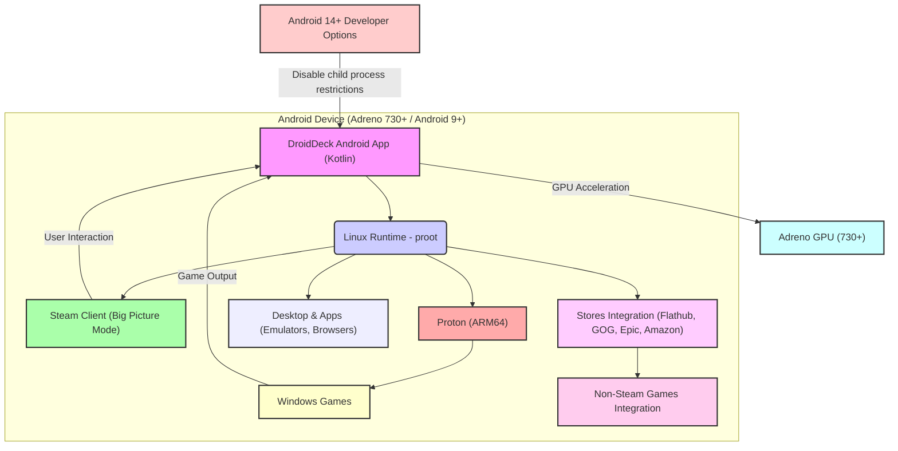

# DroidDeck: 概要

Droid-Deck/DroidDeck は 2026-09-25 に GitHub で作成されたリポジトリです。2026-10-15 時点のスター数は 8,333 です。

DroidDeckは、Androidデバイス上でValveのSteamOS体験を再現し、Steam Big PictureモードとARM64版Protonを介してWindowsゲームの実行を目指すオープンソースプロジェクトです。対象は README に記載された Adreno GPU 搭載のデバイスです。

従来のAndroidゲーミングは、ネイティブアプリに限定されるか、クラウドゲーミングサービスに依存していました。DroidDeckは、この現状を打破し、デバイス上で直接PCゲームを動作させるという、これまでになかった自由とパフォーマンスを提供します。特に、Steam Deckのような専用ハードウェアに投資することなく、既存のAndroidデバイス資産を最大限に活用できる点が、その最大の魅力であり革新性と言えるでしょう。

## 解決する主要な課題とアーキテクチャ

DroidDeckが解決する主要な課題は以下の通りです。

1.  **AndroidデバイスでのPCゲーム体験の欠如:** 多くのAndroidデバイスは高性能なハードウェアを持つものの、PCゲームの実行環境がありませんでした。DroidDeckはProtonを導入することで、このギャップを埋めます。
2.  **高価な専用ゲーミングハードウェアへの依存:** Steam Deckのような専用デバイスは魅力的ですが、初期投資が必要です。DroidDeckは既存のAndroidデバイスを活用し、コストを削減します。
3.  **クラウドゲーミングの制約:** ネットワーク環境に依存し、遅延やデータ使用量の問題があるクラウドゲーミングに対し、DroidDeckはデバイス上でのローカル実行を可能にします。

DroidDeckのアーキテクチャは、Androidアプリケーション、Linuxランタイム、そしてValveの技術要素を巧みに統合しています。

1.  **DroidDeck Android App (Kotlin):** Androidデバイス上で動作するメインアプリケーション。ユーザーインターフェースを提供し、Linuxランタイムの起動と管理を行います。
2.  **Linux Runtime (proot):** Androidのサンドボックス内で動作する仮想的なLinux環境。`proot`技術を利用し、root権限なしでLinux環境をエミュレートします。
3.  **Steam Client (Big Picture Mode):** Linuxランタイム上で動作するSteamクライアント。ゲームライブラリへのアクセス、ダウンロード、起動を管理します。
4.  **Proton (ARM64):** Valveが開発したWindowsゲーム互換レイヤーのARM64版。WindowsゲームのAPIコールをLinux互換に変換し、Androidデバイス上でWindowsゲームを実行可能にします。
5.  **Adreno GPU (730+):** DroidDeckのパフォーマンスを支える重要なハードウェア要素。DirectX 11/12ゲームのレンダリングを高速化します。
6.  **Stores Integration:** FlathubからのLinuxアプリ、GOG、Epic Games、Amazon Gamesなどの外部ストアからゲームをダウンロードし、Steamに非Steamゲームとして統合する機能を提供します。

このアーキテクチャにより、DroidDeckはAndroidデバイスのハードウェア性能を最大限に引き出し、PCゲーミングの新たな可能性を切り開いています。

## インストール（README からの転記）

README にインストール手順のコードブロックが見つかりませんでした。導入方法は [README](https://github.com/Droid-Deck/DroidDeck#readme) を確認してください。

## ライセンス

- ライセンス: GNU General Public License v3.0（SPDX: GPL-3.0）
- 確認先: [LICENSE ファイル](https://github.com/Droid-Deck/DroidDeck/blob/main/LICENSE)

この節はライセンスの名称と確認先を示すもので、法的な助言ではありません。利用の可否は、LICENSE ファイルの本文と利用する状況に照らして確認してください。
