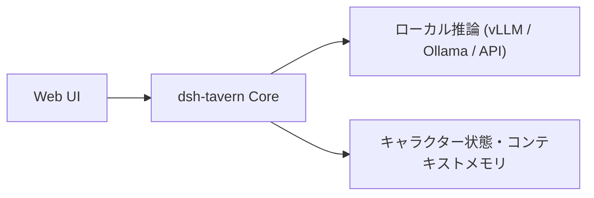

# dsh-tavern: 概要

flizzywine/dsh-tavern は 2026-08-16 に GitHub で作成されたリポジトリです。2026-10-09 時点のスター数は 819 です。

**dsh-tavern**は、LLMを活用したテキストロールプレイングおよび対話型AIエージェントプラットフォームです。オープンソースのロールプレイ環境としてデファクトスタンダードである「SillyTavern（酒館）」のエコシステム（キャラクターカード、World Info / 世界書、正規表現ルール、MVUなど）との互換性を維持しながら、アーキテクチャを根本から再設計しています。

最大の特徴は、**「DSH（DeepSeek Harness）」を基盤としたマルチエージェント型タスク分割アーキテクチャ**の採用です。従来のSillyTavernが抱えていた「プロンプト肥大化による出力崩れ」「変数ステータス計算の失敗」「キャッシュ効率の悪さによるレイテンシ・トークンコストの増大」といったペインポイントを、洗練されたオーケストレーションによって解決しています。

### 主な革新点
- **フロントとバックエンドのタスク分離**: 本文生成と変数処理（好感度、HPなどの数値計算）を別々のエージェントに分担させ、文筆クオリティの向上とステータス管理の厳密性を両立。
- **Prompt Caching（プロンプトキャッシュ）の最適化**: 構造の固定化によりキャッシュヒット率95%以上を達成し、応答時間などの数値は README で確認してください。
- **対話型メンテナンス・デバッグAgent**: キャラクターカードの調整や正規表現の不具合解析を、自然言語で自律エージェントに指示可能。

---

## 解決する主要な課題とアーキテクチャ


### 1. 従来アーキテクチャの課題（モノリシック・プロンプティング）
従来のSillyTavern等では、1回の大規模なプロンプト要求に対して「物語の地の文・会話文」「ステータスバーの変数更新」「プレイヤー用選択肢の提示」を同時にLLMに指示していました。これにより以下の致命的な欠陥が生じていました。
- **コンテキストの注意分散（Attention Dilution）**: フォーマット指定や数値計算に注意が割かれ、文章の表現力やキャラクター性が劣化する。
- **フォーマット崩れの頻発**: 会話が進むにつれてステータス枠のマークダウンが破損する。
- **全損リトライ**: 選択肢だけ直したい場合でも、本文全体を再生成（抽卡）する必要があり、APIコストと時間が無駄になる。

### 2. dsh-tavernのパイプライン・アーキテクチャ
dsh-tavernでは、ワークフローを有向グラフ（DAG）のように分割しています。

- **部分リトライと指示付き再生成（Feedback Rewrite）**: 本文のみ、選択肢のみのエラー修復が可能。「描写を減らして心理描写を増やして」といった差分ディレクションにも対応。
- **自律的メモリ検索（Tool-based Memory Retrieval）**: 毎ターン要約をプロンプトにねじ込むのではなく、エージェントが必要に応じて過去ログを検索ツール経由で取得。これにより数万トークンに及ぶ長期セッションでも初期設定の齟齬が発生しません。

---

## インストール（README からの転記）

以下は [README](https://github.com/flizzywine/dsh-tavern#readme) のインストール手順のコードブロックを、そのまま転記したものです。当サイトでは動作を確認していません。最新の手順は README を確認してください。

```powershell
     $env:DSH_TAVERN_HOST='desktop'; $tavernInstaller=[Text.Encoding]::UTF8.GetString((New-Object Net.WebClient).DownloadData('https://raw.githubusercontent.com/flizzywine/dsh-tavern/main/install.ps1')); Invoke-Expression $tavernInstaller
```

> ⚠️ 注意: インターネットから取得したスクリプトをそのまま実行する手順です。実行前にスクリプトの中身を確認し、可能であればバージョン（タグやコミット）を固定してください。

```sh
   curl -fsSL 'https://raw.githubusercontent.com/flizzywine/dsh-tavern/main/install.sh' -o /tmp/dsh-tavern-install.sh && DSH_TAVERN_HOST=desktop sh /tmp/dsh-tavern-install.sh
```

> ⚠️ 注意: インターネットから取得したスクリプトをそのまま実行する手順です。実行前にスクリプトの中身を確認し、可能であればバージョン（タグやコミット）を固定してください。

```powershell
$env:DSH_TAVERN_HOST='cli'; $tavernInstaller=[Text.Encoding]::UTF8.GetString((New-Object Net.WebClient).DownloadData('https://raw.githubusercontent.com/flizzywine/dsh-tavern/main/install.ps1')); Invoke-Expression $tavernInstaller
```

> ⚠️ 注意: インターネットから取得したスクリプトをそのまま実行する手順です。実行前にスクリプトの中身を確認し、可能であればバージョン（タグやコミット）を固定してください。

```sh
curl -fsSL 'https://raw.githubusercontent.com/flizzywine/dsh-tavern/main/install.sh' -o /tmp/dsh-tavern-install.sh && DSH_TAVERN_HOST=cli sh /tmp/dsh-tavern-install.sh
```

> ⚠️ 注意: インターネットから取得したスクリプトをそのまま実行する手順です。実行前にスクリプトの中身を確認し、可能であればバージョン（タグやコミット）を固定してください。

## ライセンス

- ライセンス: GNU Affero General Public License v3.0（SPDX: AGPL-3.0）
- 確認先: [LICENSE ファイル](https://github.com/flizzywine/dsh-tavern/blob/main/LICENSE)

この節はライセンスの名称と確認先を示すもので、法的な助言ではありません。利用の可否は、LICENSE ファイルの本文と利用する状況に照らして確認してください。
