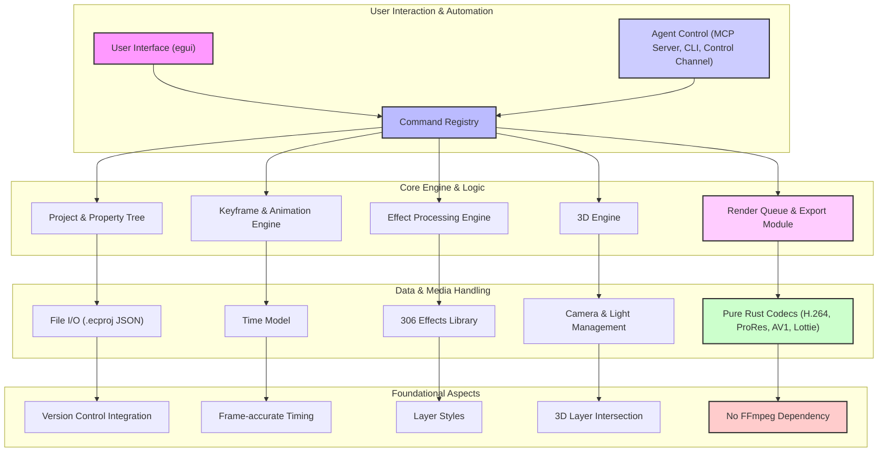

# effectcraft: 概要

storytold/effectcraft は 2026-10-01 に GitHub で作成されたリポジトリです。2026-10-18 時点のスター数は 7,161 です。

## 🎯 成熟度の目安（AI による見立て）

**根拠と検証候補になる用途:**
EffectCraftは、Adobe After Effectsのクリーンルーム再実装という野心的な目標を掲げ、純粋なRustでゼロから構築されたオープンソースのモーショングラフィックス・コンポジティングツールです。GitHubで7,000を超えるスターを獲得し、コミュニティからの注目度は非常に高いです。Lottieのネイティブサポート、プロジェクトファイルの人間が読めるJSON形式、そしてコマンドラインやMCP（Model Context Protocol）を介した高度なスクリプト・エージェント連携機能は、CI/CDパイプラインへの統合やAI駆動型コンテンツ生成への応用が考えられます。

しかし、開発者自身が「まだalpha版であり、プロフェッショナルな仕事でのAfter Effects代替には至らない」と明言している通り、After Effectsプロジェクトの直接的な互換性がない点、動作の差異が残る点、macOSが最もテストされているプラットフォームである点など、プロダクション環境での全面的な採用にはまだ課題があります。

これらの状況から、現時点では検証段階のツールと見立てています（AI による目安です）。
検証候補になる用途としては、新規プロジェクトにおけるPoC（概念実証）、社内での自動化ツールとしての試験導入、After Effectsの代替を模索する研究開発、そしてRustエコシステムへの貢献を目的とした開発参加が挙げられます。AI エージェントと連携したコンテンツ生成や、Lottie アニメーションのワークフローを検討している場合に検証候補になります。

## 解決する主要な課題とアーキテクチャ

EffectCraftは、既存の商用モーショングラフィックスツールの抱える以下の主要な課題を解決しようとしています。

1.  **高コストとベンダーロックイン**: Adobe After Effectsなどの商用ツールは高額なサブスクリプション費用がかかり、特定のベンダーに依存するリスクがあります。EffectCraftはオープンソースであるため、ライセンス費用が不要で、コミュニティ主導で開発が進められます。
2.  **パフォーマンスと安定性**: 純粋なRustでゼロから構築されているため、メモリ安全性と実行時のパフォーマンスが最適化されています。FFmpegに依存せず、独自のRust製コーデックを使用することで、より制御された高速な処理が期待できます。
3.  **自動化とCI/CD連携の困難さ**: 従来のGUI中心のツールは、スクリプトによる自動化やCI/CDパイプラインへの統合が難しい場合があります。EffectCraftは、全ての操作がコマンドレジストリを介し、コマンドライン、JSONコントロールチャンネル、MCPサーバーからアクセス可能であるため、ヘッドレスでの自動レンダリングやAIエージェントによる操作が容易です。
4.  **Web/アプリ連携の複雑さ**: Webやモバイルアプリで利用されるLottieアニメーションへの変換には、通常プラグインや追加のワークフローが必要でした。EffectCraftはLottieのインポート/エクスポートをネイティブでサポートし、このプロセスを大幅に簡素化します。
5.  **プロジェクトファイルの可読性**: 商用ツールのプロジェクトファイルはバイナリ形式が多く、バージョン管理システムでの差分比較が困難です。EffectCraftのプロジェクトファイルは人間が読めるJSON形式（`.ecproj`）であり、Gitなどのバージョン管理システムとの親和性が高いです。

### アーキテクチャ概要

EffectCraftは「Engine first」のアプローチを採用しており、厳格なレイヤリングを持つ小さなクレートのスタックで構成されています。UI層（egui）は最上位に位置し、その下のエンジン層はUIに依存しません。これにより、ヘッドレス実行や異なるUIフレームワークへの対応が容易になっています。



**主要コンポーネント:**

*   **User Interface (egui)**: クロスプラットフォーム対応のGUIフレームワークeguiを使用。
*   **Command Registry**: 全てのユーザー操作やエージェントからのコマンドを処理する中心ハブ。
*   **Project & Property Tree**: プロジェクト構造、レイヤー、プロパティを管理。`.ecproj` (JSON) 形式で保存。
*   **Keyframe & Animation Engine**: キーフレーム補間、グラフエディタ、エクスプレッションなどを処理。
*   **Effect Processing Engine**: 306種類のエフェクトと9種類のレイヤースタイルを適用。
*   **3D Engine**: クラシック3Dレイヤー、カメラ、ライト、シャドウをサポート。
*   **Render Queue & Export Module**: H.264, ProRes, AV1, Lottieなど多様な形式でのレンダリングとエクスポートを管理。
*   **Pure Rust Codecs**: FFmpegに依存しない、自社開発のRust製ビデオ/オーディオコーデック。
*   **Agent Control**: MCPサーバー、コマンドラインインターフェース、コントロールチャンネルを通じて、外部システムやAIエージェントからの操作を可能にする。

## インストール（README からの転記）

以下は [README](https://github.com/storytold/effectcraft#readme) のインストール手順のコードブロックを、そのまま転記したものです。当サイトでは動作を確認していません。最新の手順は README を確認してください。

```sh
eselect repository add snakebyte git https://github.com/switch87/snakebyte-overlay.git
emaint sync -r snakebyte
echo 'media-video/effectcraft-bin ~amd64' >> /etc/portage/package.accept_keywords/effectcraft
emerge --ask media-video/effectcraft-bin
```

```sh
git clone https://github.com/storytold/effectcraft
cd effectcraft
cargo run --release -p effectcraft          # the app (add `-- --demo` to open the demo project)
cargo run --release -p effectcraft-cli -- render --out intro.mp4    # render the demo headless
cargo xtask web --serve 8765                # the browser build on http://127.0.0.1:8765/ (docs/web.md)
```

## ライセンス

- ライセンス: Apache License 2.0（SPDX: Apache-2.0）
- 確認先: [LICENSE ファイル](https://github.com/storytold/effectcraft/blob/main/LICENSE-APACHE)

この節はライセンスの名称と確認先を示すもので、法的な助言ではありません。利用の可否は、LICENSE ファイルの本文と利用する状況に照らして確認してください。
