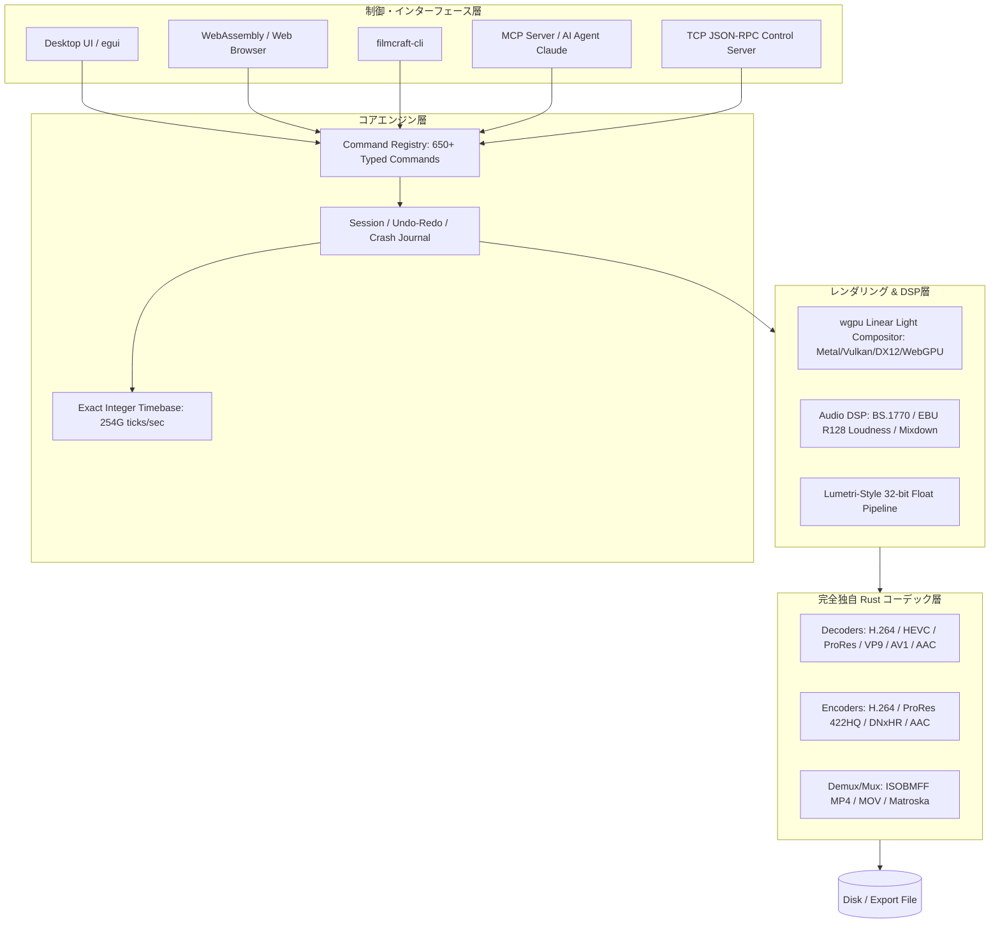

# filmcraft: 概要

storytold/filmcraft は 2026-09-30 に GitHub で作成されたリポジトリです。2026-10-12 時点のスター数は 10,085 です。

**FilmCraft**は、Adobe Premiere ProのUIおよびワークフローをピュアRustでゼロからクリーンルーム再実装したオープンソースのノンリニアビデオ編集（NLE）システムです。

従来のオープンソース動画編集ソフト（Shotcut、Kdenlive、Blenderなど）の多くは、動画デコード・エンコード処理をFFmpegなどのC/C++ライブラリに全面的に依存していました。しかし、FilmCraftは**FFmpeg非依存**を掲げ、H.264、HEVC、ProRes、AACなどの主要コーデックやコンテナパーサーをITU-T/ISO/IETFの公式仕様書に基づきピュアRustで独自実装しています。

最大の革新性は、全UI操作および編集パイプラインが650以上の厳密に型定義されたコマンドとして抽象化されており、標準で**MCP** サーバーおよびJSON-RPC制御ソケットを備えている点です。人間が触るPremiere互換のネイティブGUIを持ちながら、Claudeなどの自律型AIエージェントがヘッドレスまたはリアルタイム描画付きでタイムライン配置・カラーコレクション・音声ミックス・書き出しをミリ秒精度の完全自律操作で行える「AIネイティブ・ビデオ編集基盤」を実現しています。

## 解決する主要な課題とアーキテクチャ

FilmCraftは、長年プロフェッショナル映像制作業界と自動化エンジニアリングを悩ませてきた以下の課題を解決します。

1. **高額なプロ向けNLEのライセンス縛りと自動化の難しさ**: Premiere Pro等のExtendScript/CEP/UXPは低速でヘッドレス運用が難しく、クラウド自動レンダリングに不向き。
2. **フレーム落ち・音ズレ問題（浮動小数点ドリフト）**: ドロップフレーム（29.97）や混在フレームレートの計算に浮動小数点数を用いると、長時間シーケンスで1フレーム未満の累積誤差（ドリフト）が発生する。
3. **C/C++製マルチメディアライブラリの脆弱性とクラッシュ**: 外部メモリ破壊やセグフォを、Rustの所有権・型システムで防ぐ設計です。

### アーキテクチャとデータフロー

FilmCraftは、UIフレームワークやOS APIに依存しないレイヤードアーキテクチャを採用しています。タイムベースには毎秒`254,016,000,000`ティック（README によると一般的なフレームレートとサンプルレートで割り切れる値。23.976、29.97 ドロップフレーム、59.94 も正確に表せる）の固定小数点整数を使用し、絶対的な時間精度を保証します。



## インストール（README からの転記）

以下は [README](https://github.com/storytold/filmcraft#readme) のインストール手順のコードブロックを、そのまま転記したものです。当サイトでは動作を確認していません。最新の手順は README を確認してください。

```sh
cargo run --release -p filmcraft                           # the desktop app, with a demo project
cargo run --release -p filmcraft -- --control 9876         # plus the JSON-lines control server
cargo run --release -p filmcraft-cli -- commands           # list every engine command
cargo run --release -p filmcraft-cli -- mcp                # MCP server (headless)
```

```sh
git clone https://github.com/storytold/craft-fonts ../craft-fonts
CRAFT_FONTS_DIR="$PWD/../craft-fonts" cargo run --release -p filmcraft
```

## ライセンス

- ライセンス: Apache License 2.0（SPDX: Apache-2.0）
- 確認先: [LICENSE ファイル](https://github.com/storytold/filmcraft/blob/main/LICENSE-APACHE)

この節はライセンスの名称と確認先を示すもので、法的な助言ではありません。利用の可否は、LICENSE ファイルの本文と利用する状況に照らして確認してください。
